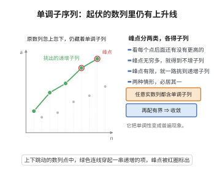

# 单调子序列定理

> **一句话大白话**：任意一串实数，无论怎样忽上忽下，里面总能挑出一段保持原有先后次序、并且一直不下降（或一直上升）的子列。
>
> **小例子**：数列 $2,1,4,3,6,5,\dots$ 中可挑出子列 $2,4,6,\dots$（严格递增），也可挑出 $1,3,5,\dots$（严格递增）。

## 介绍

单调子序列定理（又称 Erdős–Szekeres 单调子序列定理）断言：任何实数列都含有单调子列。它是数列理论中一个结构性的存在性结论，与 Bolzano-Weierstrass 定理（有界数列必有收敛子列）配合，可推出有界数列必有收敛子列：先取单调子列，再由单调有界收敛定理得到收敛。

该定理由鲍尔·埃尔德什（Paul Erdős）与乔治·塞克雷斯（George Szekeres）于 1935 年提出，其有限版本是拉姆齐型组合结论的经典例子：任意 $(r-1)(s-1)+1$ 个互异实数中，必含长度 $r$ 的递增子列或长度 $s$ 的递减子列。

它揭示了"单调性"在数列中并非罕见性质，而是普遍存在的结构，是理解数列收敛性、上下极限和抽子列技巧的重要工具。

## 几何直观

图意在说明：无论原数列怎样忽高忽低，只要按峰点分类，总能挑出一列保持先后次序的单调子列。

## 分析

**前置依赖**：数列与子列的定义、单调性（递增与不增）、实数的全序与良序性

**定理内容**：设 $\{a_n\}_{n\ge 1}$ 是任意实数列，则存在下标 $n_1<n_2<\cdots$ 使得子列 $\{a_{n_k}\}$ 单调：即它要么是不减的（$a_{n_1}\ge a_{n_2}\ge\cdots$），要么是严格递增的（$a_{n_1}<a_{n_2}<\cdots$）。

**数学内涵**：
- 定理只保证"单调"，不保证"收敛"；要收敛还需有界性配合。
- 证明用的是"峰点"分类讨论：峰点无穷多时得到不增子列，峰点有限时得到严格递增子列。

## 思考过程

把下标 $n$ 称为一个"峰点"，如果在它之后没有任何项比它更大，即对一切 $m>n$ 都有 $a_m\le a_n$（它是"此后再无法超越的高峰"）。

于是只有两种可能：
- 峰点有无穷多个，设为 $n_1<n_2<\cdots$。因为 $n_1$ 是峰点，故 $a_{n_2}\le a_{n_1}$；因为 $n_2$ 是峰点，故 $a_{n_3}\le a_{n_2}$；依此类推，得到不增子列。
- 峰点只有有限多个。取 $N$ 大于所有峰点的下标。那么任何 $n>N$ 都不是峰点，即总存在 $m>n$ 使 $a_m>a_n$。从这个性质出发，从某个 $n_1>N$ 开始，每次找一个严格更大的后继项，就得到严格递增子列。

这一分类穷尽了所有情况，故定理成立。它的妙处在于：先给每个位置贴上"能否被后来者超越"的标签，再按标签的多少分流。

## 证明过程

**步骤 1：定义峰点。** 称下标 $n\ge 1$ 为峰点，若对一切 $m>n$ 都有

$$
a_m\le a_n
$$

**步骤 2：情形一，峰点无穷多。** 设峰点下标为 $n_1<n_2<n_3<\cdots$。对每个 $k$，因 $n_k$ 是峰点且 $n_{k+1}>n_k$，由峰点定义得

$$
a_{n_{k+1}}\le a_{n_k}
$$

于是 $\{a_{n_k}\}$ 是不增子列，满足定理要求。

**步骤 3：情形二，峰点有限。** 设峰点全体为有限集，取 $N$ 大于其中最大的下标（若没有峰点则取 $N=0$）。于是对任意 $n>N$，$n$ 不是峰点，即存在 $m>n$ 使 $a_m>a_n$。

**步骤 4：递归构造严格递增子列。** 取 $n_1=N+1$。因 $n_1$ 不是峰点，存在 $n_2>n_1$ 使 $a_{n_2}>a_{n_1}$。因 $n_2>N$ 也不是峰点，存在 $n_3>n_2$ 使 $a_{n_3}>a_{n_2}$。如此递归，得到下标

$$
n_1<n_2<n_3<\cdots,\qquad a_{n_1}<a_{n_2}<a_{n_3}<\cdots
$$

即严格递增子列。

**步骤 5：结论。** 两种情形必居其一，故任意实数列总含单调子列。$\square$

**推论**：有界数列必有收敛子列。由本定理取单调子列，再由单调有界收敛定理，该子列收敛。

## 课堂问答

**老师**：任意实数列都能挑出单调子列？忽上忽下的数列凭什么包含这种结构？

**学生**：结论：任何实数列都含单调子列，证明靠峰点分类。称下标 $n$ 为峰点，若对一切 $m>n$ 都有 $a_m \le a_n$，即它是此后再无法被超越的高峰。

**老师（追问）**：峰点的多少怎么决定子列的类型？

**学生**：分两种情形。峰点无穷：设峰点下标 $n_1 < n_2 < \cdots$，因 $n_k$ 是峰点得 $a_{n_{k+1}} \le a_{n_k}$，得到不增子列。峰点有限：取 $N$ 大于所有峰点下标，任意 $n>N$ 都不是峰点，即存在 $m>n$ 使 $a_m > a_n$，从 $n_1>N$ 出发递归找严格更大的后继，得严格递增子列。要澄清的误区是以为峰点必须是全局最大——它只需"之后无人超过它"，早先的项并不受约束。

**老师（拓展）**：这条定理和收敛有什么关系？还有个组合版本？

**学生**：它只保证单调、不保证收敛；配合有界性即得收敛——先取单调子列，再由单调有界收敛定理得到收敛，这给出了 Bolzano-Weierstrass 的一个替代证明。有限版本是 $(r-1)(s-1)+1$ 个互异实数中必含长 $r$ 的递增子列或长 $s$ 的递减子列，属拉姆齐型结论，也是该定理得名 Erdős–Szekeres 定理的由来。

## 相关条目

- [Bolzano-Weierstrass定理](./Bolzano-Weierstrass定理.md)：有界数列必有收敛子列，常与单调子序列定理配合使用。
- [单调有界收敛定理](./单调有界收敛定理.md)：单调子列加上有界性即得收敛。
