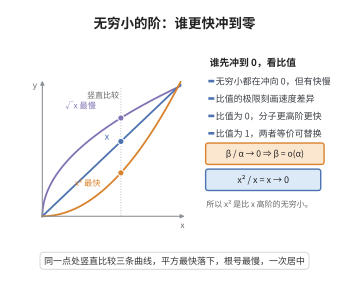

# 无穷小的阶的比较

> **一句话大白话**：无穷小比“谁冲回零更快”——比值趋向 $0$ 说明分子那个回零更快（更高阶），比值是常数或 $1$ 则是同阶或等价。
>
> **小例子**：$x\to0$ 时 $\frac{x^2}{x}=x\to0$，所以 $x^2=o(x)$，即 $x^2$ 比 $x$ 更快地奔向零。

## 介绍

无穷小的阶的比较是极限理论中的重要概念，用于刻画无穷小量趋近于零的"速度"差异。设 $\alpha(x), \beta(x)$ 是无穷小量（$\lim \alpha = \lim \beta = 0$）：
- 若 $\lim \frac{\beta}{\alpha} = 0$，则称 $\beta$ 是比 $\alpha$ **高阶**的无穷小，记作 $\beta = o(\alpha)$；
- 若 $\lim \frac{\beta}{\alpha} = c \neq 0$，则称 $\beta$ 与 $\alpha$ **同阶**无穷小；
- 若 $\lim \frac{\beta}{\alpha} = 1$，则称 $\beta$ 与 $\alpha$ **等价**无穷小，记作 $\beta \sim \alpha$。

## 几何直观

图意在说明：无穷小都趋于零但快慢不同，比值的极限为 0 说明分子是更高阶的无穷小。

## 分析

**前置依赖**：极限定义。

## 思考过程

比较无穷小的阶，本质上是比较它们"趋于零的速度"的差异。以 $x \to 0$ 为例，$x^2$ 比 $x$ 趋于零的速度更快，因此 $x^2$ 是比 $x$ 更高阶的无穷小，记作 $x^2 = o(x)$。

这种比较在近似计算和渐近分析中有重要应用：
- 在泰勒展开中，高阶无穷小告诉我们近似公式的误差范围，如 $\sin x = x + o(x)$ 表明当 $x$ 很小时 $\sin x \approx x$，误差是 $x$ 的高阶无穷小。
- 等价无穷小替换（$\alpha \sim \beta$ 时可在求极限时用 $\beta$ 替换 $\alpha$）是求极限的常用技巧，其合理性由极限运算法则保证：$\lim \frac{f(x)\alpha(x)}{g(x)} = \lim \frac{f(x)\beta(x)}{g(x)}$ 当 $\alpha \sim \beta$ 且分母极限不为零时成立。

## 证明过程（性质）

**性质**：若 $\alpha \sim \beta$，则 $\lim \frac{\alpha}{\beta} = 1$，且 $\alpha - \beta = o(\alpha)$。

**证明**：由 $\alpha \sim \beta$ 得 $\lim \frac{\alpha}{\beta} = 1$，故 $\lim \frac{\alpha - \beta}{\alpha} = \lim (1 - \frac{\beta}{\alpha}) = 1 - 1 = 0$，即 $\alpha - \beta = o(\alpha)$。$\square$

**常见等价无穷小**（$x \to 0$ 时）：
- $\sin x \sim x$，$\tan x \sim x$，$\arcsin x \sim x$
- $\ln(1+x) \sim x$，$e^x - 1 \sim x$
- $1 - \cos x \sim \frac{1}{2}x^2$

## 课堂问答

**老师**：都在趋于零，还能分出高下吗？"阶"到底在比什么？

**学生**：比的是趋于零的速度。设 $\alpha, \beta$ 为无穷小：若 $\lim \frac{\beta}{\alpha} = 0$，则 $\beta$ 是 $\alpha$ 的高阶无穷小，记 $\beta = o(\alpha)$；若趋于非零常数 $c$ 则同阶；若 $c = 1$ 则等价，记 $\beta \sim \alpha$。例如 $x\to 0$ 时 $\frac{x^2}{x} = x \to 0$，故 $x^2 = o(x)$。

**老师（追问）**：等价无穷小凭什么能在求极限时"替换"？

**学生**：因为若 $\alpha \sim \beta$ 则 $\lim\frac{\alpha}{\beta} = 1$，于是 $\frac{f\alpha}{g}$ 与 $\frac{f\beta}{g}$ 只差一个趋 $1$ 的因子，极限不变——前提是分母极限不为零。给一条常用性质：$\alpha \sim \beta$ 时 $\alpha - \beta = o(\alpha)$，因为 $\frac{\alpha-\beta}{\alpha} = 1 - \frac{\beta}{\alpha} \to 0$。

**老师（拓展）**：它和泰勒展开什么关系？最该防的坑是什么？

**学生**：二者相通：$\sin x = x + o(x)$ 说明小 $x$ 时 $\sin x \approx x$，误差是 $x$ 的高阶项；常用等价对还有 $\tan x \sim x$、$\ln(1+x)\sim x$、$e^x - 1 \sim x$、$1 - \cos x \sim \frac12 x^2$。最该防的误区是在加减法中滥用等价替换——$\lim(\sin x - x)$ 若把 $\sin x$ 换成 $x$ 会误得 $0$，实际上它是 $o(x^2)$ 级别，此处替换会丢掉主导项。
