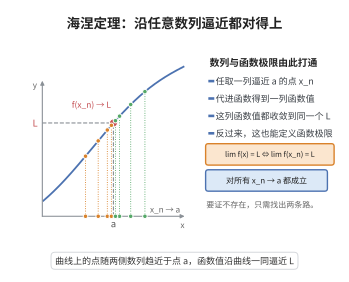

# 海涅定理

> **一句话大白话**：函数在某点的极限，等价于“用哪种数列往这点靠近，代进函数得到的数列都挤向同一个数”——函数极限和数列极限借此画上等号。
>
> **小例子**：想证 $\lim_{x\to0}\sin\frac1x$ 不存在，取 $x_n=\frac{1}{n\pi}$、$y_n=\frac{1}{2n\pi+\frac\pi2}$，函数值分别趋于 $0$ 和 $1$——趋于 $0$ 的两条路结果不同，故极限不存在。

## 介绍

海涅定理（Heine's theorem）是函数极限与数列极限之间的桥梁：$\lim_{x \to a} f(x) = L$ 当且仅当对任意满足 $x_n \to a$（$x_n \neq a$）的数列 $\{x_n\}$，都有 $\lim_{n\to\infty} f(x_n) = L$。该定理将函数极限问题转化为数列极限问题，是分析中常用的工具。

## 几何直观

图意在说明：函数极限等价于任意取一串逼近 a 的点，代入后的函数值都收敛到同一个 L。

## 分析

**前置依赖**：数列极限与函数极限定义。

## 思考过程

海涅定理建立了数列极限与函数极限之间的桥梁，其核心思想是：函数极限的存在性等价于"所有以 $a$ 为极限的数列代入函数后，所得函数值数列都收敛于同一个值"。

这一定理的实用价值在于，它允许我们将函数极限问题转化为数列极限问题来处理。例如，要证明函数极限不存在，只需构造两个不同的数列 $x_n \to a$ 和 $y_n \to a$，使得 $f(x_n)$ 和 $f(y_n)$ 收敛于不同的极限。这种方法比直接使用 $\varepsilon$-$\delta$ 语言更为简便。

在证明中，必要性部分直接使用 $\varepsilon$-$\delta$ 定义即可，而充分性部分通常采用反证法：假设函数极限不存在或不为 $L$，构造出矛盾数列。这种"构造性反证"是分析学中的经典手法。

## 证明过程

**证明**：
必要性：设 $\lim_{x\to a} f(x) = L$，则对 $\forall \varepsilon > 0$，$\exists \delta > 0$，$0 < |x-a| < \delta$ 时 $|f(x) - L| < \varepsilon$。对任意 $x_n \to a$（$x_n \neq a$），$\exists N$，$n > N$ 时 $0 < |x_n - a| < \delta$，故 $|f(x_n) - L| < \varepsilon$，即 $f(x_n) \to L$。

充分性（反证法）：假设 $\lim_{x\to a} f(x) \neq L$，则 $\exists \varepsilon_0 > 0$，$\forall \delta > 0$，$\exists x$，$0 < |x-a| < \delta$ 但 $|f(x) - L| \geq \varepsilon_0$。取 $\delta_n = \frac{1}{n}$，得 $x_n$ 满足 $0 < |x_n - a| < \frac{1}{n}$ 且 $|f(x_n) - L| \geq \varepsilon_0$。则 $x_n \to a$ 但 $f(x_n) \not\to L$，矛盾。$\square$

## 课堂问答

**老师**：函数极限和数列极限是两回事，怎么把它们连起来？

**学生**：海涅定理：$\lim_{x\to a} f(x) = L$ 当且仅当对任意 $x_n \to a$（$x_n \neq a$）都有 $f(x_n) \to L$。必要性直接由 $\varepsilon$-$\delta$ 可得：任给 $x_n \to a$，充分靠后 $0 < |x_n - a| < \delta$，于是 $|f(x_n) - L| < \varepsilon$。

**老师（追问）**：反方向的充分性怎么处理？

**学生**：用反证抓矛盾数列。假设 $\lim_{x\to a} f(x) \neq L$，则存在 $\varepsilon_0 > 0$，对每个 $\delta$ 都能找到 $x$ 满足 $0 < |x-a| < \delta$ 但 $|f(x) - L| \ge \varepsilon_0$；取 $\delta_n = \frac1n$ 得到 $x_n \to a$ 且 $|f(x_n) - L| \ge \varepsilon_0$，与"任意 $x_n \to a$ 都有 $f(x_n) \to L$"矛盾。要防的误区是漏掉 $x_n \neq a$ 这一条件。

**老师（拓展）**：这条定理最实用的地方？

**学生**：它把函数极限问题翻译成数列极限问题。要证极限不存在，只需造两条都趋向 $a$ 的数列使函数值趋于不同数：$x_n = \frac{1}{n\pi}$、$y_n = \frac{1}{2n\pi + \pi/2}$，$\sin\frac1{x_n}\to 0$、$\sin\frac1{y_n}\to 1$，故 $\lim_{x\to0}\sin\frac1x$ 不存在。它也是函数极限 Cauchy 准则充分性的关键一步，注意区分第 21 级的同名"海涅定理"（紧集上连续函数一致连续）。

## 相关条目

- [海涅定理（第21级-点集拓扑学）](../第21级-点集拓扑学/海涅定理.md)：同名不同理——本条目为函数极限的数列刻画（Heine 归结原则）；第21级条目为紧集上连续函数一致连续（Heine-Cantor 定理）。
