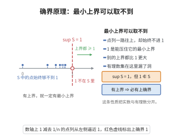

# 确界原理

> **一句话大白话**：任何“有上界”的实数集合都有一个“最小上界”（上确界）——那是集合够不到却无限逼近的天花板，也说明数轴上没有空洞。
>
> **小例子**：集合 $S=\{1-\frac1n\mid n\in\mathbb N^+\}$ 的最小上界为 $\sup S=1$，但 $1\notin S$——它不是集合里的最大值，却是紧贴在集合上方的天花板。

## 介绍

确界原理是实数完备性的核心定理：$\mathbb{R}$ 的非空有上界子集必有上确界（最小上界）。该原理刻画了实数集与有理数集的本质区别，是实数分析的基础，等价于单调有界收敛定理、闭区间套定理等其他完备性定理。

## 几何直观

图意在说明：有上界的集合总有一个最小的上界，但这个上界本身未必属于集合。

## 分析

**前置依赖**：实数完备性公理。

**定理内容**：设 $S \subseteq \mathbb{R}$ 非空且有上界，则 $S$ 有上确界 $\sup S$。

## 思考过程

确界原理是实数完备性的核心表达。对于有上界的非空实数集，上确界 $\sup S$ 是"最小上界"，它与最大值的区别在于：最大值必须属于该集合，而上确界可以不在集合中。例如，集合 $S = \{1 - \frac{1}{n} \mid n \in \mathbb{N}^+\}$ 的上确界为 $1$，但 $1 \notin S$。

从直观上理解，确界原理保证了"数轴上没有空洞"——每一个有上界的实数集都有一个最小的上界。这一性质在有理数集中不成立（例如 $\{x \in \mathbb{Q} \mid x^2 < 2\}$ 在 $\mathbb{Q}$ 中无上确界），因此确界原理刻画了实数集的完备性。

## 证明过程

**证明**：在实数公理体系中，确界原理通常作为完备性公理直接给出。若从 Dedekind 分割出发，可由构造直接证明。

设 $S \subseteq \mathbb{R}$ 非空有上界。令 $B = \{x \in \mathbb{R} \mid x \text{ 是 } S \text{ 的上界}\}$，$A = \mathbb{R} \setminus B$，则 $(A, B)$ 构成一个 Dedekind 分割，其确定的分界点即为 $\sup S$。$\square$

## 课堂问答

**老师**：什么叫"数轴上没有空洞"？确界原理到底断言了什么？

**学生**：结论：$\mathbb{R}$ 的任意非空有上界子集 $S$ 必有上确界 $\sup S$（最小上界）。它刻画了 $\mathbb{R}$ 与 $\mathbb{Q}$ 的本质区别，是实数完备性的核心表达。

**老师（追问）**：上确界和最大值有什么区别？举一个例子。

**学生**：最大值必须属于 $S$，上确界可以不在 $S$ 中。例如 $S = \{1 - \frac1n \mid n \in \mathbb{N}^+\}$，$\sup S = 1$，但 $1 \notin S$——它是紧贴在集合上方、集合够不到却无限逼近的天花板。要防的误区是只记"有上界就有上确界"却漏掉"非空"——空集没有上确界。

**老师（拓展）**：为什么说它体现了 $\mathbb{R}$ 的完备性？它在公理体系里怎么定位？

**学生**：对照 $\mathbb{Q}$：$\{x \in \mathbb{Q} \mid x^2 < 2\}$ 在 $\mathbb{Q}$ 中无上确界，说明有理数集"有洞"。在实数公理体系中，确界原理通常作为完备性公理直接给出；若从 Dedekind 分割构造 $\mathbb{R}$，则令 $B$ 为 $S$ 的上界全体、$A = \mathbb{R}\setminus B$，该分割的分界点即为 $\sup S$。它与单调有界收敛定理、闭区间套定理等价，共同刻画完备性。
