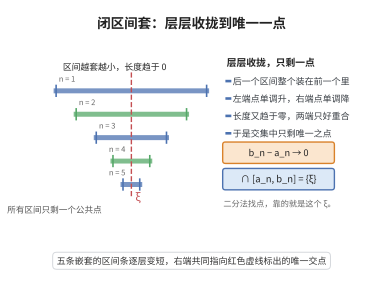

# 闭区间套定理

> **一句话大白话**：一整套层层嵌套、长度不断缩到零的闭区间，最终会一起收拢到唯一的一个点——像望远镜越调越清晰，最终锁死一个位置。
>
> **小例子**：区间列 $[1-\frac1n,\;1+\frac1n]$ 一个套一个、长度 $\frac2n\to0$，它们唯一的公共点是 $1$，即 $\bigcap_{n}[1-\frac1n,1+\frac1n]=\{1\}$。

## 介绍

闭区间套定理是实数完备性的重要定理：若 $\{[a_n, b_n]\}$ 是一列闭区间，满足 $[a_{n+1}, b_{n+1}] \subseteq [a_n, b_n]$ 且 $\lim_{n\to\infty} (b_n - a_n) = 0$，则存在唯一的实数 $\xi$ 属于所有区间，即 $\bigcap_{n=1}^\infty [a_n, b_n] = \{\xi\}$。

## 几何直观

图意在说明：长度趋于零的嵌套闭区间只能交于一个点，这个点就是被层层锁定的 ξ。

## 分析

**前置依赖**：单调有界收敛定理。

## 思考过程

闭区间套定理的直观理解是：一列不断缩小且相互嵌套的闭区间最终会收缩到唯一的一个点。这类似于用望远镜不断聚焦，最终锁定一个确定的位置。

从实数完备性的角度看，区间套定理与确界原理、单调有界收敛定理是等价的——它们从不同侧面刻画了实数集的完备性。具体而言，左端点列 $\{a_n\}$ 单调递增有上界，右端点列 $\{b_n\}$ 单调递减有下界，二者的极限相等，该极限点即为所有区间共同的交点。

在证明 Bolzano-Weierstrass 定理时，闭区间套定理提供了核心工具：通过不断二分有界区间，构造出包含无穷多个数列项的区间套，从而提取出收敛子列。

## 证明过程

**证明**：$\{a_n\}$ 单调递增有上界（$b_1$），$\{b_n\}$ 单调递减有下界（$a_1$）。由单调有界收敛定理，$\lim a_n = \xi$，$\lim b_n = \eta$。由 $b_n - a_n \to 0$ 得 $\xi = \eta$。对任意 $n$，$a_n \leq \xi \leq b_n$，故 $\xi \in \bigcap_{n=1}^\infty [a_n, b_n]$。若另有 $\xi'$ 也属于所有区间，则 $|\xi - \xi'| \leq b_n - a_n \to 0$，故 $\xi' = \xi$。$\square$

## 课堂问答

**老师**：一列层层嵌套、长度趋于零的闭区间，最终会缩到哪里去？

**学生**：结论：若 $[a_{n+1}, b_{n+1}] \subseteq [a_n, b_n]$ 且 $b_n - a_n \to 0$，则存在唯一 $\xi$ 属于所有区间，即 $\bigcap_{n=1}^\infty [a_n, b_n] = \{\xi\}$。

**老师（追问）**：怎么把"唯一交点"严格证出来？

**学生**：左端点列 $\{a_n\}$ 单调递增有上界 $b_1$，右端点列 $\{b_n\}$ 单调递减有下界 $a_1$，由单调有界收敛定理得 $\lim a_n = \xi$、$\lim b_n = \eta$，再由 $b_n - a_n \to 0$ 得 $\xi = \eta$；对任意 $n$ 有 $a_n \le \xi \le b_n$，故 $\xi$ 属于所有区间。若另有 $\xi'$ 也在其中，则 $|\xi - \xi'| \le b_n - a_n \to 0$，故 $\xi' = \xi$。要防的误区是把"闭区间"的条件丢掉——换成开区间套 $(0, \frac1n)$ 交集为空，结论失效。

**老师（拓展）**：它在完备性理论里扮演什么角色？

**学生**：它与确界原理、单调有界收敛定理彼此等价，从"嵌套收缩"的角度刻画 $\mathbb{R}$ 的完备性。它还提供证明 Bolzano-Weierstrass 定理的核心工具：对含无穷多项的有界区间不断二分，构造区间套并提取收敛子列。闭性正是保证公共点存在、不被端点"漏掉"的关键。
