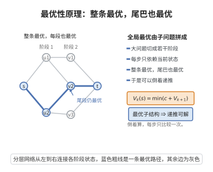

# 动态规划的最优性原理

> **一句话大白话**：多阶段决策里"最优策略的尾巴依然是最优"：不管你走到哪一步、用的什么手段到这，只要还想让总代价最小，从当前状态往后的那后半截决策，本身就必须是对"当前这个状态"的最优子策略。这给了我们"从后往前、递推求优"的可靠依据。
>
> **小例子**：导航求 A 到 D 的最短路。若最优路径 A–B–C–D 前半是 A–B，那么 B–C–D 也必然是从 B 到 D 的最短路，否则整条路径就不最优——这就是最优性原理，它让最长公共子序列、背包、区间调度等都可用"状态递推"求解。

## 一、定理介绍

> **前置依赖**：多阶段决策模型、马尔可夫性质与状态、最优策略的定义、最优值函数与递推关系、反证法。

**最优性原理（Bellman 原理）**：$N$ 阶段决策问题的最优策略具有该性质——无论初始状态与初始决策如何，剩余决策必须构成一个以所得的新状态为起点的**最优策略**。其数学形式是 **Bellman 最优性方程**，是动态规划的基石。

## 几何直观

图意在说明：整体最优路径的每一段子路径也必然最优，因此可以按阶段倒着递推。

## 二、原理思路

引入最优值函数 $V_k(s_k)$：从阶段 $k$、状态 $s_k$ 出发至结束的最小总成本。关键是"分段拼接 + 后段独立"。对任意策略，总成本 = 首段成本 + 余下总成本；因剩余决策只受"末段到达的状态"影响而与前面怎么来无关（马尔可夫性），所以只要让"余下部分"取到最优，就能让整条策略最优。反证即：若后段子策略非最优，换用更优的会令整条更优，矛盾。这立刻滑出递推方程 $V_k=\min\{c_k+V_{k+1}\}$。

## 三、定理的严格表述

设状态转移 $s_{i+1}=T_i(s_i,a_i)$，阶段成本 $c_i(s_i,a_i)$，最优值函数
$$
V_k(s_k)=\min_{a_k,\dots,a_{N-1}}\sum_{i=k}^{N-1}c_i(s_i,a_i).
$$
则 Bellman 方程成立（$V_N=0$）：
$$
V_k(s_k)=\min_{a_k\in\mathcal A(s_k)}\big\{c_k(s_k,a_k)+V_{k+1}\big(T_k(s_k,a_k)\big)\big\},\quad k=0,\dots,N-1.
$$

## 四、证明要点

1. **取最优策略**.设 $\pi^*=(a_k^*,\dots,a_{N-1}^*)$ 最优，$s_{k+1}^*=T_k(s_k,a_k^*)$。
2. **断言后段最优**.反设存在 $\tilde\pi$ 从 $s_{k+1}^*$ 出发成本更低，以其替换 $\pi^*$ 的后段得新策略，总成本低于 $V_k(s_k)$，矛盾。故 $V_k(s_k)=c_k(s_k,a_k^*)+V_{k+1}(s_{k+1}^*)$。
3. **对首步取最小**.因 $a_k^*$ 是所有可行首决策中使 $c_k+V_{k+1}$ 最小者（否则同步骤 2 反证），故
   $$
   V_k(s_k)=\min_{a_k}\{c_k(s_k,a_k)+V_{k+1}(T_k(s_k,a_k))\}.
   $$
   $\blacksquare$

## 五、应用与意义

- **经典问题统一框架**.背包、最长公共子序列、最短路、最优 BST、区间调度均为其特例。
- **模型预测控制**.最优性原理也支撑重规划与滚动时域控制。
- **与最优控制的联系**.Bellman 方程对应连续情形的 HJB 方程，是控制理论的基础。
- **计算意义**.把指数复杂度降为多项式/状态递推，是"以空间换时间"的典范。

## 课堂问答

**老师**：最优性原理一句话怎么讲？它的前提是什么？

**学生**：最优策略的任意一段后缀，对由该段起点状态出发的子问题仍然最优。前提是马尔可夫性——未来只依赖当前状态，与怎样到达该状态无关。

**老师（追问）**：请用反证法把它变成 Bellman 方程。

**学生**：设 $\pi^*=(a_k^*,\dots,a_{N-1}^*)$ 最优，$s_{k+1}^*=T_k(s_k,a_k^*)$。若存在从 $s_{k+1}^*$ 出发成本更低的 $\tilde\pi$，替换 $\pi^*$ 的后段得到总成本低于 $V_k(s_k)$，矛盾，故后段必最优，即 $V_k(s_k)=c_k(s_k,a_k^*)+V_{k+1}(s_{k+1}^*)$。再对首决策取最小（同理若某 $a_k$ 使 $c_k+V_{k+1}$ 更小则整体更优）得 $V_k(s_k)=\min_{a_k}\{c_k(s_k,a_k)+V_{k+1}(T_k(s_k,a_k))\}$。

**老师（拓展）**：什么情况下最优性原理会失效？它和贪心有什么本质区别？

**学生**：当状态不能完整刻画历史、即不满足马尔可夫性时失效，此时需把历史"提升"进状态。与贪心的差别在于方向：贪心每步取当前最优、不回溯；DP 从后往前（或按拓扑序）用 $V_{k+1}$ 评估当前决策，保证全局最优。误区是把两者混为一谈——贪心的局部最优一般不保证全局，而 Bellman 方程给出的递推才是可证全局最优的。
