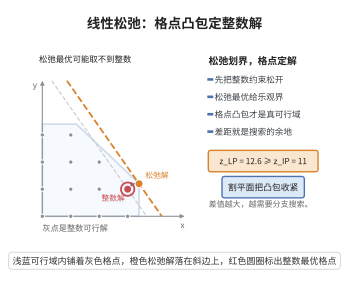

# 线性规划放松与下界

> **一句话大白话**：整数规划难就难在"必须取整数"。那就先把这条要求扔掉，得到一个普通的线性规划——它的可行集更大、目标只会更小，所以它的最优值永远压在原问题最优值之下。这个"便宜又好算"的数，就是分支定界里那把剪枝的剪刀。
>
> **小例子**：$\min\{-10x_1-6x_2:\ 2x_1+2x_2\le3,\ x\in\{0,1\}^2\}$ 的整数最优是 $x=(1,0)$，值为 $-10$；把 $x\in\{0,1\}^2$ 放松成 $0\le x\le1$ 后 LP 最优解为 $x=(1,0.5)$，值 $-13\le-10$，正是有效下界，二者之差 $3$ 就是整数性造成的间隙。

## 一、定理介绍

> **前置依赖**：线性规划基本定理、线性规划的对偶定理、下界估计与对偶界、分支定界算法的收敛性、剪枝准则。

**线性规划放松**（LP relaxation）是求解整数规划最基础的定界手段：把整数规划
$$
(IP)\qquad \min_{x}\Big\{c^\top x\ \text{s.t.}\ Ax\le b,\ x\in\mathbb Z^n\cap[l,u]\Big\}
$$
中的整数约束 $x\in\mathbb Z^n$ 去掉，只保留 $l\le x\le u$，得到线性规划
$$
(LP)\qquad \min_{x}\Big\{c^\top x\ \text{s.t.}\ Ax\le b,\ l\le x\le u,\ x\in\mathbb R^n\Big\}.
$$
由于 $(LP)$ 的可行集包含 $(IP)$ 的可行集且目标函数相同，$(LP)$ 的最优值 $v(LP)$ 是 $(IP)$ 最优值 $v(IP)$ 的**有效下界**：$v(LP)\le v(IP)$。这使分支定界算法的每个节点都能用一次 LP 求解获得可证明的下界，配合上界使用剪枝准则。

本条目证明该下界的合法性、给出"LP 解恰为整数即最优"的判定，说明间隙的来源，并把该放松纳入更一般的"放松原理"（松弛可行集 + 下界化目标）之中。

## 几何直观

图意在说明：放开整数约束得到乐观界，真正可行的是格点，二者差距给出分支搜索的范围。

## 二、原理思路

1. **放松的两条合法性条件**：放松问题 $(R)$ 与原子问题共享目标方向，但满足 (i) 放松可行集包含原可行集（$X\subseteq X^{\mathrm{rel}}$）、(ii) 在 $X$ 上放松目标不超过原目标（$f^{\mathrm{rel}}\le f$）。在 LP 放松中目标相同、可行集扩大，两条都满足。
2. 由 (i)(ii)，对任何 $x\in X$ 有 $\min_{X^{\mathrm{rel}}}f^{\mathrm{rel}}\le f^{\mathrm{rel}}(x)\le f(x)$，取下确界即得下界不等式。
3. **达到即最优**：若放松的最优解恰好落在原可行集内（LP 情形即解为整数），则由下界达到可知它也是原问题最优解。
4. **不可行传播**：放松不可行意味着原问题也不可行（可行集更小）。
5. **用对偶解释**：$v(LP)$ 也可以由 LP 的对偶最优值给出（下界估计与对偶界），因而同样享有"对偶界"的解释与影子价格含义；在分支定界中它充当节点的 $\mathrm{LB}(R)$。

## 三、定理的严格表述

设有界整数规划 $(IP)$ 与其 LP 放松 $(LP)$ 如上（约定 $A\in\mathbb R^{m\times n}$、$l\le u$ 为整数向量，$X=\{x\in\mathbb Z^n\cap[l,u]:Ax\le b\}$、$X^{\mathrm{rel}}=\{x\in\mathbb R^n:l\le x\le u,\ Ax\le b\}$）。

**定理（LP 放松给出下界）**：
(i) 若 $X\ne\varnothing$，则 $v(LP)\le v(IP)$；
(ii) 若 $X^{\mathrm{rel}}=\varnothing$，则 $X=\varnothing$（$(LP)$ 不可行 $\Rightarrow$ $(IP)$ 不可行）；
(iii) 若 $(LP)$ 有最优解 $x^*$ 且 $x^*\in\mathbb Z^n$（从而 $x^*\in X$），则 $x^*$ 是 $(IP)$ 的最优解且 $v(LP)=v(IP)$；
(iv) **一般放松原理**：若 $(R)$ 是满足 $X\subseteq X^{\mathrm{rel}}$ 与 $f^{\mathrm{rel}}\le f$（于 $X$ 上）的任何放松，则 $v(R)\le v(IP)$。

**推论（用于剪枝）**：把 $\mathrm{LB}(R):=v(LP_R)$ 作为分支定界节点 $R$ 的下界，当 $\mathrm{LB}(R)\ge\mathrm{UB}$ 时该节点可安全剪枝（剪枝准则的准则 C2）。

## 四、证明过程

**步骤 1（一般放松原理与 LP 情形）。** 设放松满足 $X\subseteq X^{\mathrm{rel}}$ 且 $f^{\mathrm{rel}}\le f$ 于 $X$ 上。对任意 $x\in X$，
$$
v(R)=\min_{y\in X^{\mathrm{rel}}}f^{\mathrm{rel}}(y)\le f^{\mathrm{rel}}(x)\le f(x).
$$
对 $x\in X$ 取下确界即 $v(R)\le\inf_{x\in X}f(x)=v(IP)$，得 (iv)。LP 放松满足 $X\subseteq X^{\mathrm{rel}}$、目标相同，故直接得 (i)。

**步骤 2（LP 最优值的存在性）。** 可行域 $X^{\mathrm{rel}}$ 是有界多面体（由 $l\le x\le u$ 知有界）且非空则闭；由线性规划基本定理，若线性规划可行且目标函数在可行域上有下界（有界多面体保证），则最优解在某个顶点取到，故 $v(LP)$ 有限。这保证了下界是"算得出来的数"，而不是 $-\infty$。

**步骤 3（不可行的传播，证 (ii)）。** 由 $X\subseteq X^{\mathrm{rel}}$：若 $X^{\mathrm{rel}}=\varnothing$，则 $X=\varnothing$。即 LP 放松不可行时整数规划必不可行，故在分支定界中可直接删除该节点（准则 C1）。

**步骤 4（达到即最优，证 (iii)）。** 设 $x^*$ 是 $(LP)$ 的最优解且 $x^*\in\mathbb Z^n$。则 $x^*$ 满足 $l\le x^*\le u$ 与 $Ax^*\le b$，且坐标为整数，故 $x^*\in X$，对 $(IP)$ 可行。由步骤 1，
$$
v(LP)=c^\top x^*\ \le\ v(IP)\le c^\top x^*,
$$
（末式因 $x^*$ 可行），三式夹逼得 $v(LP)=v(IP)=c^\top x^*$，即 $x^*$ 是 $(IP)$ 的最优解。

**步骤 5（间隙与例子）。** 当 $(LP)$ 的最优解非整数时，$v(LP)<v(IP)$ 成为可能：例如
$$
(IP)\ \min\{-10x_1-6x_2:\ 2x_1+2x_2\le3,\ x\in\{0,1\}^2\},
$$
其可行解为 $(0,0),(1,0),(0,1)$，最优值 $v(IP)=-10$（$x=(1,0)$）。放松 $0\le x\le1$ 后的 $(LP)$ 顶点为 $(1,0.5)$（约束 $2x_1+2x_2=3$ 与 $x_1=1$ 的交点），$v(LP)=-10-3=-13<v(IP)$。间隙 $v(IP)-v(LP)=3>0$ 表明 $(LP)$ 未"顶到"最优值，需要分支：把 $x_2\le0$ 与 $x_2\ge1$ 分成两个子问题继续定界。

**步骤 6（与对偶界的等价）。** 由线性规划的对偶定理，$v(LP)$ 等于其对偶问题的最优值；因此步骤 1 的下界也就是一个**对偶界**（下界估计与对偶界）。在分支定界中，每个节点 $R$ 的下界 $\mathrm{LB}(R)$ 即为该子问题 LP 放松的对偶界，由步骤 1 的有效性与剪枝准则步骤 3 的论证，满足 $\mathrm{LB}(R)\ge\mathrm{UB}$ 的节点不含严格优于当前 incumbent 的可行解，删除是安全的。$\blacksquare$

## 五、应用与意义

- **分支定界的定界核心**：MILP 求解器（CPLEX、Gurobi、SCIP）的每个节点都靠一次 LP（对偶单纯形/内点法）获得下界，界越紧搜索越小。
- **间隙度量难度**：积分间隙 $v(IP)-v(LP)$ 是问题难度的定量指标；对全幺模矩阵等特殊结构，LP 顶点自动整数，间隙为零，整数规划等价于 LP。
- **拉格朗日放松**：当 LP 放松太松或约束太多时，改用把难约束罚入目标的拉格朗日放松，其最优值同样是对偶界（下界估计与对偶界）。
- **算法设计的指引**：在分支变量的选择上，间隙与 LP 解的分数性是经典打分支规则（most-fractional、pseudocost）的依据。

## 课堂问答

**老师**：为什么把整数约束松掉一定得到下界？

**学生**：因为放松只扩大可行集、不改变目标。设 $X\subseteq X^{\mathrm{rel}}$ 且 $f^{\mathrm{rel}}\le f$，则对任意 $x\in X$ 有 $v(R)=\min_{X^{\mathrm{rel}}}f^{\mathrm{rel}}\le f^{\mathrm{rel}}(x)\le f(x)$，取下确界得 $v(R)\le v(IP)$。LP 放松目标相同、可行集更大，所以 $v(LP)\le v(IP)$ 恒成立。

**老师（追问）**：什么情况下放松的解就已经是最优、不用再分支？

**学生**：当 LP 最优解 $x^*$ 恰好整数。此时 $x^*\in X$，由下界不等式有 $v(LP)\le v(IP)\le c^\top x^*=v(LP)$，三式夹逼得 $v(LP)=v(IP)=c^\top x^*$。这就是松弛解为整数即视为原问题最优的判定，也对应剪枝准则 C3。

**老师（拓展）**：给出间隙的来源，并说明什么时候间隙为零。

**学生**：间隙来自分数顶点。例如 $\min\{-10x_1-6x_2:2x_1+2x_2\le3,\ x\in\{0,1\}^2\}$ 整数最优值 $-10$，放松后顶点 $(1,0.5)$ 给 $-13$，间隙 $3>0$。当约束矩阵是全幺模时 LP 顶点自动整数，间隙恒为零，整数规划等价于 LP——这正是"松弛好不好用"的结构性判据。误区是以为间隙只与算法有关，其实它由问题本身的组合结构决定。
