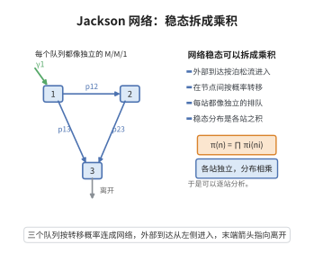

# Jackson网络的乘积形式解

> **一句话大白话**：把多个 $M/M/1$ 队列串成一个网络互相"倒顾客"，只要每个节点的"承载率"都小于 1，系统就会稳定，而整个系统的稳态分布竟简单得惊人——**是各个节点单独算出的稳态分布的乘积**。节点仿佛"互不掺和"。
>
> **小例子**：两个车间一进一出（开 Jackson 网络），各自负载 $\rho_1=0.5,\rho_2=0.6$。则 $(n_1,n_2)=(2,3)$ 的稳态概率 $=(1-0.5)0.5^2\cdot(1-0.6)0.6^3$，直接相乘即得——无需解整个高维平衡。

## 一、定理介绍

> **前置依赖**：生灭过程与 M/M/1 稳态分布、流量方程、细致平衡方程、马尔可夫链的稳态唯一性、正常返条件。

**Jackson 网络的乘积形式解**：对开 Jackson 网络（$K$ 个节点、外部 Poisson 到达、指数服务、路由概率、FIFO 无等待上限），若每个节点负载 $\rho_i=\lambda_i/\mu_i<1$，则联合稳态分布是各节点孤立 $M/M/1$ 稳态分布的乘积
$$
P(\mathbf n)=\prod_{i=1}^K (1-\rho_i)\rho_i^{\,n_i},
$$
其中 $\lambda_i$ 由流量方程 $\lambda_i=\gamma_i+\sum_{j=1}^K\lambda_j r_{ji}$ 解得。

## 几何直观

图意在说明：网络各站相互影响，但稳态分布仍可写成各站分布的乘积。

## 二、原理思路

先由**流量方程**（外部到达 + 上游路由流入）求出每个节点的总到达率 $\lambda_i$。就该网络写出**全局平衡方程**（把所有"进入状态 $\mathbf n$ 的方式"与"离开状态 $\mathbf n$ 的方式"记账）。然后猜测乘积形式 $P(\mathbf n)=\prod P_i(n_i)$，代入平衡方程并利用流量方程与 $\rho_i=\lambda_i/\mu_i$，逐项两端相等——验证成立，即可确认乘积解。

## 三、定理的严格表述

开 Jackson 网络如上。流量方程 $\boldsymbol\lambda=\boldsymbol\gamma(I-R)^{-1}$（$R=(r_{ij})$ 路由矩阵）。若所有 $\rho_i=\lambda_i/\mu_i<1$，则平稳分布
$$
P(\mathbf n)=\prod_{i=1}^K (1-\rho_i)\rho_i^{n_i},
$$
且该分布是全局平衡方程的唯一稳态分布。

## 四、证明要点

1. **流量方程**.$\lambda_i=\gamma_i+\sum_{j=1}^K\lambda_jr_{ji}$，矩阵形式 $\boldsymbol\lambda=\boldsymbol\gamma(I-R)^{-1}$；稳定性 $\rho_i<1\ \forall i$。
2. **全局平衡方程**.对每个状态 $\mathbf n$ 记账进出：
   $$
   P(\mathbf n)\Big(\sum_i\gamma_i+\sum_i\mu_i\mathbf1_{n_i>0}\Big)=\sum_i P(\mathbf n-\mathbf e_i)\gamma_i+\sum_i\sum_{j=0}^K P(\mathbf n+\mathbf e_i-\mathbf e_j)\mu_i r_{ij}.
   $$
3. **代入验证**.$P_i(n_i)=(1-\rho_i)\rho_i^{n_i}$ 满足单节点平衡 $\mu_iP_i(n_i+1)/\gamma_i\leftarrow\lambda_i$；利用 $\lambda_i=\gamma_i+\sum_j\lambda_jr_{ji}$ 与 $r_{i0}=1-\sum_jr_{ij}$ 消去交叉项，使方程两端相等。
4. **唯一性**.各节点正常返 + 不可约使马尔可夫链稳态唯一，故乘积解即是实际稳态分布。$\blacksquare$

## 五、应用与意义

- **网络性能分解**.把全网算子化分解为独立节点的乘积，极大降低高维求解量。
- **制造/计算机系统**.排队网络、工作流、服务系统的标准建模工具。
- **说明"局部独立"**.揭示稳定网络中"节点间耦合被流量方程吸收"的深刻现象。
- **理论地位**：开 Jackson 网络是排队网络乘积形式解的开山之作，延伸到 Gordon-Newell 闭环网络与 BCMP 定理。

## 课堂问答

**老师**：多个 M/M/1 节点互相转送顾客，稳态分布凭什么能写成乘积？

**学生**：结论 $P(\mathbf n)=\prod_{i=1}^{K}(1-\rho_i)\rho_i^{\,n_i}$，前提是每个节点负载 $\rho_i=\lambda_i/\mu_i<1$。理由是先由流量方程 $\lambda_i=\gamma_i+\sum_{j=1}^{K}\lambda_jr_{ji}$ 定出各节点总到达率，再把乘积形式代进全局平衡方程逐项验证两端相等。常见误区是认为各节点真的独立，其实是节点间耦合被流量方程完整吸收了。

**老师（追问）**：既然耦合被吸收进了 $\lambda_i$，那稳态还谈得上"独立"吗？

**学生**：分布形式上因式分解成立，但这是借助 $\lambda_i$ 才成立的"数学独立性"，物理上节点仍通过路由相关。求解 $\boldsymbol\lambda=\boldsymbol\gamma(I-R)^{-1}$，再由不可约正常返链给出稳态唯一性，故乘积解就是真实的联合稳态分布。

**老师（拓展）**：如果把外部到达去掉会怎样？

**学生**：变成闭环 Jackson 网络即 Gordon-Newell，乘积形式仍在，但归一化常数要对总人数受限求和；再放宽服务分布与调度规则，就得到 BCMP 定理，这条主线正是排队网络乘积形式解的开山之作。
