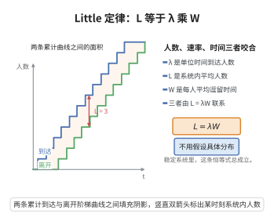

# Little定律

> **一句话大白话**：在稳态的排队系统里，"队列里的平均顾客数"＝"平均到达速率"乘以"平均逗留时间"。它一通百通——不管顾客怎么进怎么出的分布细节，这条恒等的"守恒账"永远算得平，是排队论里最省脑子又最常用的记法。
>
> **小例子**：超市收银台每分钟平均来 2 人（$\lambda=2$），每人平均停留 3 分钟（$W=3$），那店里平均就有 $\lambda W=6$ 人。据此还能反推：想让人均停留降到 2 分钟，就得让平均在店人数降到 4。

## 一、定理介绍

> **前置依赖**：平稳过程与稳定极限、样本路径积分（面积守恒）、平均期望的时间平均、更新-报酬理论。

**Little 定律**：在稳态排队系统中，平均顾客数 $L$、平均到达率 $\lambda$ 与平均逗留时间 $W$ 满足

$$
L=\lambda W.
$$

同样对队列部分 $L_q=\lambda W_q$。它几乎对任何排队系统成立（只需稳态与极限存在），是排队论的"第一恒等式"。

## 几何直观

图意在说明：阴影面积等于总逗留时间，除以时间得平均人数，除以人数得平均逗留时间。

## 二、原理思路

用**样本路径 + 面积守恒**：在 $[0,T]$ 上，$\int_0^T N(t)\,dt$ 是所有顾客逗留时间之和（每个顾客逗留各贡献一段面积）。两边除以 $T$，左端是平均顾客数 $\hat L_T$，右端是 $\frac{A(T)}{T}\cdot\frac1{A(T)}\sum_i T_i=\hat\lambda_T\cdot\hat W_T$。取 $T\to\infty$ 极限即得 $L=\lambda W$。更严格可用鞅 / 更新-报酬理论保证极限存在。

## 三、定理的严格表述

设 $N(t)$ 为系统中顾客数，$A(T)$ 为 $[0,T]$ 末到达数（恰在 $T$ 前离开者计停留时间 $T_i$）。若极限
$$
\lambda=\lim_{T\to\infty}\frac{A(T)}T,\qquad W=\lim_{T\to\infty}\frac1T\int_0^T N(t)\,dt\Big/\lim\frac{A(T)}T,\qquad
$$
存在且有限，则 $L=\lambda W$，即平均在队顾客数等于平均到达率乘以平均逗留时间。

## 四、证明要点

1. **面积守恒**.（系统空与末空情形）$\int_0^T N(t)\,dt=\sum_{i=1}^{A(T)}T_i$；一般情形含可忽略边界修正项。
2. **标准化**.$\hat\lambda_T=\frac{A(T)}T$，$\hat W_T=\frac1{A(T)}\sum_iT_i$，$\hat L_T=\frac1T\int_0^TN\,dt$；故 $\hat L_T=\hat\lambda_T\hat W_T$。
3. **取极限**.由假设 $\lim\hat\lambda_T=\lambda$、$\lim\hat W_T=W$，则 $L=\lim\hat L_T=\lambda W$。鞅方法可严格化边界项与极限交换。$\blacksquare$

## 五、应用与意义

- **关系万能**.几乎对一切$L,W,\lambda$成立，快速估算拥堵规模。
- **只须三者知二**.已知任意两个即可反推第三个，免去复杂分布建模。
- **性能人员工具**.呼叫中心、医院、云服务排队容量估算的标配。
- **理论价值**.以最小假设建立的核心守恒律，是排队分析的"记账基石"。

## 课堂问答

**老师**：稳态排队系统里 $L$、$\lambda$、$W$ 三者到底满足什么关系？

**学生**：结论是恒等式 $L=\lambda W$，而且几乎不依赖分布细节。理由用面积守恒：$\int_0^T N(t)\,dt$ 等于全体顾客逗留时间之和，两边除以 $T$ 得 $\hat L_T=\hat\lambda_T\hat W_T$，令 $T\to\infty$ 即得。常见误区是以为必须有 Poisson 到达或指数服务，其实只需稳态与极限存在。

**老师（追问）**：那排队部分 $L_q$ 也满足同样的定律吗？

**学生**：满足，$L_q=\lambda W_q$，且 $W=W_q+1/\mu$。要特别小心"到达率"要按系统的入口计，而不是按某节点的内部流；另一个误区是把 $W$ 当成服务时间，$W$ 是含等待的逗留时间。

**老师（拓展）**：这条恒等式实际有什么用？

**学生**：它是排队论的"记账基石"，呼叫中心、医院、云服务只要知道任意两个量就能反推第三个，省去分布建模；更严格地，可用鞅或更新-报酬定理保证样本路径极限与面积恒等的严谨性。
