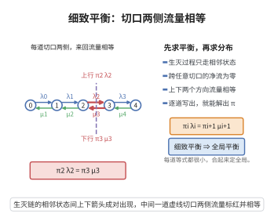

# 细致平衡方程

> **一句话大白话**：细致平衡是比"稳定"更强的条件：不仅每个状态进出的总量相等，而且**任意两个状态之间**双向的"流量"也恰好相等——从 $i$ 流向 $j$ 的流量（$\pi_i$ 乘转移率）等于从 $j$ 流向 $i$ 的流量。这样的链在时间反演下统计规律不变，称为"可逆"。
>
> **小例子**：M/M/1 队列中"人数 $n\to n+1$"的流量率是 $\pi_n\lambda$，"$n+1\to n$"的流量率是 $\pi_{n+1}\mu$。细致平衡要求二者相等：$\pi_n\lambda=\pi_{n+1}\mu$，于是 $\pi_{n+1}=\rho\pi_n$，正好给出几何稳态分布。

## 一、定理介绍

> **前置依赖**：M_M-1队列的稳态分布、Markov链平稳分布、全概率公式。

设连续时间马尔可夫链（CTMC）的转移速率 $q_{ij}\ge0\ (i\ne j)$，$q_{ii}=-\sum_{j\ne i}q_{ij}$。概率分布 $\boldsymbol\pi$ 满足**细致平衡方程**（detailed balance equations），是指
$$
\pi_i q_{ij}=\pi_j q_{ji}\qquad(\forall i\ne j).
$$
离散时间情形对应 $\pi_i p_{ij}=\pi_j p_{ji}$。满足细致平衡的链称为**可逆链**：其稳态分布与时间反演后的稳态分布相同。

## 几何直观

图意在说明：跨每道切口的上下行概率流相等，逐道写出就能递推得到整个稳态分布。

## 二、原理思路

对固定状态 $j$，把细致平衡对一切 $i\ne j$ 求和：左端是“从各状态流入 $j$”的总速率，右端是“从 $j$ 流出”的总速率，二者相等恰是 $j$ 处的**全局平衡**（即平稳方程）。故细致平衡必蕴含平稳，反之未必。对生灭过程这类“一维”链，全局平衡会逐项强制细致平衡，二者充要。Kolmogorov 回路判据进一步给出判据：细致平衡成立 $\iff$ 沿任意有向回路正反向速率之积相等。

## 三、定理的严格表述

**（细致平衡蕴含平稳）** 设 $\boldsymbol\pi\ge0$、$\sum_j\pi_j=1$ 满足 $\pi_i q_{ij}=\pi_j q_{ji}\ (\forall i\ne j)$，则 $\boldsymbol\pi$ 是平稳分布，即对一切 $j$ 有 $\sum_i\pi_i q_{ij}=0$。

**（Kolmogorov 回路判据）** 不可约 CTMC 可逆（存在满足细致平衡的 $\boldsymbol\pi$）当且仅当对任意有向回路 $i_0\to i_1\to\cdots\to i_n=i_0$ 成立
$$
\prod_{k=0}^{n-1}q_{i_k i_{k+1}}=\prod_{k=0}^{n-1}q_{i_{k+1} i_{k}} .
$$

## 四、证明过程

1. **细致平衡推出平稳**。固定 $j$，对一切 $i\ne j$ 求和：
   $$
   \sum_{i\ne j}\pi_i q_{ij}=\sum_{i\ne j}\pi_j q_{ji}=\pi_j\sum_{i\ne j}q_{ji}=-\pi_j q_{jj}.
   $$
   左端补上 $i=j$ 项为 $\sum_i\pi_i q_{ij}$，右端移项得 $\sum_i\pi_i q_{ij}=0$，即全局平衡，故 $\boldsymbol\pi$ 平稳。

2. **生灭过程的充要性**。生灭链只有相邻状态可迁：$q_{n,n+1}=\lambda_n$、$q_{n,n-1}=\mu_n$。全局平衡在 $n=0$ 处为 $\pi_0\lambda_0=\pi_1\mu_1$（离开 0 只能去 1，进入 0 只能来自 1），这正是细致平衡。归纳假设 $\pi_{n-1}\lambda_{n-1}=\pi_n\mu_n$，则 $n$ 处的全局平衡
   $$
   \pi_n(\lambda_n+\mu_n)=\pi_{n-1}\lambda_{n-1}+\pi_{n+1}\mu_{n+1}
   $$
   化为 $\pi_n\lambda_n=\pi_{n+1}\mu_{n+1}$。故逐项细致平衡成立，并给出 $\pi_n=\pi_0\prod_{k=1}^{n}\lambda_{k-1}/\mu_k$。

3. **Kolmogorov 判据的必要性**。设存在满足细致平衡的 $\boldsymbol\pi$。沿回路逐边相乘：
   $$
   \prod_k\pi_{i_k}q_{i_k i_{k+1}}=\prod_k\pi_{i_{k+1}}q_{i_{k+1} i_k}.
   $$
   回路中每个状态各出现一次，两端 $\pi$ 的乘积完全相同，约去即得回路条件。

4. **Kolmogorov 判据的充分性**。固定参考状态 $0$。对任一状态 $i$，取一条 $0\to i$ 的路径并定义
   $$
   \pi_i=\prod_{k}\frac{q_{i_k i_{k+1}}}{q_{i_{k+1} i_k}} .
   $$
   回路条件保证该定义与路径选择无关（两条路径构成闭回路，其比值相等）。再验证 $\pi_i q_{ij}=\pi_j q_{ji}$：只需在 $i$ 的路径上追加边 $i\to j$，则 $\pi_i\cdot\frac{q_{ij}}{q_{ji}}$ 恰是按另一条路径 $0\to\cdots\to i\to j$ 定义的 $\pi_j$，故 $\pi_i q_{ij}=\pi_j q_{ji}$。归一化后即得可逆的稳态分布。$\blacksquare$

## 五、应用与意义

- **简化稳态求解**：逐对等式比整组全局平衡更易解，是生灭过程、可逆排队网络的标准工具。
- **M/M/1 与 Erlang-B**：这两类结果的几何/截断几何稳态分布，直接由细致平衡一行推出。
- **可逆性与物理**：细致平衡是平衡态统计力学“涨落—耗散”与可逆链理论的概率论基础。

## 课堂问答

**老师**：细致平衡比平稳方程多要求了什么？

**学生**：结论 $\pi_iq_{ij}=\pi_jq_{ji}$（$\forall i\ne j$），即任意两状态间双向流量逐对相等。理由是固定 $j$ 对 $i$ 求和即得全局平衡 $\sum_i\pi_iq_{ij}=0$，故细致平衡蕴含平稳；反之一般不成立。满足它的链在时间反演下统计规律不变，称可逆链。常见误区是把"平稳"直接当成"可逆"。

**老师（追问）**：什么时候二者互为充要？

**学生**：对生灭链（只有相邻状态可迁），全局平衡会逐项强制细致平衡，如 $n=0$ 处即 $\pi_0\lambda_0=\pi_1\mu_1$。更一般地，Kolmogorov 回路判据给出：不可约链可逆当且仅当沿任意有向回路正反向速率之积相等，$\prod_kq_{i_ki_{k+1}}=\prod_kq_{i_{k+1}i_k}$。

**老师（拓展）**：这对排队求解有什么好处？

**学生**：可直接写 $\pi_n\lambda=\pi_{n+1}\mu$ 一行得出 M/M/1 的几何分布，Erlang-B 的截断几何也同理；它的物理母体正是平衡态统计力学中的细致平衡原理。
