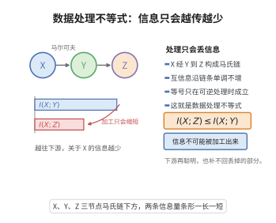

# 数据处理不等式

> **一句话大白话**：对数据无论做什么处理（处理、加工、提炼、压缩），信息只会变少不会变多。如果 $X$ 的信息先经过 $Y$ 再到 $Z$（马氏链），那么"$X$ 与 $Z$ 之间的互信息"永远不超过"$X$ 与 $Y$ 之间的互信息"。加工能丢信息，但绝不凭空造信息。
>
> **小例子**：天气 $X$ → 我的观察照片 $Y$ → 我朋友透过"打了马赛克的副本" $Z$。即 $I(X;Z)\le I(X;Y)$：越往下游，关于原配 $X$ 的信息只会衰减。这也是「数据精简必损信息」的量化表达。

## 一、定理介绍

> **前置依赖**：互信息、链式法则多变量、马尔可夫链与条件独立性、互信息的非负性。

**数据处理不等式（DPI）**：若 $X\to Y\to Z$ 构成马尔可夫链，则
$$
I(X;Y)\ge I(X;Z).
$$
它断言：任何仅依赖 $Y$ 的数据处理都无法增加关于 $X$ 的信息。

## 几何直观

图意在说明：经过马氏链层层加工后，关于源头 X 的互信息只会衰减，绝不会凭空增加。

## 二、原理思路

马尔可夫链意味着给定 $Y$ 后 $X$ 与 $Z$ 条件独立（$p(x,z|y)=p(x|y)p(z|y)$）。用互信息的链式法则把 $I(X;Y,Z)$ 按两种方式展开：$I(X;Y,Z)=I(X;Y)+I(X;Z|Y)=I(X;Z)+I(X;Y|Z)$。条件独立使 $I(X;Z|Y)=0$，于是 $I(X;Y)=I(X;Z)+I(X;Y|Z)$；由互信息非负 $I(X;Y|Z)\ge0$，立即得 $I(X;Y)\ge I(X;Z)$。

## 三、定理的严格表述

设 $P_{X,Y,Z}=P_X P_{Y|X}P_{Z|Y}$（$X\to Y\to Z$）。则
$$
I(X;Y)\ge I(X;Z).
$$
等号成立当且仅当 $X\to Z\to Y$ 亦为马尔可夫链（即 $I(X;Y|Z)=0$）。

## 四、证明要点

1. **链式法则拆分**. $I(X;Y,Z)=I(X;Y)+I(X;Z|Y)=I(X;Z)+I(X;Y|Z)$。
2. **马尔可夫性去项**.由 $X\to Y\to Z$，$I(X;Z|Y)=0$，故 $I(X;Y)=I(X;Z)+I(X;Y|Z)$。
3. **非负性**.$I(X;Y|Z)\ge0$，代入即 $I(X;Y)\ge I(X;Z)$。
4. **等号条件**.等号当且仅当 $I(X;Y|Z)=0$，即 $X$ 与 $Y$ 关于 $Z$ 条件独立，等价于 $X\to Z\to Y$。$\blacksquare$

## 五、应用与意义

- **精油–冗余法则**.任何不可逆处理的"信息不确定性只能减"，是隐私、特征选择的基础。
- **信道逆向证明**.与 Fano 不等式配合，证明 $R>C$ 时可靠通信不可能。
- **差分隐私与泛化**.现代统计学习用 DPI 分析"处理不会引入信息"、度量隐私与泛化误差。
- **理论地位**.互信息递减性质，是整个信息论"单调性"一族的代表。

## 课堂问答

**老师**：对数据做任何处理，关于源 $X$ 的信息会怎样变化？

**学生**：结论：若 $X\to Y\to Z$ 构成马尔可夫链，则 $I(X;Y)\ge I(X;Z)$。理由是链式法则把 $I(X;Y,Z)$ 两法展开：$I(X;Y)=I(X;Z)+I(X;Y|Z)$，由互信息非负即得。常见误区是以为"聪明的加工"能凭空造出关于 $X$ 的信息。

**老师（追问）**：等号在什么时候成立？

**学生**：当且仅当 $I(X;Y|Z)=0$，即 $X\to Z\to Y$ 也是马尔可夫链，此时 $Z$ 是 $Y$ 关于 $X$ 的充分统计量——下游保留了上游的全部信息，这正是"无损压缩"的极限情形。

**老师（拓展）**：数据处理不等式有什么用？

**学生**：与 Fano 不等式配合可证信道逆向定理（$R>C$ 时不可靠通信）；在统计学习中它用来度量差分隐私的"处理不增信息"与泛化误差下界；本质上是整个信息论"单调性"一族的代表。
