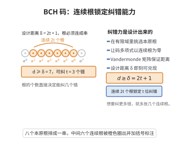

# BCH码的纠错能力

> **一句话大白话**：BCH 码通过在有限域上规定"码多项式必须以一串连续的本原根为根"来设计距离。只要设计时留出一串连续的根，就自动承诺"任两个码字至少差那么多位"，进而保证能纠指定数量的错误——纠错能力是"按设计就写好"的买卖。
>
> **小例子**：设计距离 $\delta=7$ 的 BCH 码令其以 $\alpha^b,\alpha^{b+1},\dots,\alpha^{b+5}$ 为根（连续 6 个根），则其最小距离至少 7，可纠 $t=\lfloor(7-1)/2\rfloor=3$ 个错误——纠错能力由"连续根的个数"直接锁定。

## 一、定理介绍

> **前置依赖**：有限域与本原单位根、线性码的最小距离、Vandermonde 矩阵、可逆矩阵等价条件、码的一致校验条件。

**BCH 码的纠错能力**：设 $\mathbb F_q$ 特征 $p$、$\gcd(n,q)=1$，$\alpha$ 为 $\mathbb F_{q^m}$ 中 $n$ 次本原单位根。设计距离 $\delta=2t+1$ 的 BCH 码 $\mathcal C$ 以 $\alpha^b,\alpha^{b+1},\dots,\alpha^{b+\delta-2}$ 为根（即 $c(\alpha^{b+i})=0$）。则该码的最小距离 $\ge\delta=2t+1$，故可纠正至多 $t$ 个错误。

## 几何直观

图意在说明：只要码多项式带上一串连续的本原根，最小距离就被抬到设计距离，纠错位数随之确定。

## 二、原理思路

设码多项式 $c(x)$ 有 $w$ 个非零系数，且 $c(\alpha^{b+i})=0$（$i=0,\dots,\delta-2$）。把这些零条件写成以非零系数为未知量的线性方程组，其系数矩阵是**Vandermonde 矩阵**（由 $\alpha^{i_1},\dots,\alpha^{i_w}$ 张成），因 $\alpha$ 为本原 $n$ 次根且 $i_1,\dots,i_w$ 互异，该矩阵可逆。于是若 $w\le\delta-1$，则方程组只有零解，与系数非零矛盾；故 $w\ge\delta$，最小距离 $\ge\delta$。

## 三、定理的严格表述

如上记 $\mathcal C=\{c(x)\in\mathbb F_q[x]:\deg<c-n,\ c(\alpha^{b+i})=0,\ i=0,\dots,\delta-2\}$，$\delta=2t+1$。则 $d_{\min}(\mathcal C)\ge\delta$，从而 $\mathcal C$ 可纠 $t$ 个错误。

## 四、证明要点

1. **零条件方程组**.设非零系数在位置 $i_1<\cdots<i_w$：$c(x)=\sum_{r=1}^wc_{i_r}x^{i_r}$。零条件写为 $V\,(c_{i_r}x_{\cdot}^{b i_r})=0$，其中 $V$ 为 Vandermonde。
2. **Vandermonde 可逆**.$V$ 的第 $r$ 列为 $(1,\alpha^{i_r},\dots,\alpha^{(\delta-2)i_r})^\top$；因 $\alpha^{i_r}$ 两两不同，$\det V=\prod_{r<s}(\alpha^{i_s}-\alpha^{i_r})\ne0$。
3. **矛盾**.若 $w\le\delta-1$，$V$ 有 $\delta-1\ge w$ 行且列线性无关，秩 $=w$，非齐次方程唯一零解，抵触非零 $c_{i_r}$。故 $w\ge\delta$。
4. **结论**.最小距离 $w_{\min}\ge\delta$，可纠 $t=\lfloor(\delta-1)/2\rfloor$ 个错误。$\square$

## 五、应用与意义

- **可设计纠错**.通过选择连续根的个数任意指定纠错强度。
- **代数译码".基于伴随式与 Berlekamp–Massey 算法实现高效译码。
- **实用码族**.CD、QR 码、eMMC/SSD 纠错中 BCH 应用广泛。
- **理论地位**.用"根条件→Vandermonde→距离下界"一箭双雕证明距离，是代数码经典范例。

## 课堂问答

**老师**：BCH 码怎么保证"设计距离 $\delta$ 就一定能纠 $t=\lfloor(\delta-1)/2\rfloor$ 个错误"？

**学生**：结论是 $d_{\min}\ge\delta$。理由是码多项式以连续根 $\alpha^b,\alpha^{b+1},\dots,\alpha^{b+\delta-2}$ 为根，把 $c(\alpha^{b+i})=0$ 写成以非零系数为未知量的线性方程组，系数矩阵是 Vandermonde 阵；因 $\alpha^{i_r}$ 两两不同故可逆，若码字重量 $w\le\delta-1$ 则只有零解，矛盾。常见误区是以为根越多译码越难，其实连续根的个数直接锁定纠错能力。

**老师（追问）**：Vandermonde 矩阵可逆这一步为什么关键？

**学生**：因为 $\det V=\prod_{r<s}(\alpha^{i_s}-\alpha^{i_r})\ne0$，保证这组方程的前 $\delta-1$ 行内系数列线性无关，于是任何重量 $\le\delta-1$ 的码字都不存在，最小距离至少为 $\delta=2t+1$，从而可纠 $t$ 个错误。

**老师（拓展）**：实际怎么译码？

**学生**：用伴随式配合 Berlekamp-Massey 算法求错误位置多项式再求逆得到错误值。BCH 因"可设计纠错强度"而广泛用于 CD、QR 码以及 eMMC、SSD 的纠错，是"根条件 $\to$ Vandermonde $\to$ 距离下界"一箭双雕的经典范例。
