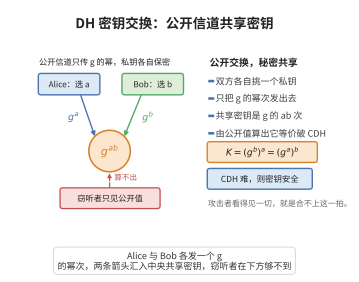

# Diffie-Hellman密钥交换的安全性

> **一句话大白话**：只要“计算型 Diffie-Hellman 问题”难解，窃听者就算看遍公开信息也算不出你们共有的秘密密钥。
>
> **小例子**：两个人公开交换 $g^a$ 和 $g^b$，秘密共钥是 $g^{ab}$。若有人能由 $g,g^a,g^b$ 算出 $g^{ab}$，就等于攻破了 CDH 假设——而这被认为是计算上不可行的。

## 一、定理介绍

> **前置依赖**：计算型Diffie-Hellman（CDH）假设、离散对数问题、循环群理论、概率可忽略函数、归约证明。

Diffie-Hellman（DH）密钥交换让双方经公开信道协商出共享密钥。其安全性建立在 CDH 假设之上：在多项式时间内，无法由 $(g,g^a,g^b)$ 计算出 $g^{ab}$。该定理刻画了“协议安全”与“底层困难问题”的等价联系。

## 几何直观

图意在说明：双方只公开 g 的幂次，却能各自算出同一个 g 的 ab 次幂作为共享密钥。

## 二、原理思路

通过归约证明：假设敌手能破坏 DH 协议，则将其作为子程序即可构造求解 CDH 的算法。因为敌手所见挑战的分布与 CDH 挑战的分布一致，故伪造算法与敌手同样成功，从而与 CDH 假设矛盾。

## 三、定理的严格表述

### 三个相关困难问题

- **离散对数（DLP）**：给定 $g,g^a$ 求 $a$。
- **计算型 DH（CDH）**：给定 $g,g^a,g^b$ 求 $g^{ab}$。
- **判定型 DH（DDH）**：给定 $g,g^a,g^b,g^c$ 判定 $c\equiv ab\pmod{|G|}$。

### 定理（DH 安全性）

在 CDH 假设成立的前提下，不存在多项式时间算法能以不可忽略概率从 $(g,g^a,g^b)$ 恢复共享密钥 $g^{ab}$。

## 四、证明过程

1. **假设矛盾**。设敌手 $\mathcal{A}$ 能以概率 $\varepsilon(k)$ 求 $g^{ab}$，其中 $\varepsilon$ 不可忽略。
2. **构造归约 $\mathcal{B}$**。$\mathcal{B}$ 接收 CDH 挑战 $(g,X,Y)=(g,g^x,g^y)$，将其作为公开信息发给 $\mathcal{A}$。
3. **转译答案**。$\mathcal{A}$ 输出的 $K$ 即 $\mathcal{B}$ 对 CDH 的答案。
4. **分布一致**。$\mathcal{A}$ 所见分布与真实 CDH 挑战分布相同，故 $\mathcal{B}$ 亦以 $\varepsilon$ 概率成功，与 CDH 假设矛盾。

## 五、应用与意义

DH 协议是 TLS、SSH 等安全传输中密钥协商的基础。其安全性归约为 CDH 假设，为后量子密码、零知识证明等领域的归约证明树立了范式。需注意该证明仅针对被动窃听者，主动中间人攻击需额外认证。

## 课堂问答

**老师**：DH 协议里双方只公开 $g^a$ 和 $g^b$，凭什么说窃听者拿不到共享密钥 $g^{ab}$？

**学生**：结论是——只要 CDH 假设成立，任何多项式时间算法都无法以不可忽略概率由 $(g,g^a,g^b)$ 算出 $g^{ab}$。理由是一个直接归约：若敌手 $\mathcal{A}$ 能以不可忽略概率求出 $g^{ab}$，我把收到的 CDH 挑战 $(g,X,Y)$ 原样当作公开信息喂给它，它输出的 $K$ 就是 CDH 的解，二者成功概率完全相同，于是 CDH 被攻破，矛盾。

**老师（追问）**：那 DLP、CDH、DDH 三个困难问题是什么关系？证明只用了哪一个？

**学生**：难度上是 $\mathrm{DLP}\Rightarrow\mathrm{CDH}\Rightarrow\mathrm{DDH}$ 依次减弱。DLP 是已知 $g,g^a$ 求 $a$；CDH 是已知 $g,g^a,g^b$ 求 $g^{ab}$；DDH 是判定 $c\equiv ab\pmod{|G|}$。本定理的归约只需要 CDH，DDH 用不到——常见误区是把 DH 的安全性说成依赖 DDH，其实那对应的是 ElGamal 那类需要不可区分性的场景。

**老师（拓展）**：这个证明漏掉了什么攻击者？

**学生**：它只考虑了被动窃听者。主动的中间人可以把双方分别替换成自己的 $g^c$，双方仍各得一把密钥，却能读到全部通信。因此工程上 DH 必须叠加身份认证，才能抵挡中间人攻击；这一点正好说明"归约成立"与"部署安全"是两件事。
