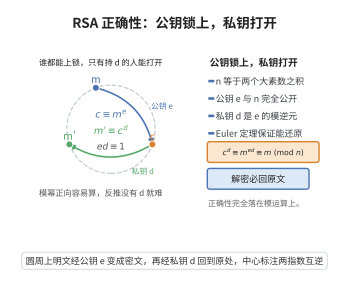

# RSA密码的正确性

> **一句话大白话**：用 RSA 加密再解密，一定能得回原文——无论用公钥怎么“锁”，私钥总能把它“解开”。
>
> **小例子**：选两个素数 $p=61,q=53$，算 $n=3233$，公钥加密 $c\equiv m^e\pmod n$，私钥解密 $m'\equiv c^d\pmod n$，最后总有 $m'=m$。就像挂锁被任何人锁上，只有你那把钥匙能打开。

## 一、定理介绍

> **前置依赖**：欧拉定理、Carmichael函数、中国剩余定理（CRT）、模算术、同余的基本性质。

RSA 是最为经典的公钥密码方案。它保证：给定公钥 $(n,e)$ 加密得到的密文，用对应的私钥 $(n,d)$ 解密必能恢复出明文。正确性完全建立在模运算与 Euler（Carmichael）定理之上，是密码学中“算法正确性”的重要基础。

## 几何直观

图意在说明：加密与解密互为逆运算，是因为 e 与 d 在模欧拉函数意义下互逆。

## 二、原理思路

RSA 正确性的核心在于指数关系 $ed\equiv 1\pmod{\phi(n)}$ 或 $\pmod{\lambda(n)}$。由于 $m^{\phi(n)}\equiv 1\pmod n$，反复自乘可使指数回到 $1$，从而解密恰好逆回来解题加密。关键是要把 $m$ 与 $n$ 不互素的情形也纳入证明，需分模 $p$ 与模 $q$ 用中国剩余定理（CRT）组合。

## 三、定理的严格表述

### 定理（RSA 正确性）

设 $p,q$ 为两个不同的素数，$n=pq$，$\phi(n)=(p-1)(q-1)$。选 $e$ 满足 $1<e<\phi(n)$ 且 $\gcd(e,\phi(n))=1$，计算 $d\equiv e^{-1}\pmod{\phi(n)}$。则对任意明文 $m\in\mathbb{Z}_n^*$，
$$
m'\equiv c^d\equiv (m^e)^d\equiv m\pmod n,
$$
即解密后得到原明文。

### Carmichael 函数版本

取 $ed\equiv 1\pmod{\lambda(n)}$，其中 $\lambda(n)=\mathrm{lcm}(p-1,q-1)$，则同样有 $m'=m$。

## 四、证明过程

1. **化指数**。由 $ed=1+k\phi(n)$，
   $$
   m'\equiv (m^e)^d\equiv m^{ed}\equiv m^{1+k\phi(n)}
   =m\,(m^{\phi(n)})^{k}\pmod n.
   $$
2. **互素情形**。若 $\gcd(m,n)=1$，由 Euler 定理 $m^{\phi(n)}\equiv 1\pmod n$，故 $m'\equiv m$。
3. **不互素情形**。设 $m\equiv 0\pmod p$，则 $m^{ed}\equiv 0\equiv m\pmod p$；对模 $q$ 用 Euler 定理或模态分析，可证 $m^{ed}\equiv m\pmod q$。
4. **组合**。由中国剩余定理，$m^{ed}\equiv m$ 同时成立 $\pmod p$ 与 $\pmod q$，推出 $\pmod n$。

## 五、应用与意义

RSA 的正确性保证了密码方案“功能上无懈可击”，是公钥加密、数字签名与密钥协商现代实现的前提。它建立在整数分解困难性的基础之上，是信息安全体系中的支柱性结论之一。

## 课堂问答

**老师**：RSA 加密再解密一定回到原文，这一步的正确性靠什么？

**学生**：靠指数关系 $ed\equiv 1\pmod{\phi(n)}$。写 $ed=1+k\phi(n)$，则 $m'\equiv m^{ed}\equiv m\,(m^{\phi(n)})^k\pmod n$。当 $\gcd(m,n)=1$ 时由 Euler 定理 $m^{\phi(n)}\equiv 1$，立刻得 $m'\equiv m$。

**老师（追问）**：可明文未必与 $n$ 互素，比如 $m$ 恰好是 $p$ 的倍数，这时上面的证明不就断了？

**学生**：这正是要补的关键一步，必须分模 $p$、模 $q$ 处理。若 $m\equiv 0\pmod p$，则 $m^{ed}\equiv 0\equiv m\pmod p$，无需 Euler 定理；对模 $q$ 则用 Euler 定理（$m$ 与 $q$ 互素）也得 $m^{ed}\equiv m\pmod q$。由中国剩余定理，同余式同时模 $p$、模 $q$ 成立即模 $n=pq$ 成立。所以对全体 $m\in\mathbb{Z}_n$ 都成立，不只是单位群。

**老师（拓展）**：换成 Carmichael 函数会不会更省？

**学生**：会。取 $ed\equiv 1\pmod{\lambda(n)}$，$\lambda(n)=\mathrm{lcm}(p-1,q-1)$，它整除 $\phi(n)=(p-1)(q-1)$，所以仍推出 $m^{ed}\equiv m$。好处是私钥指数 $d$ 更小，解密更快，这也是现代实现偏爱 $\lambda(n)$ 的原因。注意 $\lambda(n)$ 的定义要用 $\mathrm{lcm}$，写成乘积就退回 $\phi(n)$ 了。
