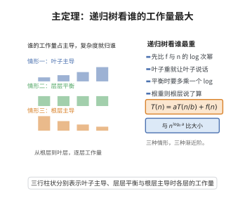

# 分治算法的复杂度分析（主定理）

> **一句话大白话**：把规模为 $n$ 的问题递归拆成 $a$ 个规模 $n/b$ 的子问题，总复杂度由“叶子层”“根层”或“层层相等”三种情况之一决定。
>
> **小例子**：归并排序满足 $T(n)=2T(n/2)+n$，属 $f(n)=\Theta(n^{\log_2 2})$，故 $T(n)=\Theta(n\log n)$。

## 一、定理介绍

> **前置依赖**：递归树方法、渐近记号（大O/Θ）、对数与指数性质、等比级数求和、数学归纳法原理。

主定理（Master Theorem）给出分治递推 $T(n)=aT(n/b)+f(n)$ 的渐近解。它把递归复杂度分为三种情形：叶子主导、层层平衡、根层主导，是分析分治算法复杂度最常用的工具。

## 几何直观

图意在说明：递归树各层工作量此消彼长，哪一层最重，总复杂度就由哪一层决定。

## 二、原理思路

用递归树求和：第 $k$ 层有 $a^k$ 个子问题，规模 $n/b^k$，本层总代价 $a^k f(n/b^k)$。临界比较基准是 $n^{\log_b a}$（对应叶子数目的量级 $a^{\log_b n}=n^{\log_b a}$），$f(n)$ 与它相比谁主导即决定复杂度。

## 三、定理的严格表述

设 $a\ge1$，$b>1$ 为常数，$T(n)=aT(n/b)+f(n)$，$f(n)$ 渐近正函数：
- 若 $f(n)=O(n^{\log_b a-\varepsilon})$（$\varepsilon>0$），则 $T(n)=\Theta(n^{\log_b a})$；
- 若 $f(n)=\Theta(n^{\log_b a})$，则 $T(n)=\Theta(n^{\log_b a}\log n)$；
- 若 $f(n)=\Omega(n^{\log_b a+\varepsilon})$ 且满足正则性条件 $af(n/b)\le cf(n)$（$c<1$），则 $T(n)=\Theta(f(n))$。

## 四、证明过程

递归树各层代价之和为
$$
T(n)=\sum_{k=0}^{\log_b n}a^k f(n/b^k).
$$

1. **情形一**。$f(n)=O(n^{\log_b a-\varepsilon})$，利用 $b^{\log_b a}=a$ 估算每层代价几何增长，求和得 $T(n)=O(n^{\log_b a})$ 且由叶子得下界，故 $\Theta$。
2. **情形二**。$f(n)=\Theta(n^{\log_b a})$ 时每层代价相同，共 $\log_b n$ 层，故 $T(n)=\Theta(n^{\log_b a}\log n)$。
3. **情形三**。正则性条件使各层代价按 $c^k$ 衰减，几何级数收敛，$T(n)=O(f(n))$ 且 $T(n)\ge f(n)$，得 $\Theta(f(n))$。

## 五、应用与意义

主定理快捷地指导二分查找、归并排序、快速傅里叶变换及 Strassen 矩阵乘法的复杂度判定。它也揭示了分治算法的“摊还层代价”思想，是算法设计与分析中的核心定理之一。

## 课堂问答

**老师**：主定理 $T(n)=aT(n/b)+f(n)$ 三种情形的分界线 $n^{\log_b a}$ 是怎么来的？

**学生**：它来自递归树的叶子总量。第 $k$ 层有 $a^k$ 个子问题、规模 $n/b^k$，本层代价 $a^k f(n/b^k)$；到叶子层 $k=\log_b n$ 时子问题数为 $a^{\log_b n}=n^{\log_b a}$。所以 $f(n)$ 与 $n^{\log_b a}$ 谁主导就决定总和，总代价为 $\sum_{k=0}^{\log_b n} a^k f(n/b^k)$。

**老师（追问）**：三种情形分别对应哪一部分主导？情形二为什么多出一个 $\log n$？

**学生**：情形一 $f(n)=O(n^{\log_b a-\varepsilon})$，叶子主导，几何级数求和得 $T(n)=\Theta(n^{\log_b a})$；情形三 $f(n)=\Omega(n^{\log_b a+\varepsilon})$ 且满足正则性 $af(n/b)\le cf(n)$（$c<1$），根层主导，得 $T(n)=\Theta(f(n))$；情形二 $f(n)=\Theta(n^{\log_b a})$，每层代价相同，共 $\log_b n$ 层，于是 $T(n)=\Theta(n^{\log_b a}\log n)$。归并排序 $T(n)=2T(n/2)+n$，$\log_2 2=1$，落在情形二，得 $\Theta(n\log n)$。

**老师（拓展）**：情形三那个正则性条件能省吗？举个它出问题的例子会怎样？

**学生**：不能省。它保证各层代价按 $c^k$ 几何衰减，从而 $\sum a^k f(n/b^k)$ 被 $f(n)$ 的常数倍控制。若 $f$ 抖动剧烈使 $af(n/b)>f(n)$，各层代价反而增长，总和就会超过 $f(n)$。常见误区是只检查 $f(n)=\Omega(n^{\log_b a+\varepsilon})$ 就下结论，忘了验证正则性；例如某些带振荡项的 $f$ 会绕过平凡比较。另外情形一、三之间的间隙（$f$ 恰为 $n^{\log_b a}\log^k n$ 之类）主定理覆盖不到，需借助 Akra–Bazzi 方法。
