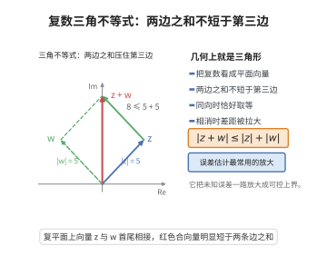

# 复数模的三角不等式

> **一句话大白话**：两个复数之和的模，不会超过它们模的和；这个不等式是复数运算与误差估计中最常用的"放大工具"。

> **小例子**：取 $z=3+4i$、$w=-3+4i$，则 $|z|=|w|=5$，而 $|z+w|=|8i|=8\le10$。差距来自实部的完全抵消：和的模远小于模之和，这种情形在数值计算中正是"相消误差"（cancellation）会被放大的信号。

## 一、定理介绍

> **前置依赖**：复数的定义与四则运算、复数的模与共轭、实数的绝对值、Cauchy-Schwarz不等式、Minkowski不等式。

复数模的三角不等式是复分析中最基本的不等式，其名称来自几何解释：在复平面上，$z$、$w$、$z+w$ 构成一个三角形（或退化为线段），三角形任一边长不超过另两边长之和。这一几何事实在欧几里得《几何原本》中已有记载，把复数与平面向量等同起来的解释则由 Wessel（1799）、Argand（1806）与 Gauss 给出，而 Cauchy 在 1821 年的《Cours d'analyse》中把它系统地用于复数列与级数的收敛性判别，成为复分析严密化的关键工具之一。

在计算数学中，三角不等式的地位尤其特殊：一切误差分析几乎都以它为出发点。由于浮点运算无法精确表示实数与复数，实际计算得到的量 $\tilde z$ 与理论量 $z$ 之间有误差；要给出误差的**上界**，最自然的手段就是把误差项逐项相加并取模，而这一步用到的正是三角不等式。前向误差分析（$\tilde z=\prod(1+\delta_i)z$ 型的界）、后向误差分析、数值稳定性的判定、以及级数截断与快速多极子方法的误差估计，都反复使用它。它同时也是判断"病态问题"的标尺：当 $|z+w|\ll|z|+|w|$ 时，相对误差会被放大 $\frac{|z|+|w|}{|z+w|}$ 倍，这就是相消（cancellation）导致精度损失的定量表述。

## 几何直观

图意在说明：两个复数之和的模不超过模之和，只有同向时才能取等号。

## 二、原理思路

1. 把模长平方用共轭写成 $|u|^{2}=u\bar u$，展开 $|z+w|^{2}$，得到 $|z|^{2}+|w|^{2}+2\,\mathrm{Re}(z\bar w)$。这步把几何问题化为代数恒等式。

2. 用初等事实 $\mathrm{Re}\,\zeta\le|\zeta|$ 把 $\mathrm{Re}(z\bar w)$ 放大为 $|z\bar w|=|z|\,|w|$，从而 $|z+w|^{2}\le(|z|+|w|)^{2}$；两边开方（模长非负）即得三角不等式。

3. 反向不等式由"把和还原成差"的技巧得到：对 $z=(z-w)+w$ 用三角不等式，再交换 $z,w$ 得两侧估计，合成为 $||z|-|w||\le|z-w|$。最后对多项用归纳法推广，并把结论用于误差传递的定量分析。

## 三、定理的严格表述

对任意 $z,w\in\mathbb{C}$，

$$
|z+w|\le|z|+|w| .
$$

**反向三角不等式**：

$$
\left||z|-|w|\right|\le|z-w| .
$$

**多变量形式**：对任意 $z_1,\dots,z_n\in\mathbb{C}$，

$$
\left|\sum_{k=1}^{n}z_k\right|\le\sum_{k=1}^{n}|z_k| ,
$$

且等号成立当且仅当所有非零 $z_k$ 具有相同的辐角。

**复数级数形式**：若 $\sum_{k\ge1}|z_k|<\infty$，则 $\sum_{k\ge1}z_k$ 收敛，且

$$
\left|\sum_{k=1}^{\infty}z_k\right|\le\sum_{k=1}^{\infty}|z_k| .
$$

## 四、证明过程

**步骤 1（模长平方的共轭表示）。** 对 $u\in\mathbb{C}$，$|u|^{2}=u\bar u$。由共轭的线性性质 $\overline{z+w}=\bar z+\bar w$，

$$
|z+w|^{2}=(z+w)\overline{(z+w)}=(z+w)(\bar z+\bar w)=z\bar z+z\bar w+w\bar z+w\bar w .
$$

**步骤 2（合并交叉项）。** 注意 $w\bar z=\overline{z\bar w}$，故 $z\bar w+w\bar z=2\,\mathrm{Re}(z\bar w)$。又 $z\bar z=|z|^{2}$、$w\bar w=|w|^{2}$，于是

$$
|z+w|^{2}=|z|^{2}+|w|^{2}+2\,\mathrm{Re}(z\bar w).
$$

**步骤 3（用实部不超过模长放大）。** 对任意 $\zeta\in\mathbb{C}$ 有 $\mathrm{Re}\,\zeta\le|\mathrm{Re}\,\zeta|\le|\zeta|$。取 $\zeta=z\bar w$，并利用 $|z\bar w|=|z|\,|\bar w|=|z|\,|w|$，得

$$
\mathrm{Re}(z\bar w)\le|z\bar w|=|z|\,|w| .
$$

**步骤 4（得到三角不等式）。** 把步骤 3 代回步骤 2：

$$
|z+w|^{2}\le|z|^{2}+|w|^{2}+2|z|\,|w|=\left(|z|+|w|\right)^{2}.
$$

两端开算术平方根（非负）即得 $|z+w|\le|z|+|w|$。等号当且仅当 $\mathrm{Re}(z\bar w)=|z\bar w|$，即 $z\bar w$ 是非负实数，等价于 $z,w$ 辐角相同或其中之一为零。

**步骤 5（反向三角不等式）。** 把 $z$ 写成 $z=(z-w)+w$，对 $z-w$ 与 $w$ 用步骤 4：

$$
|z|\le|z-w|+|w|\qquad\Longrightarrow\qquad |z|-|w|\le|z-w| .
$$

交换 $z$ 与 $w$ 得 $|w|-|z|\le|w-z|=|z-w|$。两式合并即

$$
\left||z|-|w|\right|\le|z-w| .
$$

**步骤 6（多变量形式的归纳）。** $n=1$ 平凡，$n=2$ 即步骤 4。设结论对 $n-1$ 成立，则

$$
\left|\sum_{k=1}^{n}z_k\right|=\left|z_n+\sum_{k=1}^{n-1}z_k\right|\le|z_n|+\left|\sum_{k=1}^{n-1}z_k\right|\le|z_n|+\sum_{k=1}^{n-1}|z_k|=\sum_{k=1}^{n}|z_k| .
$$

对部分和 $S_n$ 用此式，得 $\left|S_m-S_n\right|\le\sum_{k=n+1}^{m}|z_k|\to0$（当 $n,m\to\infty$），故 $\{S_n\}$ 是 Cauchy 列、级数收敛；再对 $S_n$ 取极限并用 $|\cdot|$ 的连续性得级数形式。

**步骤 7（误差传递的定量形式）。** 设浮点计算结果满足 $\tilde z=z(1+\delta_1)$、$\tilde w=w(1+\delta_2)$，$|\delta_i|\le u$（$u$ 为单位舍入误差）。则

$$
\left|\tilde z+\tilde w-(z+w)\right|=\left|z\delta_1+w\delta_2\right|\le|z|\,|\delta_1|+|w|\,|\delta_2|\le u\left(|z|+|w|\right).
$$

相对误差为

$$
\frac{\left|\tilde z+\tilde w-(z+w)\right|}{|z+w|}\le u\cdot\frac{|z|+|w|}{|z+w|} .
$$

放大因子 $\frac{|z|+|w|}{|z+w|}$ 可以任意大（当 $z\approx-w$ 时），这正是复数加减法在高抵消情形下失去精度的定量说明；反之由步骤 5，$\left||\tilde z|-|z|\right|\le|\tilde z-z|$，说明模的计算误差不会超过复数的绝对值误差。$\square$

## 五、应用与意义

- 误差分析：给出浮点加减法、级数求和、迭代算法的前向误差上界，是数值稳定性的基本估计工具。
- 复级数与收敛性：证明绝对收敛蕴含收敛（复数的比较判别法），是幂级数、Taylor 与 Laurent 展开的基础。
- 相消与病态问题：放大因子 $\frac{|z|+|w|}{|z+w|}$ 定量刻画了相消误差，指导算法改写（如用稳定公式替代直接相减）。
- 调和分析与数值积分：在估计 Fourier 系数、快速多极子方法截断误差时反复使用，把复杂误差拆成可加项逐个控制。

## 课堂问答

**老师**：$|z+w|\le|z|+|w|$ 看起来是几何直觉，怎么严格证？

**学生**：用共轭把几何化成代数。$|z+w|^2=(z+w)(\bar z+\bar w)=|z|^2+|w|^2+2\,\mathrm{Re}(z\bar w)$，再用 $\mathrm{Re}\,\zeta\le|\zeta|$ 得 $\mathrm{Re}(z\bar w)\le|z||w|$，于是 $|z+w|^2\le(|z|+|w|)^2$，开方即得。等号成立当且仅当 $z\bar w$ 为非负实数，即 $z,w$ 同向。

**老师（追问）**：它在误差分析里到底扮演什么角色？

**学生**：它是"把误差拆成可加项再逐项放缩"的许可。设 $\tilde z=z(1+\delta_1)$、$\tilde w=w(1+\delta_2)$、$|\delta_i|\le u$，则 $|\tilde z+\tilde w-(z+w)|\le|z||\delta_1|+|w||\delta_2|\le u(|z|+|w|)$，相对误差放大倍数为 $\frac{|z|+|w|}{|z+w|}$。

**老师（拓展）**：这个放大因子什么时候会爆炸？反过来又能得到什么结论？

**学生**：当 $z\approx-w$ 时分子约 $2|z|$ 而分母趋于 $0$，因子可任意大——这就是相消（cancellation）导致精度损失的定量刻画，提示我们要改写公式避免直接相减。反方向用反向三角不等式 $||z|-|w||\le|z-w|$（把 $z=(z-w)+w$ 展开再交换变量即得），说明模的计算误差不超过复数本身的误差，所以算 $|z|$ 是良态的。

## 相关条目

- [浮点运算的误差分析](./浮点运算的误差分析.md)：以本不等式为基础建立加减法与累加的前向误差界。
- [快速多极子方法的误差界](./快速多极子方法的误差界.md)：截断误差的估计依赖多项三角不等式。
- [自适应算法的收敛性](./自适应算法的收敛性.md)：迭代误差的传递与收敛判据使用同类估计。
- [蒙特卡洛方法的收敛性](./蒙特卡洛方法的收敛性.md)：抽样误差的绝对值控制。
- [Cauchy-Riemann方程](../第18级-复分析/Cauchy-Riemann方程.md)：复数可微性的基础，复分析的开端。
- [Minkowski不等式](../第17级-实分析/Minkowski不等式.md)：本不等式在 $L^{p}$ 空间中的推广。
- [Cauchy-Schwarz不等式](../第14级-线性代数/Cauchy-Schwarz不等式.md)：同为内积空间中的基本不等式，常与三角不等式并用。
- [绝对收敛与条件收敛](../第13级-级数理论/绝对收敛与条件收敛.md)：本不等式用于复数级数收敛性判别。
