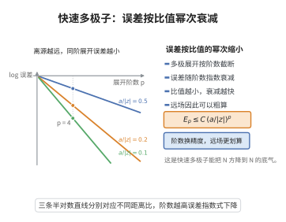

# 快速多极子方法的误差界

> **一句话大白话**：多极展开截断得越多越准，误差按 $(a/|z|)^p$ 指数式衰减——离源区越远，同阶展开就越精确。
>
> **小例子**：一群电荷挤在半径 $a$ 的圆盘里，在距离 $|z|=10a$ 处取 $p=4$，截断误差量级约 $(0.1)^4=10^{-4}$，足够用于引力或静电场模拟。

## 一、定理介绍

> **前置依赖**：幂级数展开、等比级数求和、复数模的三角不等式、级数收敛理论、Laurent展开。

快速多极子方法（FMM）用多极展开与局部展开逼近远场作用，避免 $O(N^2)$ 的两两相互作用。其误差界说明截断误差随展开阶数 $p$ 指数衰减，是该方法高效且可控的数学基础。

## 几何直观

图意在说明：多极展开的截断误差随阶数指数衰减，源区越远、比值越小，收敛越快。

## 二、原理思路

多极展开是 $\Phi(z)=\sum a_k z^{-(k+1)}$ 的幂级数。误差由级数尾项控制，因 $|z_i|\le a<|z|$ 而收敛；局部展开同理，由几何级数估计截断误差。分离“源区”与“目标区”是误差估测的关键。

## 三、定理的严格表述

### 多极展开截断误差

设电荷 $q_i$ 位于以原点为中心、半径 $a$ 的圆盘内，$p$ 阶多极展开 $\Phi(z)=\sum_{k=0}^{\infty}a_k z^{-(k+1)}$，$a_k=\sum_i q_i z_i^{k}$，则
$$
\left|\Phi(z)-\sum_{k=0}^{p-1}\frac{a_k}{z^{k+1}}\right|
\le\frac{1}{|z|-a}\left(\frac{a}{|z|}\right)^{p}\sum_{i=1}^{N}|q_i|.
$$

### 局部展开截断误差

局部展开截断误差以 $O((r/R)^p)$ 衰减，其中 $r=|z-z_0|$，$R$ 为源点到 $z_0$ 的距离。

## 四、证明过程

1. **精确级数**。由 $\Phi(z)=\sum_i q_i/(z-z_i)$ 展开为 $\sum_k z^{-(k+1)}\sum_i q_i z_i^k$。
2. **尾项估计**。余项 $R_p(z)$ 满足
   $$
   |R_p(z)|\le\sum_i |q_i|\sum_{k=p}^{\infty}\frac{|z_i|^k}{|z|^{k+1}}.
   $$
3. **几何级数**。因 $|z_i|\le a$ 且 $|z|>a$，
   $$
   \sum_{k=p}^{\infty}\frac{|z_i|^k}{|z|^{k+1}}
   =\frac{|z_i|^p}{|z|^p(|z|-|z_i|)}\le\frac{a^p}{|z|^p(|z|-a)}.
   $$
4. **合并即得**。代回即得多极截断误差界。

## 五、应用与意义

FMM 的误差可控性使其广泛用于天体模拟、静电计算与电磁散射。指数衰减的误差界保证了“高阶展开即高精度”的计算策略，是 $O(N\log N)$ 快速算法的核心保障。

## 课堂问答

**老师**：FMM 用 $p$ 阶多极展开去近似远场势，截断误差凭什么按 $(a/|z|)^p$ 指数衰减？

**学生**：因为展开系数受几何级数控制。位势 $\Phi(z)=\sum_i q_i/(z-z_i)$ 在 $|z|>a\ge|z_i|$ 时展开为 $\sum_{k\ge0} a_k z^{-(k+1)}$，$a_k=\sum_i q_i z_i^k$。余项 $R_p(z)$ 的每个样本项是尾几何级数，$\sum_{k=p}^\infty|z_i|^k/|z|^{k+1}=\frac{|z_i|^p}{|z|^p(|z|-|z_i|)}$，故 $|R_p(z)|\le\frac{1}{|z|-a}(\frac{a}{|z|})^p\sum_i|q_i|$。源区越紧凑（$a$ 小）、目标区越远（$|z|$ 大），衰减越快。

**老师（追问）**：那 $(a/|z|)$ 要多大才进入"可靠"区？设 $|z|=10a$ 取 $p=4$ 会怎样？

**学生**：代入得 $(0.1)^4=10^{-4}$ 量级，对引力、静电模拟已经够用。要警惕的是当 $|z|$ 接近 $a$（两个盒子靠得很近）时，比值趋于 $1$，指数衰减就退化了——这正是 FMM 必须把近场作用单独直接求和、只把远场交给多极展开的原因。

**老师（拓展）**：除了多极展开，误差界还要用到什么工具？

**学生**：局部展开的截断误差同理，以 $O((r/R)^p)$ 衰减，其中 $r$ 是目标区内点到展开中心距离、$R$ 是源点到该中心的距离。整个估计反复依赖复数模的三角不等式把 $N$ 项误差叠加起来。所以 FMM 的误差可控性不是靠某一步的精巧，而是几何分离条件（远场）加上可加放缩共同保证的——这也是它可以是 $O(N\log N)$ 又保持精度的原因。
