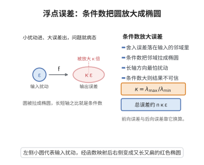

# 浮点运算的误差分析

> **一句话大白话**：每算一步引入一丁点舍入误差，做 $n$ 步后误差被“放大”的倍数由条件数 $\kappa$ 决定；总误差大约就是 $n\kappa\varepsilon_{\mathrm{mach}}$ 个量级。
>
> **小例子**：设机器精度 $\varepsilon_{\mathrm{mach}}\approx10^{-16}$，算 $10^6$ 步、条件数 $10^3$，则相对误差界约 $10^{-7}$，粗略估算即可预判结果可信度。

## 一、定理介绍

> **前置依赖**：舍入误差模型、条件数理论、数学归纳法原理、三角不等式、泰勒展开（高阶项忽略）。

浮点运算离不开舍入误差。向前误差分析刻画“计算结果离精确结果有多远”，向后误差分析则把误差重新解释为对输入的扰动。两者通过条件数 $\kappa$ 联系起来，是数值分析可靠性的定量基石。

## 几何直观

图意在说明：输入的小扰动经过条件数放大后变成输出的大误差，圆被拉长成椭圆。

## 二、原理思路

把整段计算看成复合函数，跟踪舍入误差沿计算图的传播。向后分析用“存在扰动 $\Delta x$ 使 $\hat y=f(x+\Delta x)$”作归纳，进而用条件数把向后误差换算成向前误差，最终合并为 $n\kappa\varepsilon_{\mathrm{mach}}$ 阶的界。

## 三、定理的严格表述

### 向前误差分析

设 $y=f(x)$ 为精确结果，每个基本运算舍入误差 $|\delta_i|\le\varepsilon_{\mathrm{mach}}$，则
$$
|\mathrm{fl}(f(x))-f(x)|
\le n\,\kappa\,\varepsilon_{\mathrm{mach}}\,|f(x)|+O(\varepsilon_{\mathrm{mach}}^2),
$$
其中 $\kappa$ 为条件数。

### 向后误差分析

设 $\gamma_n=\dfrac{n\varepsilon_{\mathrm{mach}}}{1-n\varepsilon_{\mathrm{mach}}}$，则存在扰动 $\Delta x$ 使 $\hat y=f(x+\Delta x)$ 且 $|\Delta x|\le\gamma_n|x|$（逐分量成立）。

## 四、证明过程

1. **基本运算建模**。对 $z=a\circ b$，$\mathrm{fl}(a\circ b)=(a\circ b)(1+\delta)$，$|\delta|\le\varepsilon_{\mathrm{mach}}$。
2. **向后误差归纳**。假设 $\hat a=a(1+\delta_a)$、$\hat b=b(1+\delta_b)$ 的误差已在界内，则 $\hat z=(a\circ b)(1+\delta_z)$，逐层乘积给出 $(1+\varepsilon_{\mathrm{mach}})^n\le1+\gamma_n$。
3. **借助条件数**。向前误差与向后误差满足
   $$
   \frac{\|\hat y-y\|}{\|y\|}\le\kappa\,\frac{\|\Delta x\|}{\|x\|}\le\kappa\,\gamma_n.
   $$
4. **展开合并**。代入 $\gamma_n=n\varepsilon_{\mathrm{mach}}+O(\varepsilon_{\mathrm{mach}}^2)$ 即得向前误差界。

## 五、应用与意义

误差分析被用于判断算法是否“数值稳定”，指导对消、病态问题与算法替代方案的选择。它是矩阵计算、优化与科学计算软件可靠性的理论保障，也是理解条件数与稳定性概念的核心入口。

## 课堂问答

**老师**：向前误差和向后误差在说什么？它们怎么联系起来？

**学生**：向前误差回答"算出的 $\mathrm{fl}(f(x))$ 离真值 $f(x)$ 有多远"，给出 $|\mathrm{fl}(f(x))-f(x)|\le n\kappa\varepsilon_{\mathrm{mach}}|f(x)|+O(\varepsilon_{\mathrm{mach}}^2)$；向后误差换视角，说存在输入扰动 $\Delta x$ 使 $\hat y=f(x+\Delta x)$ 且逐分量 $|\Delta x|\le\gamma_n|x|$，其中 $\gamma_n=\frac{n\varepsilon_{\mathrm{mach}}}{1-n\varepsilon_{\mathrm{mach}}}$。二者靠条件数 $\kappa$ 换算：$\frac{\|\hat y-y\|}{\|y\|}\le\kappa\frac{\|\Delta x\|}{\|x\|}\le\kappa\gamma_n$。

**老师（追问）**：$\gamma_n$ 里那个分母 $1-n\varepsilon_{\mathrm{mach}}$ 是哪来的？

**学生**：是累积舍入的"利滚利"。每步建模为 $\mathrm{fl}(a\circ b)=(a\circ b)(1+\delta)$，$|\delta|\le\varepsilon_{\mathrm{mach}}$，沿计算图叠 $n$ 层后相对误差因子 $(1+\varepsilon_{\mathrm{mach}})^n\le\frac{1}{1-n\varepsilon_{\mathrm{mach}}}=1+\gamma_n$。这也提示一个前提：当 $n\varepsilon_{\mathrm{mach}}\ge1$ 时界失效，说明步数太多会真的崩掉。

**老师（拓展）**：$\kappa$ 大就意味着算法"不好"吗？

**学生**：不是。$\kappa$ 是问题本身的属性，不是算法的属性——病态问题（$\kappa$ 大）用任何向后稳定的算法都会放大误差。常见误区是把"数值不稳定"和"问题病态"混为一谈。正确读法是：向后稳定性是算法的功劳（保证 $\Delta x$ 小），$\kappa$ 是问题的宿命，向前误差是两者乘积。要改善只能改写问题或换更高精度，而不是"优化算法"就能突破 $\kappa$。
