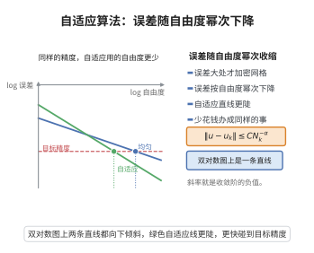

# 自适应算法的收敛性

> **一句话大白话**：哪儿误差大就在哪儿加密网格，误差会稳定收缩，自由度 $N$ 越多，逼近越准，收敛阶 $N^{-\alpha}$ 可控。
>
> **小例子**：解 Poisson 方程时，若解的转角处有小奇异，自适应有限元会在那里自动“加密”，用较少的自由度就达到与均匀加密相当的精度。

## 一、定理介绍

> **前置依赖**：Sobolev空间与能量范数、有限元方法基础、后验误差估计、Dörfler标记策略、收缩型收敛理论。

自适应有限元方法依据后验误差指示器，迭代地在误差大处加密网格。该定理保证生成的近似解序列 $u_k$ 收敛，误差按自由度 $N_k$ 的幂次 $N_k^{-\alpha}$ 衰减，是自适应算法可靠性与高效性的理论基础。

## 几何直观

图意在说明：自适应加密让误差按自由度的幂次下降，而且比均匀加密更快达到同一精度。

## 二、原理思路

核心是三件套：后验误差估计器（局部误差可测）、Dörfler 标记策略（选误差占比足够大的单元）、以及加密的收缩性质。三者结合，使整体误差单调下降并产生可量化的收敛率。

## 三、定理的严格表述

### 定理（自适应有限元收敛性）

对 Poisson 方程 $-\Delta u=f$，由自适应算法生成的序列 $\{u_k\}$ 满足
$$
\|u-u_k\|_E\le C\,N_k^{-\alpha}\,\|u\|_{H^{1+\gamma}(\Omega)},
$$
其中 $\|\cdot\|_E$ 为能量范数，$N_k$ 为第 $k$ 步自由度数目，$\alpha$ 取决于维度与正则性。

### 误差指示器

$$
\eta_T(u_k)^2=h_T^2\|f+\Delta u_k\|_{L^2(T)}^2
+\frac12\sum_{e\subset\partial T}h_e\big\|[\nabla u_k\cdot n_e]\big\|_{L^2(e)}^2.
$$

## 四、证明过程

1. **后验估计**。存在 $C_1,C_2$ 使 $C_1\eta_T(u_k)\le\|u-u_k\|_{E,T}\le C_2\eta_T(u_k)$（上下界）。
2. **标记策略**。Dörfler 选择最小 $\mathcal{M}_k$ 使 $\sum_{T\in\mathcal{M}_k}\eta_T^2\ge\theta\sum_{T\in\mathcal{T}_k}\eta_T^2$。
3. **收缩性质**。加密后
   $$
   \|u-u_{k+1}\|_E^2\le\|u-u_k\|_E^2-\lambda\sum_{T\in\mathcal{M}_k}\eta_T(u_k)^2.
   $$
4. **递推收敛**。由上下界与 Dörfler 条件推得误差单调下降且满足收缩不等式，反复迭代即得 $N_k^{-\alpha}$ 收敛率。

## 五、应用与意义

自适应有限元广泛用于工程模拟、流体与弹性力学中带奇异性或局部结构的 PDE 求解。该收敛定理在保证算法“必定收敛”的同时说明了加密策略的效率，是现代 PDE 数值解法设计的理论支柱。

## 课堂问答

**老师**：自适应有限元凭什么保证"加了自由度一定会变准"？收敛率 $N_k^{-\alpha}$ 又从哪来？

**学生**：核心是三件套。其一，后验误差指示器可测局部误差，$\eta_T(u_k)^2=h_T^2\|f+\Delta u_k\|_{L^2(T)}^2+\frac12\sum_{e\subset\partial T}h_e\|[\nabla u_k\cdot n_e]\|_{L^2(e)}^2$，且满足上界 $C_1\eta_T\le\|u-u_k\|_{E,T}\le C_2\eta_T$；其二，Dörfler 标记选最小集合 $\mathcal{M}_k$ 使 $\sum_{T\in\mathcal{M}_k}\eta_T^2\ge\theta\sum_{T}\eta_T^2$；其三，加密具有收缩性 $\|u-u_{k+1}\|_E^2\le\|u-u_k\|_E^2-\lambda\sum_{T\in\mathcal{M}_k}\eta_T(u_k)^2$。三者结合推出 $\|u-u_k\|_E\le C N_k^{-\alpha}\|u\|_{H^{1+\gamma}(\Omega)}$。

**老师（追问）**：Dörfler 里那个 $\theta$ 有什么用？随便取行不行？

**学生**：$\theta$ 是"标记足量"的门槛，必须取 $0<\theta\le1$ 的固定常数。它保证每次至少拿下总误差平方的一个正比例，收缩量 $\lambda\sum_{\mathcal{M}_k}\eta_T^2$ 才不会趋于零。若 $\theta$ 取得过小，可能只标一两个单元，收缩量被 $\theta$ 压得太小，收敛率里的常数就会恶化甚至失去干净的多项式界。

**老师（拓展）**：为什么能保证误差单调下降，而不是标错地方导致反复？

**学生**：因为收缩不等式是"整体误差减去被标单元误差"，而 Dörfler 保证被标部分占了 $\theta$ 的比例，所以每步至少有正比例的下降，误差序列单调且有一致下界（$0$），递推即得几何级数式的收敛。$\alpha$ 由维度和解的正则性指数 $\gamma$ 决定：解越光滑（$\gamma$ 大），同样的加密换来的收敛越快。要注意这套理论依赖"网格加密保持形状正则"，退化单元会破坏常数。
