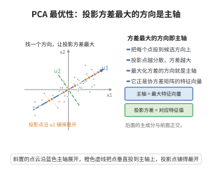

# PCA的最优性定理

> **一句话大白话**：让数据投到某方向后“拉开得最开”（方差最大）的那个方向，正是协方差矩阵最大特征值对应的特征向量。
>
> **小例子**：一堆点在二维里斜着分布，PCA 找到的“第一主轴”就是协方差矩阵最大特征值对应的方向，投上去方差最大、信息保留最多。

## 一、定理介绍

> **前置依赖**：拉格朗日乘子法、对称矩阵的特征分解（谱定理）、Rayleigh商、二次型与内积、多元微积分（梯度与极值）。

主成分分析（PCA）寻找使投影后方差最大的正交方向。该定理用 Lagrange 乘子法证明：单位方向 $\boldsymbol w$ 上投影方差 $\boldsymbol w^\top\boldsymbol S\boldsymbol w$ 的最大值正是协方差矩阵 $\boldsymbol S$ 的最大特征值，极值方向即对应特征向量。

## 几何直观

图意在说明：在所有候选方向中，投影方差最大的那个方向正是协方差矩阵最大特征值对应的特征向量。

## 二、原理思路

把“方差最大”写成带约束的优化问题，用 Lagrange 乘子法求驻点，得到的驻点方程恰是特征值方程 $\boldsymbol S\boldsymbol w=\lambda\boldsymbol w$。最大特征值给出最大方差，其对应特征向量即第一主成分方向，后续方向据正交约束依次取最大特征值。

## 三、定理的严格表述

设 $\boldsymbol X\in\mathbb{R}^{n\times p}$ 为中心化数据矩阵，$\boldsymbol S=\frac1n\boldsymbol X^\top\boldsymbol X$ 为样本协方差矩阵，则第一主成分方向是如下问题的解
$$
\max_{\|\boldsymbol w\|=1}\boldsymbol w^\top\boldsymbol S\boldsymbol w,
$$
且 $\boldsymbol w_1$ 为 $\boldsymbol S$ 最大特征值对应的特征向量。

## 四、证明过程

1. **建模**。投影后方差为
   $$
   \mathrm{Var}(\boldsymbol X\boldsymbol w)=\frac1n\|\boldsymbol X\boldsymbol w\|^2=\boldsymbol w^\top\boldsymbol S\boldsymbol w.
   $$
2. **Lagrange 函数**。$\mathcal L(\boldsymbol w,\lambda)=\boldsymbol w^\top\boldsymbol S\boldsymbol w-\lambda(\boldsymbol w^\top\boldsymbol w-1)$。
3. **驻点方程**。对 $\boldsymbol w$ 求导并设零，
   $$
   \frac{\partial\mathcal L}{\partial\boldsymbol w}=2\boldsymbol S\boldsymbol w-2\lambda\boldsymbol w=\boldsymbol 0\;\Longrightarrow\;\boldsymbol S\boldsymbol w=\lambda\boldsymbol w.
   $$
4. **最优值**。代入目标函数得 $\boldsymbol w^\top\boldsymbol S\boldsymbol w=\lambda$，故最大特征值对应最大方差，特征向量即最优方向。

## 五、应用与意义

PCA 用于降维、特征提取与数据可视化，在图像处理、基因组学与金融中有广泛用途。该定理揭示“降维即谱分解”，并把最优性归约为对称矩阵的特征问题，是机器学习与统计学习的基本结果。

## 课堂问答

**老师**：为什么"投影后方差最大"的方向恰好是协方差矩阵最大特征值对应的特征向量？

**学生**：把它写成带约束的优化。第一主成分方向解 $\max_{\|w\|=1} w^\top S w$，其中 $S=\frac1n X^\top X$ 是样本协方差矩阵。作 Lagrange 函数 $\mathcal L(w,\lambda)=w^\top S w-\lambda(w^\top w-1)$，对 $w$ 求导置零得 $2Sw-2\lambda w=0$，即 $Sw=\lambda w$——驻点方程正是特征值方程，代回目标得 $w^\top S w=\lambda$，所以最大特征值给出最大方差。

**老师（追问）**：投影方差为什么能写成 $w^\top S w$？

**学生**：因为数据已中心化。投影为 $Xw$，其方差为 $\frac1n\|Xw\|^2=\frac1n(Xw)^\top(Xw)=w^\top(\frac1n X^\top X)w=w^\top S w$。中心化这一步不能省：不中心化的话投影均值非零，$\frac1n\|Xw\|^2$ 里会混进均值的贡献，那时解出的是偏离真实主轴的"最大二阶矩方向"。

**老师（拓展）**：第一主成分之外的方向怎么定？有什么必须注意的条件？

**学生**：在正交约束 $w_i^\top w_j=0$ 下依次取最大特征值，由对称矩阵谱定理可得 $S$ 的一组正交特征向量 $w_1,\dots,w_p$ 对应特征值 $\lambda_1\ge\dots\ge\lambda_p$，即各主成分。第 $k$ 个方向贡献的解释方差占比为 $\lambda_k/\sum_j\lambda_j$。要注意 PCA 的最优性是"线性投影下方差最大"，只捕捉二阶结构：数据若含非线性结构或量纲差异大，得先标准化，否则方差大的变量会垄断主成分。
