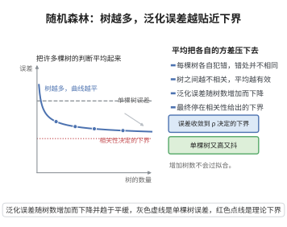

# 随机森林的泛化误差

> **一句话大白话**：把很多棵又“独立”又“准确”的树一平均，集体犯错的概率比单棵树小得多，泛化误差被压得越来越低。
>
> **小例子**：让 100 个专家独立投票判断，若每人独立、平均准度远高于瞎猜，则“多数票”几乎一定是对的——这就是随机森林胜过单棵决策树的奥秘。

## 一、定理介绍

> **前置依赖**：弱收敛与大数定律、Chebyshev不等式、边际余量（margin）定义、方差与协方差分解、概率论基础。

随机森林是 Bagging 与随机特征选择的结合。其泛化误差上界说明：随机森林的误差随树数增多收敛到强分组图（margin）的分布，过拟合被随机化有效抑制。误差由每棵树的强度与树间的相关性共同决定。

## 几何直观

图意在说明：多棵树平均后方差被压低，误差随树数增加而下降，最终稳定在由树间相关性决定的下界。

## 二、原理思路

定义每棵树的余量（margin）$r(x,y)=P_\theta(h_\theta(x)=y)-\max_{j\ne y}P_\theta(h_\theta(x)=j)$。森林的泛化误差相按下余量小于零的概率控制。随机化（在特征与样本上抽样）降低了树间相关性，从而减小整体误差上界。

## 三、定理的严格表述

设随机森林由无限棵决策树 $\{h_\theta\}$ 组成，最强边际余量为 $r(x,y)$，则广义误差
$$
PE^{*}\le\frac{\overline\rho\,(1-s^2)}{s^2},
$$
其中 $s$ 为各树平均强度（即树的准确度度量），$\overline\rho$ 为树间平均相关系数。因此增大强度 $s$ 或降低相关性 $\overline\rho$ 都使误差上界下降。

## 四、证明过程

1. **余量刻画**。森林犯错的概率由 $\Pr_\theta(r(x,y)<0)$ 的走向控制，误差上界先转化为余量的负概率。
2. **Chebyshev 型估计**。误差界可写为用“期望余量”与“方差”表达的形式 $PE^{*}\le\frac{\mathrm{Var}(\text{margin})}{\mathbb{E}^2[\text{margin}]}$。
3. **分解方差**。余量方差分解为独立余量部分的方差与树间相关性贡献，整理为
   $$
   PE^{*}\le\frac{\overline\rho\,(1-s^2)}{s^2}.
   $$
4. **解读**。强度 $s$ 越大、相关性 $\overline\rho$ 越小，上界越小——这正是随机化特征选择的目的。

## 五、应用与意义

随机森林在分类、回归、特征重要性与异常检测中广泛使用。泛化误差界说明其“集成减少偏差与方差”的机理，为理解 Bagging、梯度提升及各类集成方法的统计本质提供了框架。

## 课堂问答

**老师**：随机森林把很多棵树平均起来，泛化误差为什么会下降？下界由什么控制？

**学生**：核心结论是 $PE^*\le\frac{\overline\rho(1-s^2)}{s^2}$，其中 $s$ 是单棵树的平均"强度"（准确度），$\overline\rho$ 是树间平均相关系数。误差界只由这两个量决定：强度 $s$ 越大、相关性 $\overline\rho$ 越小，上界越低。而随机森林通过样本 Bootstrap 与随机特征选择，正是为了压低 $\overline\rho$，同时保持每棵树足够准（$s$ 不大幅下降）。

**老师（追问）**：树越多，泛化误差一定越小吗？会过拟合吗？

**学生**：按这个界，$\overline\rho$ 与 $s$ 是分布层面的量，加树并不改变它们，所以误差上界不随树数增大而上升——树数增多只是让有限森林的实际误差收敛到这个界，不会过拟合。这正是"随机森林比单棵树更稳"的机理：单棵树方差大，平均掉随机性后方差被压下来，而偏差几乎不增加。

**老师（拓展）**：这个界是怎么推出来的？margin 在其中扮演什么角色？

**学生**：先定义余量（margin）$r(x,y)=P_\theta(h_\theta(x)=y)-\max_{j\ne y}P_\theta(h_\theta(x)=j)$，森林只在余量为负时犯错，于是泛化误差被 $\Pr_\theta(r(x,y)<0)$ 控制。再用 Chebyshev 型估计把它转成 $\frac{\mathrm{Var}(\text{margin})}{\mathbb E^2[\text{margin}]}$，把余量方差分解为各树独立部分与树间协方差部分，整理即得 $\frac{\overline\rho(1-s^2)}{s^2}$。要注意这是极限（无限棵树）的界，且依赖树近似独立抽样；若特征选择过强使树高度相似，$\overline\rho\to1$，界退化回单棵树的水平，集成就失去意义。
