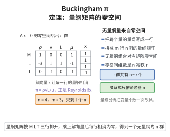

# Buckinghamπ定理

> **一句话大白话**：物理量之间的公式，可以用无量纲组合（称 $\pi$ 群）来写——本来 $n$ 个有量纲量的关系，最多化简成 $n-m$ 个无量纲量的关系（$m$ 个基本量纲）。
>
> **小例子**：单摆周期 $T$ 与摆长 $l$、重力加速度 $g$ 有关，三个量涉及 $2$ 个基本量纲，故只需一个无量纲量 $\pi=T\sqrt{g/l}$，于是 $\pi=\text{const}$，即 $T\propto\sqrt{l/g}$。

## 一、定理介绍

> **前置依赖**：量纲分析基本概念、矩阵的秩、秩-零化度定理、线性无关与基、整除与幂积运算。

Buckingham $\pi$ 定理是量纲分析的根本工具。它指出物理关系 $f(q_1,\dots,q_n)=0$ 可改写为仅含 $n-r$ 个无量纲群 $F(\pi_1,\dots,\pi_{n-r})=0$ 的形式，其中 $r$ 为量纲矩阵的秩。它极大减少了独立变量数目，指导实验设计与模型缩放。

## 几何直观

图意在说明：无量纲组合正是量纲矩阵零空间的向量，变量个数因此从 n 个压到 n 减 r 个。

## 二、原理思路

每个物理量 $q_j$ 的量纲为基本量纲的幂积。要求组合 $\pi=q_1^{x_1}\cdots q_n^{x_n}$ 无量纲，即要求量纲矩阵 $\boldsymbol A$ 满足 $\boldsymbol A\boldsymbol x=\boldsymbol 0$。解空间维数为 $n-r$，故恰有 $n-r$ 个独立的无量纲群。

## 三、定理的严格表述

设 $n$ 个物理量 $q_1,\dots,q_n$ 满足 $f(q_1,\dots,q_n)=0$，涉及 $m$ 个基本量纲。量纲矩阵 $\boldsymbol A\in\mathbb{R}^{m\times n}$ 的秩为 $r$，则存在 $n-r$ 个独立的无量纲量
$$
\pi_k=\prod_{j=1}^{n}q_j^{v_j^{(k)}},\quad k=1,\dots,n-r,
$$
使得 $F(\pi_1,\dots,\pi_{n-r})=0$。

## 四、证明过程

1. **量纲矩阵**。写出 $[q_j]=\prod_{i=1}^{m}D_i^{a_{ij}}$，构成矩阵 $\boldsymbol A=(a_{ij})$。
2. **无量纲条件**。$[\pi]=\prod_i D_i^{\sum_j a_{ij}x_j}$，故 $\pi$ 无量纲当且仅当 $\boldsymbol A\boldsymbol x=\boldsymbol 0$。
3. **解空间**。$\boldsymbol A$ 秩为 $r$，齐次解空间维数 $n-r$，取规范基 $\{\boldsymbol v^{(k)}\}$ 得无量纲群。
4. **改写关系**。选 $r$ 个量纲独立的量作基本量，将其余量用它们与 $\pi_k$ 表示并代入 $f=0$，即得 $F(\pi_1,\dots,\pi_{n-r})=0$。

## 五、应用与意义

$\pi$ 定理支撑风洞实验、缩比模型与单位制分析，是流体、传热与化工建模的重要手段。它将“相似准则”概念系统化，也为后续的 Newton 相似准则与无量纲数（Reynolds、Froude 等）提供统一框架。

## 课堂问答

**老师**：单摆周期 $T$、摆长 $l$、重力加速度 $g$ 三个量，用 Buckingham $\pi$ 定理能化简成几个无量纲群？

**学生**：结论是先算 $n-r=3-2=1$，只需一个无量纲群 $\pi=T\sqrt{g/l}$。理由：组合 $\pi=q_1^{x_1}\cdots q_n^{x_n}$ 无量纲当且仅当量纲矩阵满足 $\boldsymbol A\boldsymbol x=\boldsymbol 0$，由秩-零化度定理解空间维数为 $n-r$；单摆中量纲矩阵秩 $r=2$，故 $3-2=1$。

**老师（追问）**：为什么用矩阵的秩 $r$，而不是基本量纲个数 $m$？

**学生**：因为 $m$ 个基本量纲未必都独立，只有秩 $r\le m$ 才是真正独立的量纲数，答案应是 $n-r$ 而非 $n-m$。常见误区就是照搬成 $n-m$，当量纲矩阵行相关时数目会算错。

**老师（拓展）**：$\pi$ 定理给了无量纲群的存在与数目，它能替你写出 $F(\pi_1,\dots,\pi_{n-r})=0$ 的具体形式吗？

**学生**：不能。定理只保证存在 $n-r$ 个独立 $\pi$ 群并给出 $F$，函数 $F$ 的具体形状仍需靠物理方程或实验确定；$\pi$ 定理的价值在于把 $n$ 个有量纲量压成 $n-r$ 个无量纲量，从而指导实验设计与缩比。
