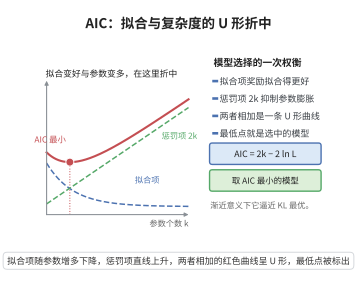

# 模型选择的AIC渐近性质

> **一句话大白话**：AIC 同时惩罚“拟合得多好”和“用了多少参数”两者，在真实模型属于被比较族时，它渐近地能选出那个最贴近真理又不过度复杂的模型。
>
> **小例子**：给一组时间序列数据比较 AR(1)、AR(3) 与 AR(10)，AIC 会挑出平衡了拟合优度与参数数目的最优滞后阶数，既不过简也不过拟。

## 一、定理介绍

> **前置依赖**：最大似然估计、KL散度、泰勒展开（渐近近似）、期望运算、信息论基础。

Akaike 信息准则（AIC）定义为 $\mathrm{AIC}=2k-2\ln\hat L$，其中 $k$ 为参数个数、$\hat L$ 为最大似然。其渐近性质表明：在候选模型族包含真实模型（或其逼近误差可忽略）时，AIC 渐近等价于最小化 KL 散度，从而一致地选择出“最接近真分布”的模型。

## 几何直观

图意在说明：AIC 把拟合优度与参数个数放在同一把尺子上，U 形曲线的最低点就是应选的模型规模。

## 二、原理思路

AIC 由最大似然的偏差分析推导：单用最大似然会因“用数据估计参数”而产生正偏差，故减去期望偏差 $k$，得到 $2(k-\ln\hat L)$。它是 KL 散度期望的最小二乘近似，兼顾拟合与复杂度。

## 三、定理的严格表述

对参数族 $\{f_{\theta}\}$，令 $\hat\theta$ 为最大似然估计。定义
$$
\mathrm{AIC}=2k-2\ln f_{\hat\theta}(y).
$$
在正则条件（真分布属于族或其偏差可忽略）下，最小化 AIC 渐近等价于最小化 KL 散度逼近，即选择最优候选。

## 四、证明过程

1. **KL 偏差展开**。期望 KL 散度 $D(f\|f_{\theta})$ 在 $\theta=\theta_0$ 的二次近似展开。
2. **最大似然偏差**。$\hat\theta$ 使经验似然最大，其期望比真实最优似然高出约 $k/2$，即
   $$
   \mathbb{E}[\ln f_{\hat\theta}(y)-\ln f_{\theta_0}(y)]\approx\frac{k}{2}.
   $$
3. **构造准则**。减掉该偏差得 $\mathbb{E}[\ln f_{\theta_0}(y)]-\frac{k}{2}$，乘以 $-2$ 即 AIC 的期望形式。
4. **渐近选择**。各候选模型的 AIC 之差异即可比 KL 之差异，取最小者得到渐近最优模型。

## 五、应用与意义

AIC 用于回归变量选择、时间序列定阶与混合模型维数选择等。其渐近性质为模型选择提供“拟合—复杂度”的权衡依据，与 BIC（更偏稀疏）一起构成信息准则家族的核心。

## 课堂问答

**老师**：AIC 是 $2k-2\ln\hat L$，那个惩罚项 $2k$ 是从哪里冒出来的？

**学生**：结论是它来自最大似然估计的偏差修正。用数据估计参数 $\hat\theta$ 后，期望对数似然会比真实最优高出约 $k/2$，即
$$\mathbb{E}\big[\ln f_{\hat\theta}(y)-\ln f_{\theta_0}(y)\big]\approx\frac{k}{2}.$$
为消去这份乐观偏差，减去 $k$ 再乘 $-2$，就得到 $\mathrm{AIC}=2k-2\ln\hat L$。

**老师（追问）**：这个准则与 KL 散度到底是什么关系？

**学生**：它是 KL 散度期望的渐近无偏估计。由于 $\mathbb{E}[\ln f_{\hat\theta}]-\frac{k}{2}$ 逼近 $\mathbb{E}[\ln f_{\theta_0}]$，故最小化 AIC 渐近等价于在候选族中选择 KL 散度最小的模型。常见误区是把 AIC 当成"一致"选择器——它并不保证选出真模型，只在真模型属于族内时逼近最优预测。

**老师（拓展）**：那 BIC 与 AIC 的目标有何不同？

**学生**：BIC 的惩罚是 $k\ln n$，随样本变重，故具一致性、能选出真模型；AIC 惩罚固定为 $2k$，追求渐近预测最优，可能过拟合。两者的差异源于"识别真模型"与"最优预测"两类目标的不同取舍。
