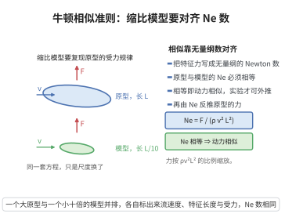

# 牛顿相似准则

> **一句话大白话**：做缩比模型实验时，要让真实对象和模型“表现相似”，关键是让无量纲的 Newton 数（或对应相似数）保持一致。
>
> **小例子**：测一个 10 米大桥的受力，可用 1 米模型，只要模型与实体的无量纲数（如 Reynolds 数）相等，测出的力就能按缩放律换算回真实值。

## 一、定理介绍

> **前置依赖**：Buckinghamπ定理、量纲分析、无量纲数（Reynolds数、Froude数）、物理量纲基本概念、比例缩放理论。

牛顿相似准则源于 Buckingham $\pi$ 定理，用于缩比模型实验。它要求原型与模型在无量纲层次“动力相似”，即作用力之比以牛顿数形式相等。它是量纲分析在物理建模与工程试验中的应用。

## 几何直观

图意在说明：只有原型与模型的 Newton 数相等，两者的受力规律才相似，模型实验的结果才能外推到原型。

## 二、原理思路

由 $\pi$ 定理，物理规律可写成无量纲群的关系。要保证模型与原型相似，需使相应无量纲群（如 Newton 数 $Ne=F/(\rho v^2 L^2)$、Reynolds 数、Froude 数）相等。据此可由模型试验数据反推原型的压强、力矩与功率等物理量。

## 三、定理的严格表述

### Newton 数

定义 Newton 数（或力系数）
$$
Ne=\frac{F}{\rho\,v^2L^2},
$$
其中 $F$ 为特征力，$\rho$ 为密度，$v$ 为特征速度，$L$ 为特征尺度。原型与模型相似的充分条件是各主导无量纲数相等。

### 相似性条件

若原型下标 $p$、模型下标 $m$，则动力相似要求 $Ne_p=Ne_m$，由此推出力的缩放关系。

## 四、证明过程

1. **量纲分析**。力、密度、速度、尺度之间 $F=\rho v^2L^2\cdot Ne$，由 $\pi$ 定理得 $Ne$ 为唯一无量纲群（在只含该四个量时）。
2. **相似要求**。真实流动与模型流动满足同一无量纲化方程，当无量纲群相等时，无量纲解相同。
3. **缩放律**。由 $F_p/(\rho_p v_p^2L_p^2)=F_m/(\rho_m v_m^2L_m^2)$ 反解出 $F_p$ 与其余量的比例关系。
4. **主导数匹配**。实际中需同时匹配 Reynolds（粘性）、Froude（重力）等主导无量纲数。

## 五、应用与意义

牛顿相似准则广泛应用于风洞试验、船舶与汽车空气动力、水利模型与化学工程放大。它把流体相似、结构相似的思想落地为可操作的试验准则，是工程建模与原型验证的通用方法论。

## 课堂问答

**老师**：做缩比模型实验，凭什么可以用小模型测得的结果换算回原型？

**学生**：结论是让原型与模型的主导无量纲数相等，即动力相似。Newton 数定义为
$$Ne=\frac{F}{\rho v^2L^2},$$
要求 $Ne_p=Ne_m$，由此反解 $F_p/(\rho_p v_p^2L_p^2)=F_m/(\rho_m v_m^2L_m^2)$，得到力的缩放律。

**老师（追问）**：同时涉及粘性和重力时，能既匹配 Reynolds 数又匹配 Froude 数吗？

**学生**：一般不能。两个独立无量纲群同时相等会给出相互冲突的尺度要求，除非更换流体或尺度，这正是"尺度效应"。常见误区是只匹配一个数就宣称完全相似，其实只能保证该机制主导下的相似。

**老师（拓展）**：工程上怎么处理这种"配不齐"？

**学生**：按主导机制取舍：风洞以等 Reynolds 数为主，水工模型以等 Froude 数为主，其余无量纲数做修正。这正是 $\pi$ 定理的直接应用——相似条件并不唯一，取决于哪几个 $\pi$ 群必须相等。
