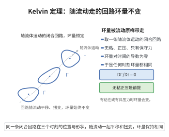

# Kelvin涡量定理

> **一句话大白话**：在无粘、正压、仅受保守力作用的流体里，任何一条随流体运动而移动的闭合环路上的环量，永远不随时间改变。
>
> **小例子**：一盆水被搅出旋涡后（无粘近似下），那个旋涡的整体“转动强度”会一直保持，就像角动量守恒一样牢固。

## 一、定理介绍

> **前置依赖**：Euler方程、物质导数与对流通量、斯托克斯定理、正压性条件、保守力场（势函数）、向量微积分（环路积分）。

Kelvin 涡量定理（Kelvin's circulation theorem）断言：无粘、正压且体积力有势的流体中，沿封闭物质线的环量 $\Gamma=\oint_C\boldsymbol u\cdot d\boldsymbol l$ 满足 $D\Gamma/Dt=0$。它是涡管、涡线守恒性与许多涡动力学结论的出发点。

## 几何直观

图意在说明：无粘、正压且只有保守力时，随流体运动的闭合回路环量对时间的变化率为零。

## 二、原理思路

交换环量物质导数中的微分与积分次序，把 $D\boldsymbol u/Dt$ 用 Euler 方程替换。第二项因 $\oint\boldsymbol u\cdot d\boldsymbol u=\oint d\big(\frac12|\boldsymbol u|^2\big)=0$ 而消失；正压性把 $\frac1\rho\nabla p$ 写成势函数梯度，闭合积分又为零。

## 三、定理的严格表述

对无粘、正压（$\rho=\rho(p)$）且体积力有势的流体，沿任一闭合物质线环量守恒
$$
\frac{D\Gamma}{Dt}=0,\qquad \Gamma=\oint_C\boldsymbol u\cdot d\boldsymbol l.
$$

## 四、证明过程

1. **交换次序**。
   $$
   \frac{D\Gamma}{Dt}=\oint_{C}\frac{D\boldsymbol u}{Dt}\cdot d\boldsymbol l+\oint_{C}\boldsymbol u\cdot\frac{D(d\boldsymbol l)}{Dt}.
   $$
2. **第二项为零**。因 $\frac{D(d\boldsymbol l)}{Dt}=d\boldsymbol u$，故
   $$
   \oint\boldsymbol u\cdot d\boldsymbol u=\oint d\Big(\frac12|\boldsymbol u|^2\Big)=0.
   $$
3. **Euler 方程**。$\frac{D\boldsymbol u}{Dt}=-\frac1\rho\nabla p+\boldsymbol g$。
4. **正压 + 有势**。$\frac1\rho\nabla p=\nabla P$，$\boldsymbol g=-\nabla G$，则 $\oint(-\nabla P-\nabla G)\cdot d\boldsymbol l=0$，故 $D\Gamma/Dt=0$。

## 五、应用与意义

Kelvin 定理是涡动力学的基础：它导出涡线守恒、Helmholtz 涡定理的推论（无粘流体“涡旋不会凭空产生”），并用于海气环流、台风与翼尖涡的理解。它为不可压缩理想流中的大尺度涡结构提供了守恒约束。

## 课堂问答

**老师**：把一盆水搅出旋涡后松手，旋涡为什么会"一直转下去"？

**学生**：在无粘、正压、体积力有势的理想假设下，沿闭合物质线的环量守恒，即 $D\Gamma/Dt=0$，涡的"整体转动强度"不随时间改变，像角动量守恒一样牢固。证明要点是
$$
\frac{D\Gamma}{Dt}=\oint_C\frac{D\boldsymbol u}{Dt}\cdot d\boldsymbol l+\oint_C\boldsymbol u\cdot\frac{D(d\boldsymbol l)}{Dt},
$$
第二项因 $\oint d(\frac12|\boldsymbol u|^2)=0$ 消失，第一项代入 Euler 方程后由正压性与有势性化为梯度环积分而为零。

**老师（追问）**：三个前提里哪个最容易被违反？

**学生**：粘性最容易被违反。真实流体总有粘性，涡量会从固体边界扩散、耗散，"涡旋不会凭空产生"只在无粘极限成立。正压性也很关键：斜压流体中 $\frac1\rho\nabla p$ 不再是梯度，斜压项 $\nabla\rho\times\nabla p$ 可以生成涡量，海陆风与斜压不稳定即靠它。

**老师（拓展）**：这条守恒还有哪些更强推论？

**学生**：由此可推出涡线、涡管随流体"冻结"，即 Helmholtz 涡定理：涡管强度沿管守恒，涡线不能中断于流体内部，只能闭合成环或止于边界。这正是涡动力学守恒结构的来源。
