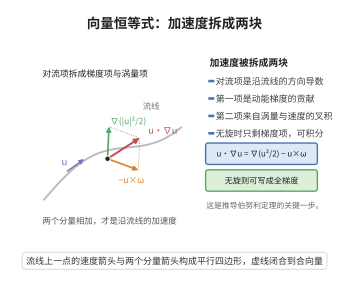

# 向量恒等式

> **一句话大白话**：向量场的"对流项"可以拆开写成 $\boldsymbol u\cdot\nabla\boldsymbol u=\nabla\big(\tfrac12|\boldsymbol u|^2\big)-\boldsymbol u\times(\nabla\times\boldsymbol u)$。这一步把沿流线的加速度项化成"动能梯度"与"涡量交叉项"之和，是推导伯努利定理的关键。
>
> **小例子**：取径向流 $\boldsymbol u=(x,y,z)$。此时 $\nabla\times\boldsymbol u=\boldsymbol 0$、$\boldsymbol u\cdot\nabla\boldsymbol u=\boldsymbol u$，而 $\nabla\big(\tfrac12|\boldsymbol u|^2\big)=\nabla\big(\tfrac12(x^2+y^2+z^2)\big)=\boldsymbol u$，恒等式两端同为 $\boldsymbol u$，验证一致。

## 一、定理介绍

> **前置依赖**：向量三重积公式、向量混合积的几何意义、方向导数与梯度的关系。

**向量恒等式**（对流项分解）：设 $\boldsymbol u:\Omega\to\mathbb R^3$ 为 $C^1$ 向量场，则
$$
(\boldsymbol u\cdot\nabla)\boldsymbol u=\nabla\!\Big(\tfrac12|\boldsymbol u|^2\Big)-\boldsymbol u\times(\nabla\times\boldsymbol u).
$$
记涡量 $\boldsymbol\omega=\nabla\times\boldsymbol u$，即 $(\boldsymbol u\cdot\nabla)\boldsymbol u=\nabla\big(\tfrac12|\boldsymbol u|^2\big)-\boldsymbol u\times\boldsymbol\omega$。当流动无旋（$\boldsymbol\omega=\boldsymbol 0$）时右端化为纯梯度，这一"显式梯度化"正是伯努利定理能沿流线积分成 $p/\rho+\tfrac12|\boldsymbol u|^2+gz=\text{const}$ 的支点。

## 几何直观

图意在说明：对流项等于动能梯度减去速度与涡量的叉积，无旋时只剩可积分的梯度项。

## 二、原理思路

从向量分析的基本恒等式
$$
\nabla(\boldsymbol a\cdot\boldsymbol b)=(\boldsymbol a\cdot\nabla)\boldsymbol b+(\boldsymbol b\cdot\nabla)\boldsymbol a+\boldsymbol a\times(\nabla\times\boldsymbol b)+\boldsymbol b\times(\nabla\times\boldsymbol a)
$$
出发，取 $\boldsymbol a=\boldsymbol b=\boldsymbol u$，则对称的两项合并为 $2(\boldsymbol u\cdot\nabla)\boldsymbol u$、交叉的两项合并为 $2\boldsymbol u\times(\nabla\times\boldsymbol u)$，整理即得。也可以用向量三重积公式 $\boldsymbol a\times(\boldsymbol b\times\boldsymbol c)=\boldsymbol b(\boldsymbol a\cdot\boldsymbol c)-\boldsymbol c(\boldsymbol a\cdot\boldsymbol b)$ 的微分版本逐分量验证，下文给出后者作为严格证明。

## 三、定理的严格表述

**（向量恒等式）** 设 $\Omega\subseteq\mathbb R^3$ 为开集，$\boldsymbol u=(u_1,u_2,u_3)\in C^1(\Omega,\mathbb R^3)$。则在 $\Omega$ 上逐点成立
$$
(\boldsymbol u\cdot\nabla)\boldsymbol u=\nabla\!\Big(\tfrac12\sum_{k=1}^{3}u_k^2\Big)-\boldsymbol u\times(\nabla\times\boldsymbol u).
$$

## 四、证明过程

1. **展开左端**。按定义 $(\boldsymbol u\cdot\nabla)\boldsymbol u=\sum_k u_k\,\partial_k\boldsymbol u$，其第 $i$ 个分量为
   $$
   \big[(\boldsymbol u\cdot\nabla)\boldsymbol u\big]_i=\sum_{k=1}^{3}u_k\,\partial_k u_i .
   $$

2. **动能梯度**。由方向导数与梯度的关系，$\nabla\big(\tfrac12|\boldsymbol u|^2\big)$ 的第 $i$ 个分量为
   $$
   \Big[\nabla\big(\tfrac12|\boldsymbol u|^2\big)\Big]_i=\sum_{k=1}^{3}u_k\,\partial_i u_k .
   $$

3. **交叉项的分量式**。记 Levi-Civita 符号 $\varepsilon_{ijk}$，则 $(\nabla\times\boldsymbol u)_k=\sum_{l,m}\varepsilon_{klm}\partial_l u_m$，于是
   $$
   \big[\boldsymbol u\times(\nabla\times\boldsymbol u)\big]_i=\sum_{j,k}\varepsilon_{ijk}\,u_j\,(\nabla\times\boldsymbol u)_k=\sum_{j,k,l,m}\varepsilon_{ijk}\varepsilon_{klm}\,u_j\,\partial_l u_m .
   $$

4. **用 $\varepsilon$-$\delta$ 恒等式化简**。由 $\sum_k\varepsilon_{ijk}\varepsilon_{klm}=\delta_{il}\delta_{jm}-\delta_{im}\delta_{jl}$ 得
   $$
   \big[\boldsymbol u\times(\nabla\times\boldsymbol u)\big]_i=\sum_{j,l,m}\big(\delta_{il}\delta_{jm}-\delta_{im}\delta_{jl}\big)u_j\,\partial_l u_m=\sum_{k}u_k\,\partial_i u_k-\sum_{k}u_k\,\partial_k u_i .
   $$

5. **合并**。把第 2、4 步相减：
   $$
   \Big[\nabla\big(\tfrac12|\boldsymbol u|^2\big)-\boldsymbol u\times(\nabla\times\boldsymbol u)\Big]_i=\sum_k u_k\partial_i u_k-\Big(\sum_k u_k\partial_i u_k-\sum_k u_k\partial_k u_i\Big)=\sum_k u_k\partial_k u_i ,
   $$
   恰等于第 1 步的 $\big[(\boldsymbol u\cdot\nabla)\boldsymbol u\big]_i$。对每个 $i$ 成立，恒等式得证。$\blacksquare$

## 五、应用与意义

- **伯努利定理**：无旋时 $\boldsymbol u\cdot\nabla\boldsymbol u=\nabla\big(\tfrac12|\boldsymbol u|^2\big)$，沿流线点乘并积分即得能量形式的伯努利方程。
- **涡量与 Lamb 矢量**：恒等式右端的 $\boldsymbol u\times\boldsymbol\omega$ 即 Lamb 矢量，是涡量动力学方程的出发点。
- **一般性**：该恒等式是向量分析的标准工具，在电磁学、弹性动力学与数值格式的离散算子设计中被反复使用。

## 课堂问答

**老师**：伯努利定理能沿流线积分，靠的正是这个恒等式。它说的是什么？

**学生**：对流项可拆成"动能梯度减涡量交叉项"：
$$
(\boldsymbol u\cdot\nabla)\boldsymbol u=\nabla\!\left(\frac12|\boldsymbol u|^2\right)-\boldsymbol u\times(\nabla\times\boldsymbol u).
$$
当流动无旋 $\boldsymbol\omega=\nabla\times\boldsymbol u=\boldsymbol 0$ 时右端成纯梯度，才能整体积分成能量形式。

**老师（追问）**：右边第二项叫 Lamb 矢量，它有什么物理意义？

**学生**：Lamb 矢量 $\boldsymbol u\times\boldsymbol\omega$ 正是涡量动力学方程的驱动项。取旋度后 $\nabla\times(\boldsymbol u\times\boldsymbol\omega)$ 给出涡量的对流与拉伸，是理解涡旋演化的出发点；无旋时它消失，正是拉格朗日无旋性守恒的代数原因。

**老师（拓展）**：怎么严格验证这个恒等式？

**学生**：用 $\varepsilon$-$\delta$ 恒等式逐分量看。由 $\sum_k\varepsilon_{ijk}\varepsilon_{klm}=\delta_{il}\delta_{jm}-\delta_{im}\delta_{jl}$ 得
$$
\left[\boldsymbol u\times(\nabla\times\boldsymbol u)\right]_i=\sum_k u_k\partial_i u_k-\sum_k u_k\partial_k u_i,
$$
从动能梯度里减去它，恰好剩下 $\sum_k u_k\partial_k u_i$，即 $(\boldsymbol u\cdot\nabla)\boldsymbol u$ 的第 $i$ 分量。常见错误是只验证一个特例就以为证毕，须对每个 $i$ 逐分量成立才算严谨。
