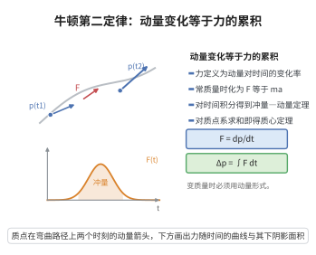

# 牛顿第二定律

> **一句话大白话**：物体动量的变化率等于它所受的合力——$\boldsymbol F=\dfrac{d\boldsymbol p}{dt}$。质量不变时它就是熟悉的 $\boldsymbol F=m\boldsymbol a$；质量会变时（如火箭），必须用动量形式，不能简单写成 $ma$。
>
> **小例子**：火箭喷气，质量 $m(t)$ 不断减小。若不计外力，动量守恒给出 $m\dot{\boldsymbol v}=-\dot m\,(\boldsymbol v_{\text{喷}}-\boldsymbol v)$：推力来自喷出气体带走的动量，正是动量形式的第二定律在起作用。

## 一、定理介绍

> **前置依赖**：微积分基本定理、牛顿-莱布尼茨公式、方向导数与梯度的关系。

**牛顿第二定律**：在惯性参考系中，质点动量 $\boldsymbol p=m\boldsymbol v$ 的时间变化率等于所受的合外力
$$
\frac{d\boldsymbol p}{dt}=\boldsymbol F .
$$
对质量不变的质点，由 $\boldsymbol p=m\boldsymbol v$ 且 $\dot m=0$ 化为 $\boldsymbol F=m\boldsymbol a$；对变质量系统（火箭、雨滴）则必须保留 $\dot{\boldsymbol p}=\dot m\,\boldsymbol v+m\dot{\boldsymbol v}$。它与牛顿第一、第三定律共同构成经典力学的公理基础，并被推广为连续介质的动量守恒（Cauchy 第一运动定律）。

## 几何直观

图意在说明：力是动量的变化率，把力对时间积分就得到冲量，等于动量的增量。

## 二、原理思路

先由“力改变运动状态”的实验事实，把**力定义为动量的时间变化率**（这样第三定律与动量守恒才自洽）。再由动量的定义与导数的线性性导出常质量形式 $\boldsymbol F=m\boldsymbol a$；由微积分基本定理把 $\dot{\boldsymbol p}=\boldsymbol F$ 沿时间积分，得到冲量—动量定理；对质点系求和、对连续体取极限，即过渡到质心运动定理与 Cauchy 动量方程。

## 三、定理的严格表述

**（牛顿第二定律）** 在惯性系中，质点（或质点系）的动量 $\boldsymbol p$ 满足
$$
\dot{\boldsymbol p}=\boldsymbol F_{\text{合}},\qquad \boldsymbol p=\sum_{\alpha}m_\alpha\boldsymbol v_\alpha\ (\text{质点系}).
$$
**（冲量—动量定理）** 对任意 $t_1<t_2$，
$$
\boldsymbol p(t_2)-\boldsymbol p(t_1)=\int_{t_1}^{t_2}\boldsymbol F_{\text{合}}\,dt .
$$

## 四、证明过程

1. **常质量形式**。$m$ 为常数时 $\boldsymbol p(t)=m\boldsymbol v(t)$，$\boldsymbol v=\dot{\boldsymbol x}$。由导数的线性性
   $$
   \dot{\boldsymbol p}=\frac{d}{dt}(m\boldsymbol v)=m\dot{\boldsymbol v}=m\boldsymbol a ,
   $$
   即 $\boldsymbol F=m\boldsymbol a$。

2. **变质量形式**。质量随时间变化时，
   $$
   \dot{\boldsymbol p}=\frac{d}{dt}(m\boldsymbol v)=\dot m\,\boldsymbol v+m\dot{\boldsymbol v}.
   $$
   对火箭，喷出物带走的动量率为 $\dot m(\boldsymbol v-\boldsymbol v_{\text{喷}})$（$\dot m<0$，$\boldsymbol v_{\text{喷}}$ 为喷流速度），动量守恒写为 $\dot m\,\boldsymbol v+m\dot{\boldsymbol v}=\boldsymbol F_{\text{外}}+\dot m\,\boldsymbol v_{\text{喷}}$，整理得 $m\dot{\boldsymbol v}=\boldsymbol F_{\text{外}}+\dot m(\boldsymbol v_{\text{喷}}-\boldsymbol v)$，即齐奥尔科夫斯基方程之源。

3. **冲量—动量定理**。把 $\dot{\boldsymbol p}=\boldsymbol F$ 由 $t_1$ 到 $t_2$ 积分，用微积分基本定理（逐分量即牛顿-莱布尼茨公式）$\int_{t_1}^{t_2}\dot{\boldsymbol p}\,dt=\boldsymbol p(t_2)-\boldsymbol p(t_1)$，得
   $$
   \boldsymbol p(t_2)-\boldsymbol p(t_1)=\int_{t_1}^{t_2}\boldsymbol F\,dt .
   $$
   这解释了“碰撞中冲量决定速度改变量”的实验规律。

4. **质点系与质心**。对系统求和，内力成对抵消（第三定律 $\boldsymbol F_{\alpha\beta}=-\boldsymbol F_{\beta\alpha}$），故 $\dot{\boldsymbol P}=\boldsymbol F_{\text{外}}$；写 $\boldsymbol P=M\boldsymbol v_{\text{cm}}$ 得质心运动定理 $M\ddot{\boldsymbol x}_{\text{cm}}=\boldsymbol F_{\text{外}}$：系统整体像一个受外力作用的质点。

5. **连续介质情形**。把质点系取为随体物质体积 $V$ 并令其收缩，由质量守恒与雷诺输运定理 $\dot{\boldsymbol P}=\int_V\rho\dot{\boldsymbol v}\,dV$，外力化为 $\int_V\rho\boldsymbol b\,dV+\int_{\partial V}\boldsymbol\sigma\cdot\boldsymbol n\,dS$；再用高斯散度定理把面积分化为体积分并局域化，即得 Cauchy 动量方程 $\nabla\cdot\boldsymbol\sigma+\rho\boldsymbol b=\rho\dot{\boldsymbol v}$，成为 Navier–Stokes 方程的出发点。$\blacksquare$

## 五、应用与意义

- **经典力学与天体力学**：单摆、行星轨道、弹簧振子等运动方程都由 $\boldsymbol F=m\boldsymbol a$ 直接写出。
- **工程与航天**：变质量形式（火箭方程）是航天推进与变质量系统分析的核心工具。
- **连续介质力学**：由质点系的动量守恒配合输运定理与散度定理，导出 Cauchy 第一运动定律，进而得到弹性动力学与 Navier–Stokes 方程。

## 课堂问答

**老师**：为什么第二定律要写成动量的形式，而不是 $\boldsymbol F=m\boldsymbol a$？

**学生**：因为 $\boldsymbol F=m\boldsymbol a$ 默认质量不变，而动量形式
$$
\boldsymbol F=\frac{d\boldsymbol p}{dt}
$$
对变质量系统才普遍成立。火箭喷气时 $\dot m\ne0$，展开 $\dot{\boldsymbol p}=\dot m\boldsymbol v+m\dot{\boldsymbol v}$，多出的 $\dot m\boldsymbol v$ 项决定推力，这正是齐奥尔科夫斯基方程的来源。

**老师（追问）**：冲量-动量定理怎么来，它比逐点力更实用在哪？

**学生**：把 $\dot{\boldsymbol p}=\boldsymbol F$ 从 $t_1$ 积到 $t_2$，用微积分基本定理得
$$
\boldsymbol p(t_2)-\boldsymbol p(t_1)=\int_{t_1}^{t_2}\boldsymbol F\,dt .
$$
碰撞、爆炸这类力大且作用极短的过程，力的波形难测，但冲量即动量改变可测，直接用动量守恒最方便。

**老师（拓展）**：它如何过渡到连续介质的动量方程？

**学生**：对质点系求和，内力成对抵消得质心定理 $M\ddot{\boldsymbol x}_{\text{cm}}=\boldsymbol F_{\text{外}}$；再把质点系换成随体体积，配 Reynolds 输运定理与散度定理把面力化为 $\int\nabla\cdot\boldsymbol\sigma\,dV$，局域化即得 Cauchy 第一运动定律 $\nabla\cdot\boldsymbol\sigma+\rho\boldsymbol b=\rho\dot{\boldsymbol v}$，成为 N-S 方程与弹性动力学的共同起点。
