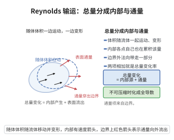

# Reynolds 输运定理

> **一句话大白话**：一个随流体一起运动的“体积块”里某物理量的变化率 = 这块体积内部该量自身随时间的变化（含内部产生）+ 从它表面被流体带出去的通量；即“总量变化 = 内部变化 + 表面通量”。
>
> **小例子**：一升随水流移动的热水，其总热量的变化率等于水内部自身产生的热加上随水流穿过这一升边界的对流输送；若水不可压缩（$\nabla\cdot\boldsymbol u=0$）且无热源，则随体体积内总热量守恒，且 $\frac{D}{Dt}\int_{V(t)}\phi\,dV=\int_{V(t)}\frac{D\phi}{Dt}\,dV$。

## 一、定理介绍

> **前置依赖**：多重 Riemann 积分与换元公式、Jacobi 行列式与 Jacobi 公式、物质导数（随体导数）、高斯散度定理、连续性与可微性

Reynolds 输运定理由英国力学家 Osborne Reynolds 于 1903 年系统使用，是连续介质力学中沟通“随体（Lagrange）观点”与“空间（Euler）观点”的桥梁。质量守恒、动量守恒、能量守恒三大方程的 Euler 形式，均从随体形式出发、借本定理转换得到。

定理要解决的技术困难是：积分区域 $V(t)$ 本身随时间变化，故不能直接把时间导数移入积分号内（Leibniz 公式只在固定区域或仅端点变动时简单适用）。本定理给出一般速度场驱动下区域变动时的求导公式，并把它写成“内部项 + 边界通量项”的守恒形式。

从物理上看，定理表明随体描述与空间描述的差别恰好是一个对流（散度）项，这正是“物质导数 = 局部导数 + 对流项”在积分层面的精确体现。

## 几何直观

图意在说明：一个随流体运动的体积内总量的变化率，等于内部自身的变化加上从表面流出的通量。

## 二、原理思路

关键是引入参考构型（参考坐标）$\boldsymbol X$，把变化的区域 $V(t)$ 拉回到固定区域 $V_0$ 上，从而可在积分号内求导：

1. **参数化**：用运动映射 $\boldsymbol x=\boldsymbol\chi(\boldsymbol X,t)$ 把 $V(t)$ 表示为参考体积 $V_0$ 的像，Jacobi 行列式 $J=\det(\partial\boldsymbol x/\partial\boldsymbol X)$ 度量局部体积膨胀率。
2. **拉回**：换元把 $\int_{V(t)}\phi\,dV$ 写成 $\int_{V_0}\phi(\boldsymbol\chi(\boldsymbol X,t),t)J\,dV_0$，积分区域固定。
3. **积分号内求导**：得 $\int_{V_0}(\dot\phi\,J+\phi\,\dot J)\,dV_0$，其中 $\dot\phi$ 为物质导数。
4. **Euler 展开公式**：证明 $\dot J=J\,\nabla_{\boldsymbol x}\cdot\boldsymbol v$，即体积微元的相对膨胀率等于速度散度。
5. **换回 Euler 坐标并用散度定理**：把 $\nabla\cdot(\phi\boldsymbol v)$ 的通量部分化为表面通量。

## 三、定理的严格表述

**（Reynolds 输运定理）** 设 $\Omega\subseteq\mathbb R^3$ 为非空开集，$\boldsymbol v\in C^1(\Omega\times(t_1,t_2),\mathbb R^3)$ 为速度场。设 $V(t)\Subset\Omega$ 随速度场 $\boldsymbol v$ 运动，即存在固定区域 $V_0$ 与 $C^1$ 运动映射 $\boldsymbol\chi:V_0\times(t_1,t_2)\to\Omega$，满足 $V(t)=\boldsymbol\chi(V_0,t)$、$\det(\partial\boldsymbol\chi/\partial\boldsymbol X)>0$ 且 $\partial_t\boldsymbol\chi(\boldsymbol X,t)=\boldsymbol v(\boldsymbol\chi(\boldsymbol X,t),t)$。设 $\phi\in C^1(\Omega\times(t_1,t_2))$，$\boldsymbol n$ 为 $\partial V(t)$ 的单位外法向。则 $t\mapsto\int_{V(t)}\phi\,dV$ 可微且

$$
\frac{d}{dt}\int_{V(t)}\phi\,dV=\int_{V(t)}\frac{\partial\phi}{\partial t}\,dV+\oint_{\partial V(t)}\phi\,\boldsymbol v\cdot\boldsymbol n\,dA .
$$

利用 $\phi\nabla\cdot\boldsymbol v$ 的可加性，上式等价于散度形式

$$
\frac{d}{dt}\int_{V(t)}\phi\,dV=\int_{V(t)}\left(\frac{\partial\phi}{\partial t}+\nabla\cdot(\phi\boldsymbol v)\right)dV .
$$

当 $V(t)$ 为**物质体积**（$\boldsymbol v=\boldsymbol u$ 为流速）时，代入物质导数 $\dot\phi=\frac{\partial\phi}{\partial t}+\boldsymbol u\cdot\nabla\phi$，得随体形式

$$
\frac{D}{Dt}\int_{V(t)}\phi\,dV=\int_{V(t)}\left(\frac{D\phi}{Dt}+\phi\,\nabla\cdot\boldsymbol u\right)dV .
$$

更一般地，若控制体边界以速度 $\boldsymbol v_b$（不必等于 $\boldsymbol u$）运动，则把上式中的 $\boldsymbol v$ 换为 $\boldsymbol v_b$ 即可。

## 四、证明过程

**步骤 1：拉回到固定参考区域**

以 $\boldsymbol x=\boldsymbol\chi(\boldsymbol X,t)$ 作变量替换。记 $F=\frac{\partial\boldsymbol x}{\partial\boldsymbol X}$（$3\times3$ 矩阵），$J=\det F>0$。由多重积分换元公式

$$
\int_{V(t)}\phi(\boldsymbol x,t)\,dV_{\boldsymbol x}=\int_{V_0}\phi(\boldsymbol\chi(\boldsymbol X,t),t)\,J(\boldsymbol X,t)\,dV_{\boldsymbol X}.
$$

此时右端积分区域 $V_0$ 与 $t$ 无关。

**步骤 2：在积分号内求导**

被积函数 $(\boldsymbol X,t)\mapsto\phi(\boldsymbol\chi(\boldsymbol X,t),t)J(\boldsymbol X,t)$ 为 $C^1$，且 $V_0$ 有界，故可在积分号内求导：

$$
\frac{d}{dt}\int_{V(t)}\phi\,dV=\int_{V_0}\frac{\partial}{\partial t}\Big[\phi(\boldsymbol\chi(\boldsymbol X,t),t)\,J(\boldsymbol X,t)\Big]\,dV_{\boldsymbol X}.
$$

由链式法则，$\frac{\partial}{\partial t}\phi(\boldsymbol\chi,t)=\frac{\partial\phi}{\partial t}+\nabla_{\boldsymbol x}\phi\cdot\boldsymbol v=:\dot\phi$，于是

$$
\frac{d}{dt}\int_{V(t)}\phi\,dV=\int_{V_0}\Big(\dot\phi\,J+\phi\,\dot J\Big)\,dV_{\boldsymbol X},\qquad \dot J:=\frac{\partial J}{\partial t}(\boldsymbol X,t).
$$

**步骤 3：Euler 展开公式 $\dot J=J\,\nabla_{\boldsymbol x}\cdot\boldsymbol v$**

记 $F(t)=\frac{\partial\boldsymbol\chi}{\partial\boldsymbol X}(\boldsymbol X,t)$。对时间求导并交换次序：

$$
\dot F=\frac{\partial}{\partial t}\frac{\partial\boldsymbol\chi}{\partial\boldsymbol X}=\frac{\partial}{\partial\boldsymbol X}\frac{\partial\boldsymbol\chi}{\partial t}=\frac{\partial}{\partial\boldsymbol X}\boldsymbol v(\boldsymbol\chi(\boldsymbol X,t),t)=(\nabla_{\boldsymbol x}\boldsymbol v)(\boldsymbol\chi(\boldsymbol X,t),t)\,F .
$$

由 Jacobi 公式（对可逆矩阵族 $\frac{d}{dt}\det A=\det A\cdot\mathrm{tr}(A^{-1}\dot A)$）与迹的循环不变性 $\mathrm{tr}(F^{-1}AF)=\mathrm{tr}A$：

$$
\dot J=\det F\cdot\mathrm{tr}(F^{-1}\dot F)=J\cdot\mathrm{tr}\big(F^{-1}(\nabla_{\boldsymbol x}\boldsymbol v)F\big)=J\,\mathrm{tr}(\nabla_{\boldsymbol x}\boldsymbol v)=J\,\nabla_{\boldsymbol x}\cdot\boldsymbol v .
$$

**步骤 4：合并并换回 Euler 坐标**

将步骤 3 代入步骤 2，并利用 $\dot\phi=\frac{\partial\phi}{\partial t}+\boldsymbol v\cdot\nabla\phi$：

$$
\dot\phi\,J+\phi\,\dot J=\Big(\frac{\partial\phi}{\partial t}+\boldsymbol v\cdot\nabla_{\boldsymbol x}\phi+\phi\,\nabla_{\boldsymbol x}\cdot\boldsymbol v\Big)J=\Big(\frac{\partial\phi}{\partial t}+\nabla_{\boldsymbol x}\cdot(\phi\boldsymbol v)\Big)J .
$$

再作换元把积分拉回 $V(t)$，即得散度形式

$$
\frac{d}{dt}\int_{V(t)}\phi\,dV=\int_{V(t)}\left(\frac{\partial\phi}{\partial t}+\nabla_{\boldsymbol x}\cdot(\phi\boldsymbol v)\right)dV .
$$

**步骤 5：化为表面通量（散度定理）**

$\phi\boldsymbol v\in C^1$，$\partial V(t)$ 分片光滑，由散度定理

$$
\int_{V(t)}\nabla\cdot(\phi\boldsymbol v)\,dV=\oint_{\partial V(t)}\phi\,\boldsymbol v\cdot\boldsymbol n\,dA ,
$$

代入步骤 4 即得定理的第一种形式。对一般控制体，把参数化中的速度场替换为边界速度 $\boldsymbol v_b$，其余推导不变。

**步骤 6：物质体积与不可压缩情形**

物质体积对应 $\boldsymbol v=\boldsymbol u$，此时 $\frac{\partial\phi}{\partial t}+\nabla\cdot(\phi\boldsymbol u)=\frac{D\phi}{Dt}+\phi\nabla\cdot\boldsymbol u$，得随体形式。若进一步 $\nabla\cdot\boldsymbol u=0$（等容运动），则 $\dot J=0$、体积守恒，此时 $\frac{D}{Dt}\int_{V(t)}\phi\,dV=\int_{V(t)}\frac{D\phi}{Dt}\,dV$，随体导数与积分可自由交换。反之，若该交换对一切 $\phi\in C^1$ 成立，取 $\phi=1$ 得 $\frac{D}{Dt}\int_{V(t)}dV=\int_{V(t)}\nabla\cdot\boldsymbol u\,dV=0$，由局域化引理得 $\nabla\cdot\boldsymbol u=0$：故等容性是交换成立的充要条件。$\blacksquare$

## 五、应用与意义

**守恒方程的推导**：

1. **质量守恒（连续性方程）**：取 $\phi=\rho$，对任意物质体积有 $\frac{D}{Dt}\int_V\rho\,dV=0$，由输运定理与体积分局域化引理得 $\frac{\partial\rho}{\partial t}+\nabla\cdot(\rho\boldsymbol u)=0$。
2. **动量守恒**：取 $\phi=\rho\boldsymbol u$，把面力 $\oint_{\partial V}\boldsymbol t\,dA$ 用 Cauchy 应力定理化为 $\int_V\nabla\cdot\boldsymbol\sigma\,dV$，得 $\rho\frac{D\boldsymbol u}{Dt}=\nabla\cdot\boldsymbol\sigma+\rho\boldsymbol b$。
3. **能量守恒**：取 $\phi=\rho(e+\frac12|\boldsymbol u|^2)$ 且计入变形功率 $\boldsymbol\sigma:\nabla\boldsymbol u$，可得能量方程。

**理论意义**：定理给出“物质导数 = 局部导数 + 对流项”的积分版本，使 Lagrange 与 Euler 描述可互相翻译；它也是有限体积方法（FVM）的理论依据——FVM 直接对守恒律的积分形式做通量平衡，天然保证离散守恒性。

**推广**：任意维数、黎曼流形（以 Lie 导数代替物质导数，$\frac{d}{dt}\int_{\boldsymbol\chi_t(V)}\phi=\int(\dot\phi+\phi\,\mathrm{div}\,\boldsymbol v)$）、含间断面情形（需加跳跃项 $\oint_\Sigma[\![\phi(\boldsymbol v-\boldsymbol v_\Sigma)\cdot\boldsymbol n]\!]dA$，即 Rankine–Hugoniot 条件）以及随机流下的 Itô–Wentzell 公式，都是本定理的推广。

## 课堂问答

**老师**：为什么积分区域随时间变动时，不能直接把导数搬进积分号？

**学生**：因为 Leibniz 公式只对固定区域或简单端点变动成立，而 $V(t)$ 整体在运动。办法是引入参考坐标 $\boldsymbol X$ 与运动映射 $\boldsymbol x=\boldsymbol\chi(\boldsymbol X,t)$，用换元公式把积分拉回固定区域 $V_0$ 再求导，得
$$
\frac{d}{dt}\int_{V(t)}\phi\,dV=\int_{V(t)}\frac{\partial\phi}{\partial t}\,dV+\oint_{\partial V(t)}\phi\,\boldsymbol v\cdot\boldsymbol n\,dA,
$$
即"总量变化 = 内部变化 + 表面通量"。

**老师（追问）**：$\dot J=J\nabla\cdot\boldsymbol v$ 是怎么冒出来的？

**学生**：由 Jacobi 公式 $\frac{d}{dt}\det A=\det A\cdot\mathrm{tr}(A^{-1}\dot A)$ 与链式法则 $\dot F=(\nabla_{\boldsymbol x}\boldsymbol v)F$，再用迹的循环性：
$$
\dot J=J\,\mathrm{tr}\big(F^{-1}(\nabla_{\boldsymbol x}\boldsymbol v)F\big)=J\,\mathrm{tr}(\nabla_{\boldsymbol x}\boldsymbol v)=J\,\nabla_{\boldsymbol x}\cdot\boldsymbol v .
$$
即体积微元的相对膨胀率等于速度散度。

**老师（拓展）**：随体导数与积分能自由交换吗？

**学生**：仅当等容（$\nabla\cdot\boldsymbol u=0$）时才行，此时 $\dot J=0$，$\frac{D}{Dt}\int\phi\,dV=\int\frac{D\phi}{Dt}dV$。反之若对一切 $\phi$ 可交换，取 $\phi=1$ 便由局域化引理推出 $\nabla\cdot\boldsymbol u=0$，故等容性是交换成立的充要条件。常见错误是默认它总成立。
