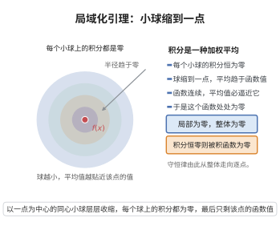

# 体积分局域化引理

> **一句话大白话**：如果某个连续的量在**每一个**小体积上的积分都是零，那么它本身处处为零——因为积分就是取平均，把小体积缩到一点，平均值就收敛到该点的函数值。
>
> **小例子**：若连续密度 $\rho$ 满足“任意小球内的总质量都为零”，则 $\rho\equiv0$；反过来，只要守恒律对每一团物质都成立，就能把“整体陈述”升级为“逐点陈述”，从而得到偏微分方程。

## 一、定理介绍

> **前置依赖**：连续函数与一致连续、Riemann（Lebesgue）积分与积分中值定理、磨光核与 $L^1$ 收敛、高斯散度定理、静态平衡方程

连续介质力学中的守恒律总是先以“整体（积分）形式”出现：任一物质体积的质量不变、任一子体积的动量变化率等于外力、任一闭曲面上的面力主矢为零。要把它们变成可求解的偏微分方程，必须把积分陈述“局域化”为逐点陈述，完成这一步的逻辑工具就是体积分局域化引理。

引理有两副面孔。第一副是**子体积版本**：若连续函数在一切子区域上的积分为零，则函数恒为零。第二副是**试探函数版本**（du Bois-Reymond 引理）：若连续函数与一切具紧支集的 $C^\infty$ 函数配对积分为零，则函数恒为零。前者用于把守恒律写成分散度形式，后者是变分法中的“基本引理”。

引理的本质是局部化：连续函数被其局部积分平均值完全决定，因为球平均在小球收缩时的极限就是函数值。因此任何在“总和”层面成立的恒等式，只要对足够丰富的区域族成立，就必然在每一点成立。

## 几何直观

图意在说明：每个小体积上的积分都为零时，把球缩到一点，平均值趋于函数值，于是函数本身处处为零。

## 二、原理思路

1. **收缩到一点**：取以 $\boldsymbol x_0$ 为心、半径 $r\to0$ 的球 $B_r$。若 $\int_{B_r}\boldsymbol g\,dV=0$ 对一切小 $r$ 成立，则球平均值恒为零。
2. **平均值收敛到函数值**：对连续 $\boldsymbol g$，当 $r\to0$ 时 $\frac{1}{|B_r|}\int_{B_r}\boldsymbol g\,dV\to\boldsymbol g(\boldsymbol x_0)$（由一致连续与积分中值估计）。
3. **得出结论**：$\boldsymbol g(\boldsymbol x_0)=\boldsymbol 0$，而 $\boldsymbol x_0$ 任意，故 $\boldsymbol g\equiv0$。
4. **试探函数版本**：若 $\boldsymbol g$ 与一切 $C^\infty$ 试探场配对为零，先取 $\boldsymbol h=\mathbf 1_U\boldsymbol g$，用磨光核逼近 $\boldsymbol h$，把它们代入配对式再取极限，即得 $\int_U\|\boldsymbol g\|^2=0$，从而 $\boldsymbol g=\boldsymbol 0$ 于 $U$ 上。

## 三、定理的严格表述

**（体积分局域化引理）** 设 $\Omega\subseteq\mathbb R^n$ 为非空开集，$\boldsymbol g\in C(\Omega,\mathbb R^m)$。以下三条等价：

(i)（子体积形式）对任意开集 $U\Subset\Omega$（即 $\overline U$ 紧且 $\overline U\subseteq\Omega$）有
$$
\int_U\boldsymbol g(\boldsymbol x)\,dV=\boldsymbol 0 ;
$$

(ii)（小球形式）对任意 $\boldsymbol x\in\Omega$ 与一切满足 $B_r(\boldsymbol x)\Subset\Omega$ 的 $r>0$ 有
$$
\int_{B_r(\boldsymbol x)}\boldsymbol g(\boldsymbol y)\,dV=\boldsymbol 0 ;
$$

(iii)（试探函数形式）对任意向量值试探场 $\boldsymbol\varphi\in C_c^\infty(\Omega,\mathbb R^m)$ 有
$$
\int_\Omega \boldsymbol g\cdot\boldsymbol\varphi\,dV=0 .
$$

则上述任一条件成立时必有 $\boldsymbol g\equiv\boldsymbol 0$ 于 $\Omega$；特别地三条彼此等价。

**（面力平衡的局域化推论）** 设 $\boldsymbol t:\Omega\times S^{n-1}\to\mathbb R^n$（$n=3$）关于 $(\boldsymbol x,\boldsymbol\nu)$ 连续，$\rho\boldsymbol b\in C(\Omega,\mathbb R^3)$，且对每个边界分片光滑的区域 $V\Subset\Omega$ 有静态平衡
$$
\oint_{\partial V}\boldsymbol t(\boldsymbol x,\boldsymbol\nu)\,dA+\int_V\rho(\boldsymbol x)\boldsymbol b(\boldsymbol x)\,dV=\boldsymbol 0 ,
$$
其中 $\boldsymbol\nu$ 为外法向。则：(1) $\boldsymbol t(\boldsymbol x,-\boldsymbol\nu)=-\boldsymbol t(\boldsymbol x,\boldsymbol\nu)$；(2) 存在连续张量场 $\boldsymbol\sigma$ 使 $\boldsymbol t(\boldsymbol x,\boldsymbol\nu)=\boldsymbol\sigma(\boldsymbol x)\boldsymbol\nu$。

## 四、证明过程

**步骤 1：球平均值收敛到函数值**

设 $\boldsymbol x_0\in\Omega$，取 $r_0>0$ 使 $\overline{B_{2r_0}(\boldsymbol x_0)}\Subset\Omega$。$\boldsymbol g$ 在紧集 $\overline{B_{2r_0}}$ 上一致连续。对 $0<r<r_0$，由积分中值性质与三角不等式

$$
\left\|\frac{1}{|B_r|}\int_{B_r(\boldsymbol x_0)}\boldsymbol g\,dV-\boldsymbol g(\boldsymbol x_0)\right\|
=\left\|\frac{1}{|B_r|}\int_{B_r(\boldsymbol x_0)}\big(\boldsymbol g(\boldsymbol y)-\boldsymbol g(\boldsymbol x_0)\big)dV\right\|
\le\sup_{\boldsymbol y\in B_r(\boldsymbol x_0)}\|\boldsymbol g(\boldsymbol y)-\boldsymbol g(\boldsymbol x_0)\|,
$$

右端当 $r\to0$ 时趋于 $0$。因此
$$
\boldsymbol g(\boldsymbol x_0)=\lim_{r\to0}\frac{1}{|B_r(\boldsymbol x_0)|}\int_{B_r(\boldsymbol x_0)}\boldsymbol g(\boldsymbol y)\,dV .
$$

**步骤 2：(ii) 推出 $\boldsymbol g\equiv\boldsymbol 0$**

设 (ii) 成立，固定任意 $\boldsymbol x_0\in\Omega$。当 $r$ 充分小时 $\int_{B_r(\boldsymbol x_0)}\boldsymbol g\,dV=\boldsymbol 0$，故球平均值恒为 $\boldsymbol 0$。令 $r\to0$，由步骤 1 得 $\boldsymbol g(\boldsymbol x_0)=\boldsymbol 0$。由 $\boldsymbol x_0$ 的任意性，$\boldsymbol g\equiv\boldsymbol 0$。$\square$

**步骤 3：(i) 推出 (ii)**

设 (i) 成立。对 $\boldsymbol x_0\in\Omega$ 取 $r_0=\frac12\mathrm{dist}(\boldsymbol x_0,\partial\Omega)$，则对 $0<r<r_0$ 有 $B_r(\boldsymbol x_0)\Subset\Omega$，取 $U=B_r(\boldsymbol x_0)$ 即得 $\int_{B_r}\boldsymbol g\,dV=\boldsymbol 0$，即 (ii)。$\square$

**步骤 4：(iii) 推出 (i)（磨光论证）**

设 (iii) 成立，取任意开集 $U\Subset\Omega$。令 $\boldsymbol h=\mathbf 1_U\boldsymbol g$（在 $U$ 外取 $\boldsymbol 0$），则 $\boldsymbol h\in L^1(\Omega,\mathbb R^m)$ 且 $\mathrm{supp}\,\boldsymbol h\subseteq\overline U\Subset\Omega$。取标准磨光核 $\rho_\varepsilon(\boldsymbol x)=\varepsilon^{-n}\rho(\boldsymbol x/\varepsilon)$，其中 $\rho\in C_c^\infty(B_1)$、$\rho\ge0$、$\int\rho=1$。当 $\varepsilon$ 充分小时 $\boldsymbol h_\varepsilon=\rho_\varepsilon*\boldsymbol h\in C_c^\infty(\Omega,\mathbb R^m)$，代入 (iii) 得
$$
0=\int_\Omega\boldsymbol g\cdot\boldsymbol h_\varepsilon\,dV .
$$
由磨光的 $L^1$ 收敛性 $\|\boldsymbol h_\varepsilon-\boldsymbol h\|_{L^1}\to0$。又当 $\varepsilon$ 充分小时 $\mathrm{supp}\,\boldsymbol h_\varepsilon$ 落在 $\overline U$ 的一个固定紧邻域 $K\Subset\Omega$ 内，而 $\boldsymbol g$ 在 $K$ 上有界（$M=\sup_K\|\boldsymbol g\|<\infty$），于是
$$
\left|\int_\Omega\boldsymbol g\cdot(\boldsymbol h_\varepsilon-\boldsymbol h)\,dV\right|\le M\|\boldsymbol h_\varepsilon-\boldsymbol h\|_{L^1}\longrightarrow0 .
$$
因此 $\int_\Omega\boldsymbol g\cdot\boldsymbol h\,dV=0$，即 $\int_U\|\boldsymbol g\|^2\,dV=0$。被积函数连续非负，故 $\boldsymbol g=\boldsymbol 0$ 于 $U$ 上，从而 (i) 成立。$\square$

**步骤 5：等价性**

(i) $\Rightarrow$ (ii) 见步骤 3；设 (ii) 成立则由步骤 2 得 $\boldsymbol g\equiv\boldsymbol 0$，此时 (iii) 的被积函数恒为 $0$，故 (iii) 成立；设 (iii) 成立则由步骤 4 得 (i)。三条互相蕴含，故等价。$\square$

**步骤 6：面力局域化推论之 (1)：扁柱体（pillbox）论证**

固定 $\boldsymbol x_0\in\Omega$ 与 $\boldsymbol\nu\in S^2$。对 $A,h>0$ 取以 $\boldsymbol x_0$ 为心、法向为 $\boldsymbol\nu$、底面积为 $A$、厚度为 $h$ 的扁柱体 $V_{A,h}$，其侧面面积 $O(\sqrt A h)$、体积为 $Ah$。对 $V_{A,h}$ 写出平衡式并除以 $A$：
$$
\boldsymbol 0=\frac{1}{A}\int_{\text{顶面}}\boldsymbol t(\boldsymbol x,\boldsymbol\nu)\,dA+\frac{1}{A}\int_{\text{底面}}\boldsymbol t(\boldsymbol x,-\boldsymbol\nu)\,dA+O(h)+\frac{1}{A}\int_{V_{A,h}}\rho\boldsymbol b\,dV .
$$
先令 $A\to0$（$h$ 固定），由 $\boldsymbol t$ 对 $\boldsymbol x$ 的连续性，两个面平均分别收敛到 $\boldsymbol t(\boldsymbol x_0,\boldsymbol\nu)$ 与 $\boldsymbol t(\boldsymbol x_0,-\boldsymbol\nu)$；再令 $h\to0$，其余两项趋于 $0$。故 $\boldsymbol t(\boldsymbol x_0,\boldsymbol\nu)+\boldsymbol t(\boldsymbol x_0,-\boldsymbol\nu)=\boldsymbol 0$，即 $\boldsymbol t$ 关于法向是奇函数。$\square$

**步骤 7：面力局域化推论之 (2)：四面体论证**

取标准正交基 $\boldsymbol e_1,\boldsymbol e_2,\boldsymbol e_3$ 与满足 $\nu_i:=\boldsymbol\nu\cdot\boldsymbol e_i>0$ 的单位向量 $\boldsymbol\nu$。对 $s>0$，考虑以 $\boldsymbol x_0$ 为一个顶点、沿方向 $\boldsymbol e_1,\boldsymbol e_2,\boldsymbol e_3$ 伸长 $s\nu_1,s\nu_2,s\nu_3$ 的四面体 $T_s$：其斜面的外法向为 $\boldsymbol\nu$、面积 $A_s=\frac12 s^2\|\boldsymbol\nu\|=\frac12 s^2$ 的常数倍，三个坐标面的外法向为 $-\boldsymbol e_i$、面积分别为 $\nu_i$ 倍的 $A_s$，体积为 $O(s^3)$。对 $T_s$ 写平衡式并除以 $A_s$：
$$
\boldsymbol 0=\frac{1}{A_s}\int_{\text{斜面}}\boldsymbol t\,dA+\sum_{i=1}^{3}\frac{1}{A_s}\int_{\text{第 }i\text{ 坐标面}}\boldsymbol t\,dA+O(s),
$$
其中 $O(s)$ 来自 $\frac{1}{A_s}\int_{T_s}\rho\boldsymbol b\,dV=O(s)$。对每个面作以 $\boldsymbol x_0$ 为中心的相似缩放，面上被积函数连续且面积按 $s^2$ 缩放，故各面平均分别收敛到 $\boldsymbol t(\boldsymbol x_0,\boldsymbol\nu)$ 与 $\boldsymbol t(\boldsymbol x_0,-\boldsymbol e_i)$。令 $s\to0$ 并用步骤 6 的奇性 $\boldsymbol t(\boldsymbol x_0,-\boldsymbol e_i)=-\boldsymbol t(\boldsymbol x_0,\boldsymbol e_i)$，得
$$
\boldsymbol t(\boldsymbol x_0,\boldsymbol\nu)=\sum_{i=1}^{3}\nu_i\,\boldsymbol t(\boldsymbol x_0,\boldsymbol e_i).
$$
（$\nu_i<0$ 的情形由同一公式与奇性推出，$\nu_i=0$ 由连续性推出。）定义矩阵值连续场 $\boldsymbol\sigma(\boldsymbol x)=\sum_{i=1}^{3}\boldsymbol t(\boldsymbol x,\boldsymbol e_i)\otimes\boldsymbol e_i$，则对一切 $\boldsymbol\nu\in S^2$ 与 $\boldsymbol x\in\Omega$ 有 $\boldsymbol\sigma(\boldsymbol x)\boldsymbol\nu=\sum_i(\boldsymbol\nu\cdot\boldsymbol e_i)\boldsymbol t(\boldsymbol x,\boldsymbol e_i)=\boldsymbol t(\boldsymbol x,\boldsymbol\nu)$，即 $\boldsymbol t=\boldsymbol\sigma\boldsymbol\nu$。$\blacksquare$

## 五、应用与意义

**在连续介质力学中的作用**：

1. **守恒律的局域化**：质量、动量、能量、角动量的积分守恒律均经本引理化为 Euler 形式的场方程。例如 $\int_V\big(\partial_t\rho+\nabla\cdot(\rho\boldsymbol u)\big)dV=0$ 对一切物质体积成立，立即给出连续性方程。
2. **Cauchy 应力定理**：步骤 6、7 表明，“任一子体积上合力为零”的平衡假设足以推出面力的法向奇性与关于法向的线性性，即存在应力张量 $\boldsymbol\sigma$ 使 $\boldsymbol t=\boldsymbol\sigma\boldsymbol n$——这正是 Cauchy 应力张量存在性的完整证明链条。
3. **对称性约化的合法性**：各项同性本构、对称函数与对称张量的表示定理，都以“先对任意子区域成立、再逐点化”的方式使用本引理。

**理论意义**：引理把“弱（积分）陈述”与“强（逐点）陈述”联系起来。在更弱的光滑性下（如 $\boldsymbol g\in L^1_{\mathrm{loc}}$）结论改为几乎处处为零，即**变分法基本引理**（du Bois-Reymond 引理）；再由 Weyl 引理（椭圆方程弱解的正则性）可把“几乎处处”提升为“处处”。本引理只需一致连续与积分平均，是最经济的形式。

**推广**：对流形上的体积形式、对分布（(iii) 即“$\boldsymbol g$ 作为分布为零”）、对测度（Radon–Nikodym 导数）均有对应版本；有限元与间断 Galerkin 方法中的“逐元素局域化 + 通量平衡”正是本引理离散化的思想来源。

## 课堂问答

**老师**：把"任一子体积上守恒"升级为"逐点守恒"，靠的是哪条原理？

**学生**：靠连续函数的局部平均收敛到函数值。若连续 $\boldsymbol g$ 在每个小球的积分都为零，则
$$
\boldsymbol g(\boldsymbol x_0)=\lim_{r\to0}\frac{1}{|B_r(\boldsymbol x_0)|}\int_{B_r(\boldsymbol x_0)}\boldsymbol g\,dV=\boldsymbol 0,
$$
由 $\boldsymbol x_0$ 任意即得 $\boldsymbol g\equiv0$。

**老师（追问）**：试探函数版本为什么更强？

**学生**：它不要求对"区域积分"为零，而是对"配对积分"为零。取 $\boldsymbol h=\mathbf 1_U\boldsymbol g$，用磨光核逼近，代入配对式再取极限，得 $\int_U\|\boldsymbol g\|^2dV=0$，从而 $\boldsymbol g=\boldsymbol 0$。它比强条件更弱，是变分法基本引理的原型。

**老师（拓展）**：它怎样直接推出 Cauchy 应力张量？

**学生**：先对扁柱体做 pillbox 论证得面力关于法向的奇性 $\boldsymbol t(\boldsymbol x,-\boldsymbol\nu)=-\boldsymbol t(\boldsymbol x,\boldsymbol\nu)$，再对四面体令 $s\to0$ 得线性性
$$
\boldsymbol t(\boldsymbol x_0,\boldsymbol\nu)=\sum_{i=1}^{3}\nu_i\,\boldsymbol t(\boldsymbol x_0,\boldsymbol e_i),
$$
于是定义 $\boldsymbol\sigma=\sum_i\boldsymbol t(\boldsymbol e_i)\otimes\boldsymbol e_i$ 便得 $\boldsymbol t=\boldsymbol\sigma\boldsymbol n$。注意若只假设 $L^1_{\mathrm{loc}}$，结论要弱化为几乎处处为零。
