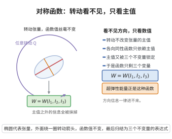

# 对称函数的表示定理

> **一句话大白话**：一个对张量“怎么转动都不变”的函数，其实只看得见张量的主值；而主值又只能通过不变量（迹、迹的平方、迹的立方）被看见，所以任何各向同性的标量函数都只是这几个不变量的函数。
>
> **小例子**：各向同性超弹性的应变能 $W(\boldsymbol C)$ 只能依赖 $I_1=\mathrm{tr}\,\boldsymbol C$、$I_2=\tfrac12\big((\mathrm{tr}\,\boldsymbol C)^2-\mathrm{tr}(\boldsymbol C^2)\big)$、$I_3=\det\boldsymbol C$，写成 $W=W(I_1,I_2,I_3)$ 而不可能依赖 $\boldsymbol C$ 的其它方向信息。

## 一、定理介绍

> **前置依赖**：对称张量的谱定理、置换群与对称函数、对称函数基本定理、Newton 恒等式、Weierstrass逼近定理、紧群上的不变积分（Haar 测度）、Tietze 延拓定理

连续介质力学中的材料若在空间中没有特殊方向（各向同性），其标量型本构量（应变能、屈服函数、损伤因子……）必须满足：把变形张量做任意正交变换后函数值不变。这类函数称为**各向同性（或对称）函数**。表示定理断言：它们恰好是主不变量（等价的：$\mathrm{tr}(\boldsymbol A^k)$）的函数，而且任何这样的不变量函数都给出各向同性函数。

定理的价值在于把“对无穷多个旋转不变”这一无限多个约束，压缩为“只依赖有限个不变量”这一有限表述。它因此成为构造本构模型的统一框架：先由表示定理确定自变量只能是哪些不变量，再用实验数据拟合具体的函数形式。

在代数上，定理是“对称多项式基本定理”的连续/光滑版本：矩阵的谱定理把张量问题化为特征值向量的问题，而对特征值向量的旋转不变性正是置换不变性（对称性），于是问题归结为对称函数如何由基本对称多项式表出。Newton 恒等式再把基本对称多项式翻译成迹类不变量，得到工程上最常用的形式。

## 几何直观

图意在说明：各向同性函数在任意转动下取值不变，因此只看得见主值，而主值又只由三个不变量决定。

## 二、原理思路

1. **对角化**：由对称张量的谱定理，$\boldsymbol A=\boldsymbol Q\,\mathrm{diag}(\lambda_1,\dots,\lambda_n)\,\boldsymbol Q^{\top}$，故正交不变性等价于“函数只通过特征值多重集依赖 $\boldsymbol A$”。
2. **化为对称函数**：定义 $F(\lambda_1,\dots,\lambda_n)=f(\mathrm{diag}(\lambda_1,\dots,\lambda_n))$，则 $F$ 关于坐标的任意置换不变，即 $F$ 是对称函数。
3. **对称 → 基本对称多项式**：由基本对称多项式定理，对称多项式可唯一写成 $e_1,\dots,e_n$ 的多项式；连续情形则先用 Haar 积分把逼近多项式“对称化”，再取极限并延拓。
4. **基本对称 → 迹类不变量**：由 Newton 恒等式，$e_k$ 是 $p_1,\dots,p_k$ 的有理系数多项式，其中 $p_k=\sum_i\lambda_i^k=\mathrm{tr}(\boldsymbol A^k)$。

## 三、定理的严格表述

**（对称函数的表示定理）** 设 $\mathrm{Sym}_n(\mathbb R)=\{\boldsymbol A\in\mathbb R^{n\times n}:\boldsymbol A^{\top}=\boldsymbol A\}$。设 $f:\mathrm{Sym}_n(\mathbb R)\to\mathbb R$ 连续，且满足**正交不变性**（各向同性）
$$
f(\boldsymbol Q\boldsymbol A\boldsymbol Q^{\top})=f(\boldsymbol A),\qquad \forall\,\boldsymbol A\in\mathrm{Sym}_n(\mathbb R),\ \forall\,\boldsymbol Q\in O(n).
$$
记 $p_k(\boldsymbol A)=\mathrm{tr}(\boldsymbol A^k)$（$k=1,\dots,n$），$I=(p_1,\dots,p_n):\mathrm{Sym}_n(\mathbb R)\to\mathbb R^n$。则存在连续函数 $\Phi:\mathbb R^n\to\mathbb R$ 使
$$
f(\boldsymbol A)=\Phi\big(p_1(\boldsymbol A),\ p_2(\boldsymbol A),\ \dots,\ p_n(\boldsymbol A)\big),\qquad \forall\,\boldsymbol A\in\mathrm{Sym}_n(\mathbb R).
$$

**等价（基本对称函数）形式**：对 $\boldsymbol A$ 的特征值 $\lambda(\boldsymbol A)=(\lambda_1,\dots,\lambda_n)$ 定义初等对称函数
$$
e_k(\boldsymbol A)=\sum_{1\le i_1<\cdots<i_k\le n}\lambda_{i_1}\cdots\lambda_{i_k},\qquad k=1,\dots,n ,
$$
则存在连续函数 $\Psi:\mathbb R^n\to\mathbb R$ 使
$$
f(\boldsymbol A)=\Psi\big(e_1(\boldsymbol A),\dots,e_n(\boldsymbol A)\big).
$$

**正则性加强**：若 $f$ 是矩阵元素的多项式（相应地，$C^\infty$），则 $\Phi,\Psi$ 也可取为多项式（相应地，在像集上 $C^\infty$）。

**注（逆方向显然成立）**：对任意函数 $\Phi$，$\boldsymbol A\mapsto\Phi(p_1(\boldsymbol A),\dots,p_n(\boldsymbol A))$ 必满足正交不变性，因为 $\mathrm{tr}\big((\boldsymbol Q\boldsymbol A\boldsymbol Q^{\top})^k\big)=\mathrm{tr}(\boldsymbol A^k)$。故定理给出的表示是“恰好的”。

## 四、证明过程

**步骤 1：谱定理化归为特征值问题**

由对称张量的谱定理，$\boldsymbol A=\boldsymbol Q\,\Lambda\,\boldsymbol Q^{\top}$，$\Lambda=\mathrm{diag}(\lambda_1,\dots,\lambda_n)$，$\boldsymbol Q\in O(n)$。由正交不变性，
$$
f(\boldsymbol A)=f(\Lambda),\qquad \Lambda=\mathrm{diag}(\lambda_1,\dots,\lambda_n).
$$
定义 $F(\lambda_1,\dots,\lambda_n):=f(\mathrm{diag}(\lambda_1,\dots,\lambda_n))$。特征值的次序可以任取（谱定理中特征向量可任意排列），而 $f(\mathrm{diag}(\lambda))$ 不依赖于排列，故 $F$ 是**对称函数**：
$$
F(\lambda_{\sigma(1)},\dots,\lambda_{\sigma(n)})=F(\lambda_1,\dots,\lambda_n),\qquad \forall\,\sigma\in S_n .
$$
于是 $f(\boldsymbol A)=F(\lambda(\boldsymbol A))$ 只通过特征值的多重集依赖 $\boldsymbol A$。$\square$

**步骤 2：多项式情形（基本对称多项式定理）**

先设 $f$ 是矩阵元素的多项式。取 $\boldsymbol A=\mathrm{diag}(\lambda)$，则 $f(\mathrm{diag}(\lambda))=F(\lambda)$ 是 $\lambda$ 的多项式，且由步骤 1 是对称多项式。由**基本对称多项式定理**，存在唯一的多项式 $G\in\mathbb R[x_1,\dots,x_n]$ 使
$$
F(\lambda)=G\big(e_1(\lambda),\dots,e_n(\lambda)\big),\qquad \forall\lambda\in\mathbb R^n .
$$
（唯一性来自 $e_1,\dots,e_n$ 代数无关；存在性由对称多项式的标准归纳证明：把 $F$ 按首项对应的字典序，减去 $x_1^{a_1-a_2}\cdots x_n^{a_n}$ 型的单项式后降低首项指数。）$\square$

**步骤 3：多项式情形（Newton 恒等式化为迹类不变量）**

对 $n$ 个变量，令 $p_k(\lambda)=\sum_{i=1}^n\lambda_i^k$。Newton 恒等式给出
$$
k\,e_k=\sum_{i=1}^{k}(-1)^{i-1}e_{k-i}\,p_i,\qquad k=1,\dots,n .
$$
由之递推可知每个 $e_k$ 都是 $p_1,\dots,p_k$ 的、系数为有理数的多项式：例如
$$
e_1=p_1,\qquad e_2=\tfrac12\big(p_1^2-p_2\big),\qquad e_3=\tfrac16\big(p_1^3-3p_1p_2+2p_3\big).
$$
于是存在多项式 $\Theta=(\Theta_1,\dots,\Theta_n):\mathbb R^n\to\mathbb R^n$ 使 $e_k(\lambda)=\Theta_k(p_1(\lambda),\dots,p_n(\lambda))$。对 $\boldsymbol A$ 取特征值 $\lambda=\lambda(\boldsymbol A)$，注意 $p_k(\lambda)=\mathrm{tr}(\boldsymbol A^k)$，故 $e_k(\boldsymbol A)=\Theta_k(p_1(\boldsymbol A),\dots,p_n(\boldsymbol A))$。代入步骤 2：
$$
f(\boldsymbol A)=G\big(\Theta_1(p(\boldsymbol A)),\dots,\Theta_n(p(\boldsymbol A))\big)=:\Phi\big(p(\boldsymbol A)\big),
$$
其中 $\Phi=G\circ\Theta$ 是多项式，且 $\Phi$ 不依赖 $\boldsymbol A$ 的选取。$\square$

**步骤 4：连续情形（对称化 Weierstrass 逼近）**

设 $f$ 连续（不必多项式）。固定 $R>0$，$\mathcal K_R=\{\boldsymbol A\in\mathrm{Sym}_n:\|\boldsymbol A\|\le R\}$ 是紧凸集。由 Weierstrass 逼近定理，存在多项式 $f_m$ 使 $\sup_{\mathcal K_R}|f_m-f|\le 1/m$。

$f_m$ 未必各向同性，故把它在紧群 $O(n)$ 上用 Haar 概率测度 $\mu$ 平均，定义
$$
\tilde f_m(\boldsymbol A)=\int_{O(n)}f_m(\boldsymbol Q\boldsymbol A\boldsymbol Q^{\top})\,d\mu(\boldsymbol Q).
$$
由测度的平移不变性，$\tilde f_m$ 是各向同性的多项式；又 $f$ 各向同性，故对 $\boldsymbol A\in\mathcal K_R$
$$
|\tilde f_m(\boldsymbol A)-f(\boldsymbol A)|=\Big|\int_{O(n)}\big(f_m-f\big)(\boldsymbol Q\boldsymbol A\boldsymbol Q^{\top})d\mu\Big|\le\sup_{\boldsymbol Q\in O(n)}\big|f_m(\boldsymbol Q\boldsymbol A\boldsymbol Q^{\top})-f(\boldsymbol Q\boldsymbol A\boldsymbol Q^{\top})\big|\le \frac1m,
$$
因为 $\boldsymbol Q\boldsymbol A\boldsymbol Q^{\top}\in\mathcal K_R$（正交变换保持 Frobenius 范数）。

**步骤 5：取极限得到 $\Phi$**

对每个 $m$，由步骤 2、3 存在多项式 $\Phi_m$ 使 $\tilde f_m(\boldsymbol A)=\Phi_m(p(\boldsymbol A))$ 对一切 $\boldsymbol A$ 成立（把 $\tilde f_m$ 视为矩阵元素的多项式，代入 $\boldsymbol A=\mathrm{diag}(\lambda)$ 后按同样的推导）。

记 $E=I(\mathrm{Sym}_n)=\{p(\boldsymbol A):\boldsymbol A\in\mathrm{Sym}_n\}\subseteq\mathbb R^n$ 为像集，并记 $E_R=I(\mathcal K_R)$。由步骤 4，$(\Phi_m)$ 在 $E_R$ 上一致收敛（因为对 $\lambda\in E_R$ 有 $\lambda=p(\boldsymbol A)$，$\boldsymbol A\in\mathcal K_R$）：
$$
|\Phi_m(\lambda)-\Phi_l(\lambda)|=|\tilde f_m(\boldsymbol A)-\tilde f_l(\boldsymbol A)|\le\frac1m+\frac1l .
$$
又 $I$ 是连续映射，$E_R$ 是紧集；对 $E$ 取紧子集的可数穷竭（$E_R\nearrow E$，因为 $\boldsymbol A$ 的范数随 $p_1,\dots,p_n$ 的界而受界），用对角线法可定义 $\Phi:E\to\mathbb R$ 为一致极限：
$$
\Phi(\lambda)=\lim_{m\to\infty}\Phi_m(\lambda),\qquad \lambda\in E ,
$$
且 $\Phi$ 在 $E$ 的每个紧子集上连续，故 $\Phi$ 在 $E$ 上连续。由 Tietze 延拓定理把 $\Phi$ 延拓为 $\mathbb R^n$ 上的连续函数（仍记作 $\Phi$）。

对任意 $\boldsymbol A\in\mathrm{Sym}_n$，取 $R\ge\|\boldsymbol A\|$，则
$$
f(\boldsymbol A)=\lim_{m}\tilde f_m(\boldsymbol A)=\lim_{m}\Phi_m(p(\boldsymbol A))=\Phi(p(\boldsymbol A)),
$$
即所需表示。把 $p_k$ 用 Newton 恒等式（步骤 3）换成 $e_k$，即得等价形式（$\Psi=\Phi\circ\Theta$ 的逆变换）。$\square$

**步骤 6：正则性加强**

若 $f$ 是多项式，步骤 2、3 中的 $G,\Theta$ 均为多项式，故 $\Phi$ 为多项式。若 $f\in C^\infty$，则在步骤 2 中改用“对称多项式环由 $e_1,\dots,e_n$ 自由生成”的 $C^\infty$ 版本（对称光滑函数必是 $e$ 的光滑函数，可由步骤 4 的对称化逼近在 $C^\infty$ 拓扑下同样成立），得到 $G\in C^\infty$；再与 $\Theta$ 复合得 $\Phi\in C^\infty$ 于 $E$ 上，并由 Whitney 延拓定理延拓到 $\mathbb R^n$。$\blacksquare$

## 五、应用与意义

**在连续介质力学与材料建模中的作用**：

1. **各向同性本构**：弹性张量/储能函数 $W=W(I_1,I_2,I_3)$ 的合法性由本定理保证；配合 Cayley–Hamilton 定理即得张量值表示 $\boldsymbol\sigma=\alpha_0\boldsymbol I+\alpha_1\boldsymbol b+\alpha_2\boldsymbol b^2$，$\alpha_k=\alpha_k(I_1,I_2,I_3)$（Neo-Hookean、Mooney–Rivlin 模型等）。
2. **屈服与破坏准则**：von Mises（依赖 $J_2$）、Drucker–Prager、Mohr–Coulomb 等准则都是不变量的函数，本定理说明这是各向同性假设的必然结论，而非人为简化。
3. **实验设计**：由定理可知，确定各向同性材料本构只需在“不变量空间”中做实验，无需考虑加载方向，从而大幅减少实验量。

**理论意义**：定理是对称多项式的“连续/光滑化”，把群作用下的不变理论落实到具体的不变量生成元；它与对称张量的谱定理（把张量约化为特征值多重集）一起构成“不变量方法”的两大支柱。

**推广**：一般紧群 $G$ 的实表示下的不变函数由不变多项式生成（Hilbert 不变量理论、不变式环的有限生成性）；张量值各向同性函数表示定理（Rivlin–Ericksen、Wang 的“结构张量”/生成元方法）把标量情形推广到张量值映射；对晶体点群（各向异性材料）可得到依赖方向不变量（结构张量）的对应表示定理。

## 课堂问答

**老师**：为什么"没有特殊方向"的材料，其标量本构只能依赖有限几个不变量？

**学生**：因为各向同性函数对一切旋转不变，由谱定理它只看得见特征值的多重集，即
$$
f(\boldsymbol Q\boldsymbol A\boldsymbol Q^\top)=f(\boldsymbol A)\quad\Longrightarrow\quad f(\boldsymbol A)=F(\lambda_1,\dots,\lambda_n),
$$
而 $F$ 关于置换对称，必是初等对称多项式（等价地迹类不变量 $\mathrm{tr}(\boldsymbol A^k)$）的函数。无限多个旋转约束被压缩成有限个不变量。

**老师（追问）**：对称函数怎么过渡到"迹不变量"？

**学生**：用 Newton 恒等式把初等对称函数 $e_k$ 用幂和 $p_k=\sum_i\lambda_i^k=\mathrm{tr}(\boldsymbol A^k)$ 表出，例如
$$
e_2=\tfrac12\big(p_1^2-p_2\big),\qquad e_3=\tfrac16\big(p_1^3-3p_1p_2+2p_3\big).
$$
连续情形先对多项式做 Haar 平均对称化，再取一致极限并用 Tietze 延拓。

**老师（拓展）**：为什么说这个表示是"恰好"的？

**学生**：因为逆方向显然成立：$\boldsymbol A\mapsto\Phi(\mathrm{tr}\boldsymbol A,\dots,\mathrm{tr}\boldsymbol A^n)$ 对任意 $\Phi$ 都正交不变，故不变量函数集与各向同性函数集完全一致。工程上应变能 $W=W(I_1,I_2,I_3)$ 的合法性正源于此，配合 Cayley-Hamilton 还可推出张量值表示 $\boldsymbol\sigma=\alpha_0\boldsymbol I+\alpha_1\boldsymbol b+\alpha_2\boldsymbol b^2$。
