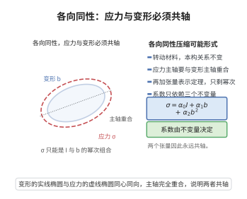

# 本构方程的各向同性表示

> **一句话大白话**：材料各向同性意味着“怎么转都一样”，于是应力张量必然能写成变形张量自身的、$\boldsymbol I,\boldsymbol b,\boldsymbol b^2$ 的组合，系数只跟三个不变量有关。
>
> **小例子**：橡胶、金属这么“各向同性”的材料，其内部应力总能用压力项加剪切成比例的 $\boldsymbol b$ 项再加高阶 $\boldsymbol b^2$ 项拼出来。

## 一、定理介绍

> **前置依赖**：张量代数（迹与行列式）、主不变量理论、Cayley-Hamilton定理、正交变换与各向同性、对称函数的表示定理。

各向同性张量函数表示定理给出最一般的各向同性弹性本构：Cauchy 应力可表示为 $\boldsymbol\sigma=\mathcal{G}(\boldsymbol b)$，且可写为 $\boldsymbol I,\boldsymbol b,\boldsymbol b^2$ 的线性组合，系数是 $\boldsymbol b$ 主不变量的函数。它是构造本构模型的统一框架。

## 几何直观

图意在说明：材料各向同性时应力主轴必须与变形主轴重合，于是应力只能写成单位张量与变形张量幂次的组合。

## 二、原理思路

各向同性要求本构在正交变换下不变，故 $\boldsymbol\sigma=\mathcal{G}(\boldsymbol b)$ 中 $\mathcal{G}$ 为各向同性张量函数，即 $\boldsymbol\sigma$ 与 $\boldsymbol b$ 同轴、特征值互为对称函数。Cayley-Hamilton 定理保证 $\boldsymbol b^n$（$n\ge3$）可由 $\boldsymbol I,\boldsymbol b,\boldsymbol b^2$ 表出，故可作此线性表示。

## 三、定理的严格表述

对各向同性弹性材料，存在三条标量函数 $\alpha_0,\alpha_1,\alpha_2$ 使得
$$
\boldsymbol\sigma=\alpha_0\boldsymbol I+\alpha_1\boldsymbol b+\alpha_2\boldsymbol b^2,
$$
其中 $\alpha_k=\alpha_k(I_1,I_2,I_3)$，而
$$
I_1=\mathrm{tr}(\boldsymbol b),\quad
I_2=\tfrac12\big((\mathrm{tr}\,\boldsymbol b)^2-\mathrm{tr}(\boldsymbol b^2)\big),\quad
I_3=\det\boldsymbol b.
$$

## 四、证明过程

1. **各向同性定义**。要求对所有正交 $\boldsymbol Q$ 有 $\boldsymbol Q\boldsymbol\sigma\boldsymbol Q^{\top}=\mathcal{G}(\boldsymbol Q\boldsymbol b\boldsymbol Q^{\top})$。
2. **同轴性**。由对称性 $\boldsymbol\sigma$ 与 $\boldsymbol b$ 同轴，其特征值 $\sigma_i$ 是 $\boldsymbol b$ 特征值 $\lambda_j^2$ 的对称函数，故可由不变量参数化。
3. **Cayley-Hamilton**。$\boldsymbol b^3-I_1\boldsymbol b^2+I_2\boldsymbol b-I_3\boldsymbol I=\boldsymbol 0$，故高次幂皆可归到 $\boldsymbol I,\boldsymbol b,\boldsymbol b^2$。
4. **线性组合**。对称张量空间内 $\boldsymbol I,\boldsymbol b,\boldsymbol b^2$（特征值互异时）成基，得 $\boldsymbol\sigma=\alpha_0\boldsymbol I+\alpha_1\boldsymbol b+\alpha_2\boldsymbol b^2$。

## 五、应用与意义

该表示是构造 Neo-Hookean、Mooney-Rivlin 等超弹性模型以及规范非线性胡克定律的基础。它把“各向同性”约束转化为明确的三参数形式，广泛应用于大变形弹性、聚合物与生物软组织建模。

## 课堂问答

**老师**：各向同性材料的应力为什么能写成 $\boldsymbol I,\boldsymbol b,\boldsymbol b^2$ 的组合？

**学生**：因为各向同性要求 $\boldsymbol Q\boldsymbol\sigma\boldsymbol Q^\top=\mathcal{G}(\boldsymbol Q\boldsymbol b\boldsymbol Q^\top)$，于是 $\boldsymbol\sigma$ 与 $\boldsymbol b$ 同轴、特征值互为对称函数，加上 Cayley-Hamilton 把 $\boldsymbol b^n\ (n\ge3)$ 降次，就得到
$$
\boldsymbol\sigma=\alpha_0\boldsymbol I+\alpha_1\boldsymbol b+\alpha_2\boldsymbol b^2,\qquad \alpha_k=\alpha_k(I_1,I_2,I_3).
$$

**老师（追问）**：为什么恰好三项，而不是更多？

**学生**：因为三维对称张量空间里 $\{\boldsymbol I,\boldsymbol b,\boldsymbol b^2\}$（特征值互异时）就是一组基，且 Cayley-Hamilton
$$
\boldsymbol b^3-I_1\boldsymbol b^2+I_2\boldsymbol b-I_3\boldsymbol I=\boldsymbol 0
$$
保证更高次幂都可约化成这三者。三维是"三项"的根本原因，一般 $n$ 维需要 $\boldsymbol I,\boldsymbol b,\dots,\boldsymbol b^{n-1}$。

**老师（拓展）**：$I_1,I_2,I_3$ 为什么要取这几组不变量？

**学生**：它们等价于 $\mathrm{tr}\boldsymbol b,\ \mathrm{tr}(\boldsymbol b^2),\ \det\boldsymbol b$，由 Newton 恒等式互相转换，是各向同性函数唯一能"看见"的量。工程上对右 Cauchy-Green 张量 $\boldsymbol b=\boldsymbol F\boldsymbol F^\top$ 用这套表示即得 Neo-Hookean、Mooney-Rivlin 模型，系数 $\alpha_k$ 的自由度只能靠实验标定。
