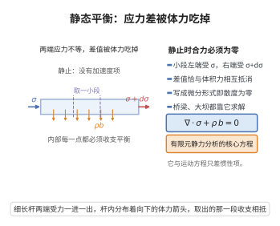

# 静态平衡方程

> **一句话大白话**：物体保持静止时，它内部每一小块受到的体力与面力必须恰好互相抵消，写成微分形式就是 $\nabla\cdot\boldsymbol\sigma+\rho\boldsymbol b=\boldsymbol 0$。
>
> **小例子**：搁在桌上的砖、静止的大坝与桥梁，内部每一点都满足这一方程；有限元静力分析求解的正是它。

## 一、定理介绍

> **前置依赖**：体积分局域化引理、Cauchy应力张量的存在性、高斯散度定理、运动方程（Cauchy第一运动定律）、对称张量的谱定理

静态平衡方程是连续介质力学在**加速度为零**情形下的场方程，即 Cauchy 第一运动定律（动量守恒）去掉惯性项后的特殊形式：

$$
\nabla\cdot\boldsymbol\sigma(\boldsymbol x)+\rho(\boldsymbol x)\,\boldsymbol b(\boldsymbol x)=\boldsymbol 0,
$$

其中 $\boldsymbol\sigma$ 为 Cauchy 应力张量，$\rho$ 为质量密度，$\boldsymbol b$ 为单位质量的体力（如重力）；配套的还有角动量平衡给出的应力张量对称性 $\boldsymbol\sigma=\boldsymbol\sigma^{\top}$。静力学的原始表述只是"任一子区域上合力为零、合力矩为零"，本条目把这种整体平衡局域化为逐点场方程，并推出 $\boldsymbol\sigma$ 的对称性。

## 几何直观

图意在说明：静止时没有惯性项，两端应力的差值与体积力恰好抵消，写开就是应力散度加体力等于零。

## 二、原理思路

证明分三层：

1. **由整体到积分形式**：静力平衡对任意子区域 $V$ 成立：面力主矢 $\oint_{\partial V}\boldsymbol\sigma\boldsymbol n\,dA$ 与体力主矢 $\int_V\rho\boldsymbol b\,dV$ 之和为零。
2. **由面积分到体积分**：用高斯散度定理把 $\oint_{\partial V}\boldsymbol\sigma\boldsymbol n\,dA$ 化为 $\int_V\nabla\cdot\boldsymbol\sigma\,dV$，得到在任意 $V$ 上积分为零的量。
3. **局域化**：由体积分局域化引理，积分恒为零推出被积函数逐点为零；对力矩平衡作同样处理即得对称性。

## 三、定理的严格表述

**（静态平衡方程）** 设连续体占据开区域 $\Omega\subseteq\mathbb R^3$，$\rho\in C(\Omega)$，体力密度 $\rho\boldsymbol b\in C(\Omega,\mathbb R^3)$，Cauchy 应力张量 $\boldsymbol\sigma\in C^1(\Omega,\mathbb R^{3\times3})$（存在性由 Cauchy应力张量的存在性 给出）。若对每个边界分片光滑的子区域 $V\Subset\Omega$ 有静力平衡与静力矩平衡

$$
\oint_{\partial V}\boldsymbol\sigma\boldsymbol n\,dA+\int_V\rho\boldsymbol b\,dV=\boldsymbol 0, \tag{F}
$$

$$
\oint_{\partial V}\boldsymbol x\times(\boldsymbol\sigma\boldsymbol n)\,dA+\int_V\boldsymbol x\times\rho\boldsymbol b\,dV=\boldsymbol 0, \tag{M}
$$

其中 $\boldsymbol n$ 为 $\partial V$ 的单位外法向，则

$$
\nabla\cdot\boldsymbol\sigma+\rho\boldsymbol b=\boldsymbol 0\quad\text{于 }\Omega,\qquad
\boldsymbol\sigma=\boldsymbol\sigma^{\top}\quad\text{于 }\Omega .
$$

反之，若上述两式成立，则对一切 $V\Subset\Omega$ 有 (F) 与 (M)。

## 四、证明过程

**步骤 1：把面力化为体积分**

对固定 $V$ 与任意常向量 $\boldsymbol a\in\mathbb R^3$，对向量场 $\boldsymbol\sigma^{\top}\boldsymbol a\in C^1$ 用高斯散度定理：

$$
\boldsymbol a\cdot\oint_{\partial V}\boldsymbol\sigma\boldsymbol n\,dA
=\oint_{\partial V}(\boldsymbol\sigma^{\top}\boldsymbol a)\cdot\boldsymbol n\,dA
=\int_V\nabla\cdot(\boldsymbol\sigma^{\top}\boldsymbol a)\,dV
=\boldsymbol a\cdot\int_V\nabla\cdot\boldsymbol\sigma\,dV .
$$

由 $\boldsymbol a$ 任意，得 $\oint_{\partial V}\boldsymbol\sigma\boldsymbol n\,dA=\int_V\nabla\cdot\boldsymbol\sigma\,dV$。

**步骤 2：局域化得到平衡方程**

代入 (F) 得 $\int_V\big(\nabla\cdot\boldsymbol\sigma+\rho\boldsymbol b\big)dV=\boldsymbol 0$ 对一切 $V\Subset\Omega$。被积函数 $\boldsymbol g:=\nabla\cdot\boldsymbol\sigma+\rho\boldsymbol b$ 连续，由体积分局域化引理（小球形式），对任意 $\boldsymbol x_0\in\Omega$ 令 $r\to0$，球平均值收敛到 $\boldsymbol g(\boldsymbol x_0)$ 而恒为零，故 $\boldsymbol g(\boldsymbol x_0)=\boldsymbol 0$。由 $\boldsymbol x_0$ 的任意性，

$$
\nabla\cdot\boldsymbol\sigma+\rho\boldsymbol b=\boldsymbol 0\quad\text{于 }\Omega . \qquad\square
$$

**步骤 3：由力矩平衡推出对称性**

用 Levi-Civita 符号 $\varepsilon_{ijk}$（全反对称，$\varepsilon_{123}=1$）写出叉积分量。面力矩第 $i$ 个分量经散度定理与乘积法则 $\partial_l(x_j\sigma_{kl})=\sigma_{kj}+x_j\partial_l\sigma_{kl}$ 化为

$$
\Big(\oint_{\partial V}\boldsymbol x\times(\boldsymbol\sigma\boldsymbol n)\,dA\Big)_i
=\int_V\varepsilon_{ijk}\sigma_{kj}\,dV+\int_V\varepsilon_{ijk}x_j\,\partial_l\sigma_{kl}\,dV .
$$

把它与体力矩 $\big(\int_V\boldsymbol x\times\rho\boldsymbol b\,dV\big)_i=\int_V\varepsilon_{ijk}x_j\rho b_k\,dV$ 代入 (M)，并利用步骤 2 中 $\partial_l\sigma_{kl}+\rho b_k=0$，得

$$
\int_V\varepsilon_{ijk}\sigma_{kj}\,dV=0\qquad\text{对一切 }V\Subset\Omega .
$$

再用体积分局域化引理，被积函数逐点为零，即对每个 $i$ 有 $\varepsilon_{ijk}\sigma_{kj}=0$。由 $\varepsilon$ 的全反对称性，这等价于

$$
\sigma_{kj}=\sigma_{jk},\qquad\text{即}\qquad \boldsymbol\sigma=\boldsymbol\sigma^{\top}\quad\text{于 }\Omega . \qquad\square
$$

**步骤 4：充分性**

反之设 $\nabla\cdot\boldsymbol\sigma+\rho\boldsymbol b=\boldsymbol 0$ 且 $\boldsymbol\sigma=\boldsymbol\sigma^{\top}$。对任意 $V\Subset\Omega$，(F) 左端由步骤 1 等于 $\int_V(\nabla\cdot\boldsymbol\sigma+\rho\boldsymbol b)dV=\boldsymbol 0$；(M) 左端等于 $\int_V\varepsilon_{ijk}\sigma_{kj}\,dV+\int_V\varepsilon_{ijk}x_j(\partial_l\sigma_{kl}+\rho b_k)dV$，两项分别由对称性与平衡方程为零。故 (F) 与 (M) 成立。$\blacksquare$

## 五、应用与意义

**在连续介质力学中的作用**：

1. **静力问题的基本方程**：弹性力学、土力学与岩石力学的静力问题都以 $\nabla\cdot\boldsymbol\sigma+\rho\boldsymbol b=\boldsymbol 0$ 与几何方程、本构方程联立求解，有限元方法求解的正是它的弱形式。
2. **主应力的存在**：由 $\boldsymbol\sigma=\boldsymbol\sigma^{\top}$，对称张量的谱定理给出三个实特征值（主应力）与一组正交特征方向（主方向），这是 Mohr 圆与应力分类的依据。
3. **流体静力学**：对静止流体 $\boldsymbol\sigma=-p\boldsymbol I$，平衡方程退化为 $\nabla p=\rho\boldsymbol b$，是帕斯卡原理与浮力定律的场方程基础。

**理论意义**：本条目展示了"整体平衡 $\Rightarrow$ 逐点平衡"的完整链条——Cauchy 应力定理先把面力写成 $\boldsymbol\sigma\boldsymbol n$，散度定理把面力化为体积分，体积分局域化引理再把积分陈述升级为逐点陈述。运动方程（Cauchy第一运动定律）在加速度为零时即退化为本方程，非静止情形须保留惯性项 $\rho\dot{\boldsymbol v}$。含体力偶的极性介质中角动量平衡需加入力偶应力项，此时 $\boldsymbol\sigma$ 一般不对称（Cosserat 连续体、液晶力学）。

## 课堂问答

**老师**：静止物体的场方程是什么？

**学生**：是 Cauchy 第一运动定律去掉惯性项：
$$
\nabla\cdot\boldsymbol\sigma+\rho\boldsymbol b=\boldsymbol 0,
$$
并配以角动量平衡给出的对称性 $\boldsymbol\sigma=\boldsymbol\sigma^\top$。有限元静力分析求解的正是它。

**老师（追问）**：从"任一子区域合力、合力矩为零"到逐点方程，中间靠什么？

**学生**：两步。先用散度定理把面力 $\oint_{\partial V}\boldsymbol\sigma\boldsymbol n\,dA$ 化为 $\int_V\nabla\cdot\boldsymbol\sigma\,dV$；再用体积分局域化引理把"任意 $V$ 上积分为零"升级为"被积函数逐点为零"。力矩平衡同理，用 $\partial_l(x_j\sigma_{kl})=\sigma_{kj}+x_j\partial_l\sigma_{kl}$ 展开面力矩，配 $\varepsilon_{ijk}$ 得
$$
\int_V\varepsilon_{ijk}\sigma_{kj}\,dV=0\ \Longrightarrow\ \sigma_{kj}=\sigma_{jk}.
$$

**老师（拓展）**：为什么对称性这么重要，它失效的场合又在哪？

**学生**：对称性让对称张量的谱定理可用，从而有主应力与主方向，是 Mohr 圆与屈服准则的前提。对静止流体 $\boldsymbol\sigma=-p\boldsymbol I$ 时方程退化为 $\nabla p=\rho\boldsymbol b$，即帕斯卡原理与浮力定律的场方程；若介质含体力偶（Cosserat 连续体、液晶），角动量平衡要加力偶应力项，$\boldsymbol\sigma$ 一般不再对称。
