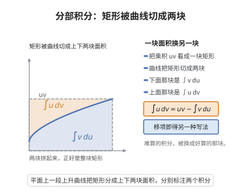

# 分部积分法

> **一句话大白话**：把一个不好算的积分，通过“拆下一个函数求导、换给另一个函数去积”，变成更好算的积分；本质是乘积求导的逆运算。
>
> **小例子**：$\int x e^x\,dx$，取 $u=x$、$dv=e^x dx$，解得 $xe^x-\int e^x\,dx=e^x(x-1)+C$。

## 介绍

分部积分法（Integration by Parts）是微积分中重要的积分计算方法，由乘法法则逆向推导而来。该方法的实质是将一个复杂的积分转化为另一个可能更容易计算的积分。分部积分法在求解含有三角函数、指数函数和对数函数乘积的积分时尤为有效，广泛应用于物理、工程和概率论等领域。

## 几何直观

图意在说明：乘积 uv 这块矩形的面积由两个积分拼成，移项就得到分部积分公式。

## 分析

**前置依赖**：乘积求导法则、微积分基本定理

**定理内容**：若 $u(x)$ 和 $v(x)$ 在区间 $[a,b]$ 上具有连续导数，则
$$\int u\,dv = uv - \int v\,du$$

写成定积分形式为
$$\int_a^b u(x)v'(x)\,dx = u(x)v(x)\Big|_a^b - \int_a^b v(x)u'(x)\,dx$$

**数学内涵**：
分部积分法是乘积求导法则的逆运算。乘法法则 $(uv)' = u'v + uv'$ 两边积分并移项即得分部积分公式。该公式将一个积分 $\int uv'$ 转换为另一个积分 $\int u'v$，关键在于合理选择 $u$ 和 $v'$，使得新积分更易计算。其核心思想是通过交换求导对象来简化问题。

**证明策略**：对乘法法则 $(uv)' = u'v + uv'$ 两边积分，利用微积分基本定理推导。

## 思考过程

由乘法法则 $(uv)' = u'v + uv'$，两边取不定积分得
$$\int (uv)'\,dx = \int u'v\,dx + \int uv'\,dx$$
即 $uv = \int v\,du + \int u\,dv$，移项即得 $\int u\,dv = uv - \int v\,du$。

记忆口诀："反对幂指三"——按反三角函数、对数函数、幂函数、指数函数、三角函数的顺序，排在前面的优先选为 $u$。

## 证明过程

**定理**：设 $u(x)$ 和 $v(x)$ 在 $[a,b]$ 上具有连续导数，则
$$\int_a^b u(x)v'(x)\,dx = u(x)v(x)\Big|_a^b - \int_a^b u'(x)v(x)\,dx$$

**证明**：

考虑函数 $u(x)v(x)$ 的导数。由乘法法则，
$$(u(x)v(x))' = u'(x)v(x) + u(x)v'(x)$$

对等式两边在区间 $[a,b]$ 上积分：
$$\int_a^b (u(x)v(x))'\,dx = \int_a^b u'(x)v(x)\,dx + \int_a^b u(x)v'(x)\,dx$$

由微积分基本定理（牛顿-莱布尼茨公式），左边为
$$\int_a^b (u(x)v(x))'\,dx = u(x)v(x)\Big|_a^b = u(b)v(b) - u(a)v(a)$$

因此
$$u(b)v(b) - u(a)v(a) = \int_a^b u'(x)v(x)\,dx + \int_a^b u(x)v'(x)\,dx$$

移项即得
$$\int_a^b u(x)v'(x)\,dx = u(x)v(x)\Big|_a^b - \int_a^b u'(x)v(x)\,dx$$

用微分形式可简记为
$$\int u\,dv = uv - \int v\,du$$

$\square$

## 课堂问答

**老师**：遇到 $\int x e^x\,dx$ 这种乘积的积分，怎么破？

**学生**：用分部积分 $\int u\,dv=uv-\int v\,du$，它是乘积法则 $(uv)'=u'v+uv'$ 两边积分移项的结果。取 $u=x$、$dv=e^x\,dx$，则 $du=dx$、$v=e^x$，得 $\int x e^x\,dx=xe^x-\int e^x\,dx=e^x(x-1)+C$。选 $u$ 的口诀是"反对幂指三"，把易积分的留给 $dv$。

**老师（追问）**：如果把 $u$ 和 $dv$ 选反了会怎样？

**学生**：会越积越复杂甚至陷入循环。比如取 $u=e^x$、$dv=x\,dx$，得到的是次数更高的积分，离答案越来越远。判据只有一个：新积分 $\int v\,du$ 是否比原积分更简单。

**老师（拓展）**：定积分形式与不定积分形式差在哪？

**学生**：差在多了边界项：$\int_a^b uv'\,dx=uv\big|_a^b-\int_a^b u'v\,dx$，其中 $uv\big|_a^b$ 由牛顿-莱布尼茨公式给出。这个端点信息在傅里叶系数计算和分部求和里至关重要，常用来把边界条件"转移"掉。
