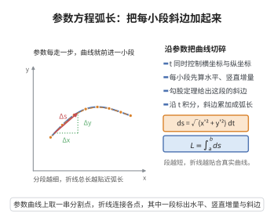

# 参数方程弧长公式

> **一句话大白话**：用参数描出来的曲线有多长，就是把无数个直角三角形的小斜边拼起来求和——每小段都是勾股定理算出来的斜边。
>
> **小例子**：单位圆 $x=\cos t,\,y=\sin t$ 从 $0$ 到 $2\pi$：$L=\int_0^{2\pi}\sqrt{\sin^2 t+\cos^2 t}\,dt=2\pi$。

## 介绍

参数方程弧长公式用于计算由参数方程表示的平面曲线的长度。当曲线由参数 $t$ 表示时，弧长公式将弧长微元表达为参数坐标导数的平方和开方。该公式是一般弧长公式在参数表示下的推广，在微分几何和计算机图形学中有着重要应用。

## 几何直观

图意在说明：参数区间被切成小段后，每段斜边由两个方向的增量合成，沿 t 累加就是曲线长度。

## 分析

**前置依赖**：弧长公式

**定理内容**：设曲线由参数方程 $x = x(t)$，$y = y(t)$（$t \in [\alpha, \beta]$）给出，且 $x'(t)$ 和 $y'(t)$ 在 $[\alpha, \beta]$ 上连续，则曲线从 $t = \alpha$ 到 $t = \beta$ 的弧长为
$$L = \int_\alpha^\beta \sqrt{[x'(t)]^2 + [y'(t)]^2}\,dt$$

**数学内涵**：
参数方程弧长公式是弧长公式 $L = \int_a^b \sqrt{1 + (dy/dx)^2}\,dx$ 在参数表示下的推广。当曲线以参数形式给出时，弧长微元 $ds = \sqrt{(dx)^2 + (dy)^2} = \sqrt{(x'(t))^2 + (y'(t))^2}\,dt$。该公式对称地处理了 $x$ 和 $y$，适用于任何光滑参数曲线，包括那些不能表示为函数 $y = f(x)$ 的曲线（如闭曲线、有垂直切线的曲线）。

**证明策略**：从弧长微元 $ds = \sqrt{dx^2 + dy^2}$ 出发，代入 $dx = x'(t)dt$，$dy = y'(t)dt$，积分即得。

## 思考过程

对于参数曲线 $(x(t), y(t))$，在 $t$ 处的微小变化 $dt$ 引起 $x$ 和 $y$ 的变化分别为 $dx = x'(t)dt$ 和 $dy = y'(t)dt$。由勾股定理，弧长微元为
$$ds = \sqrt{dx^2 + dy^2} = \sqrt{(x'(t)dt)^2 + (y'(t)dt)^2} = \sqrt{[x'(t)]^2 + [y'(t)]^2}\,dt$$
对 $ds$ 从 $\alpha$ 到 $\beta$ 积分即得总弧长。

## 证明过程

**定理**：设平面曲线 $C$ 由参数方程 $x = x(t)$，$y = y(t)$（$t \in [\alpha, \beta]$）表示，其中 $x'(t)$ 和 $y'(t)$ 在 $[\alpha, \beta]$ 上连续，且不同时为 $0$。则曲线 $C$ 的弧长为
$$L = \int_\alpha^\beta \sqrt{[x'(t)]^2 + [y'(t)]^2}\,dt$$

**证明**：

对参数区间 $[\alpha, \beta]$ 作分割 $P: \alpha = t_0 < t_1 < \cdots < t_n = \beta$，记 $\Delta t_i = t_i - t_{i-1}$。

曲线上对应点 $(x(t_{i-1}), y(t_{i-1}))$ 和 $(x(t_i), y(t_i))$ 之间的弦长为
$$\Delta s_i = \sqrt{[x(t_i) - x(t_{i-1})]^2 + [y(t_i) - y(t_{i-1})]^2}$$

由拉格朗日中值定理，存在 $\xi_i, \eta_i \in (t_{i-1}, t_i)$ 使得
$$x(t_i) - x(t_{i-1}) = x'(\xi_i)\Delta t_i$$
$$y(t_i) - y(t_{i-1}) = y'(\eta_i)\Delta t_i$$

因此弦长为
$$\Delta s_i = \sqrt{[x'(\xi_i)]^2 + [y'(\eta_i)]^2}\,\Delta t_i$$

曲线长度的近似值为
$$L \approx \sum_{i=1}^n \sqrt{[x'(\xi_i)]^2 + [y'(\eta_i)]^2}\,\Delta t_i$$

当分割的最大步长 $\|\Delta\| \to 0$ 时，由于 $x'(t)$ 和 $y'(t)$ 连续，$\sqrt{[x'(t)]^2 + [y'(t)]^2}$ 在 $[\alpha, \beta]$ 上一致连续，上述和式收敛于定积分：
$$L = \lim_{\|\Delta\|\to 0} \sum_{i=1}^n \sqrt{[x'(\xi_i)]^2 + [y'(\eta_i)]^2}\,\Delta t_i = \int_\alpha^\beta \sqrt{[x'(t)]^2 + [y'(t)]^2}\,dt$$

$\square$

## 课堂问答

**老师**：参数曲线 $(x(t),y(t))$ 的弧长为什么是 $\int_\alpha^\beta\sqrt{(x')^2+(y')^2}\,dt$？

**学生**：因为弧长微元就是勾股定理：$ds=\sqrt{dx^2+dy^2}$，代入 $dx=x'\,dt$、$dy=y'\,dt$ 得 $ds=\sqrt{(x')^2+(y')^2}\,dt$。严格证明是把 $[\alpha,\beta]$ 分割，每段弦长用拉格朗日中值定理写成 $\sqrt{(x'(\xi_i))^2+(y'(\eta_i))^2}\,\Delta t_i$，取极限成定积分。它比 $\int\sqrt{1+(y')^2}\,dx$ 更一般，能处理闭曲线和有竖直切线的曲线。

**老师（追问）**：单位圆用这个公式会得到什么？

**学生**：取 $x=\cos t$、$y=\sin t$，则 $(x')^2+(y')^2=\sin^2t+\cos^2t=1$，于是 $L=\int_0^{2\pi}1\,dt=2\pi$，正好是圆周长。这提醒我们参数形式的被积函数其实就是速度的模 $|r'(t)|$。

**老师（拓展）**：换一种参数化会不会改变弧长？

**学生**：不会，弧长是几何量，与参数选取无关。但如果特意改用弧长本身作参数 $s$，就有 $|r'(s)|=1$，微元退化为 $ds$，所以弧长参数被称为"自然参数"。
