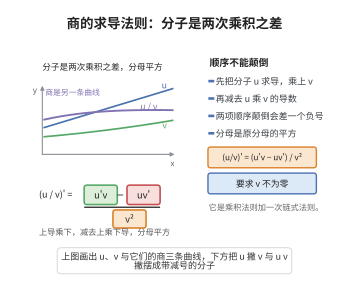

# 商的求导法则

> **一句话大白话**：两个函数相除，导数是"（上导乘下，减去上乘下导）再除以分母的平方"，分子里两项相减的顺序不能颠倒。
>
> **小例子**：$\left(\dfrac{\sin x}{x}\right)' = \dfrac{x\cos x - \sin x}{x^2}$，用来求 $\frac{\sin x}{x}$ 在 $x\to 0$ 附近的性态。

## 介绍

商的求导法则（quotient rule）是微分学的基本求导法则之一，用于求两个可导函数之商的导数。它是乘积求导法则的直接推论：把 $\frac{f}{g}$ 看成 $f$ 与 $\frac{1}{g}$ 的乘积，对 $\frac{1}{g}$ 用链式法则（外函数为 $\frac{1}{u}$，其导数为 $-\frac{1}{u^2}$），就得到商的法则。

商的求导法则在物理与工程中频繁出现：速度是位移与时间之商、浓度是溶质与溶液之商、各种"率"都是商的形式，对它们求变化率都要用到这条法则。它也是推导正切函数、正割函数等导数公式的工具。

记忆这条法则时要注意两点：分子中两乘积的先后顺序决定正负号（是"上导乘下减上乘下导"，不是反过来）；分母是 $g$ 的平方而不是 $g$，也不是 $g'$ 的平方。

## 几何直观

图意在说明：商的导数分子是上导乘下减去上乘下导，分母则是原分母的平方。

## 分析

**前置依赖**：导数的定义、乘积求导法则、可导蕴含连续。

**定理内容**：设函数 $f$ 与 $g$ 在点 $x$ 处可导，且 $g(x)\ne 0$，则商 $\frac{f}{g}$ 在 $x$ 处可导，且

$$\left(\frac{f}{g}\right)'(x) = \frac{f'(x)g(x) - f(x)g'(x)}{g(x)^2}$$

## 思考过程

直接对差商 $\frac{1}{h}\left(\frac{f(x+h)}{g(x+h)}-\frac{f(x)}{g(x)}\right)$ 通分，分母变成 $g(x+h)g(x)$，分子变成 $f(x+h)g(x)-f(x)g(x+h)$。分子的两项同样"错位"，于是插入并减去 $f(x)g(x)$，把它拆成

$$\big(f(x+h)-f(x)\big)g(x) - f(x)\big(g(x+h)-g(x)\big)$$

两组分别配出 $f$ 与 $g$ 在 $x$ 处的差商。又因为 $g$ 可导故连续，$g(x+h)\to g(x)\ne 0$，分母的极限非零，可以直接取极限。

## 证明过程

**步骤 1：写出差商并通分。**

固定 $x$，因 $g(x)\ne 0$ 且 $g$ 连续，当 $h$ 充分小时 $g(x+h)\ne 0$，故差商有意义。通分得

$$\frac{1}{h}\left(\frac{f(x+h)}{g(x+h)}-\frac{f(x)}{g(x)}\right)=\frac{f(x+h)g(x)-f(x)g(x+h)}{h\,g(x+h)g(x)}$$

**步骤 2：在分子中插入并减去 $f(x)g(x)$。**

$$f(x+h)g(x)-f(x)g(x+h)=\big(f(x+h)-f(x)\big)g(x)-f(x)\big(g(x+h)-g(x)\big)$$

**步骤 3：整理成差商形式。**

$$\frac{1}{h}\left(\frac{f(x+h)}{g(x+h)}-\frac{f(x)}{g(x)}\right)=\frac{\dfrac{f(x+h)-f(x)}{h}\,g(x)-f(x)\,\dfrac{g(x+h)-g(x)}{h}}{g(x+h)g(x)}$$

**步骤 4：取极限。**

由 $f,g$ 在 $x$ 处可导，$\frac{f(x+h)-f(x)}{h}\to f'(x)$，$\frac{g(x+h)-g(x)}{h}\to g'(x)$。由 $g$ 可导故连续，$g(x+h)\to g(x)$，于是分母 $g(x+h)g(x)\to g(x)^2\ne 0$。由极限的商与和运算法则，

$$\left(\frac{f}{g}\right)'(x)=\frac{f'(x)g(x)-f(x)g'(x)}{g(x)^2}$$

证毕。

## 课堂问答

**老师**：$\left(\frac{f}{g}\right)'$ 等于 $\frac{f'}{g'}$ 吗？

**学生**：不等于。正确的是 $\left(\frac{f}{g}\right)'=\frac{f'g-fg'}{g^2}$。它是乘积法则加链式法则的推论：把 $\frac{f}{g}$ 写成 $f\cdot\frac{1}{g}$，再对 $\frac{1}{g}$ 用链式法则。分子两项顺序不能颠倒，分母是 $g^2$，既不是 $g$ 也不是 $(g')^2$。

**老师（追问）**：直接用差商证明，关键一步是什么？

**学生**：关键是通分后的分子 $f(x+h)g(x)-f(x)g(x+h)$ 错位了，插入再减去 $f(x)g(x)$，拆成 $(f(x+h)-f(x))g(x)-f(x)(g(x+h)-g(x))$，于是两组都能配出差商。取极限时用 $g(x+h)g(x)\to g(x)^2\ne0$，分母极限非零，可以直接取。

**老师（拓展）**：用商的法则还能顺手推出哪些常见导数？

**学生**：比如 $(\tan x)'=\frac{\cos^2x+\sin^2x}{\cos^2x}=1+\tan^2x$，$(\sec x)'=\sec x\tan x$，$(\cot x)'=-\csc^2x$。凡是"率"（速度、浓度、增长率）的求导几乎都要用到它。

## 相关条目

- [求导法则](./求导法则.md)：和、差、积、商与链式法则的整体框架，本定理是其中的除法部分。
- [乘积求导法则](./乘积求导法则.md)：把 $\frac{f}{g}$ 写成 $f\cdot\frac{1}{g}$ 即可由乘积法则推出商的法则。
- [单变量链式法则](./单变量链式法则.md)：求 $\frac{1}{g}$ 的导数时所必需。
