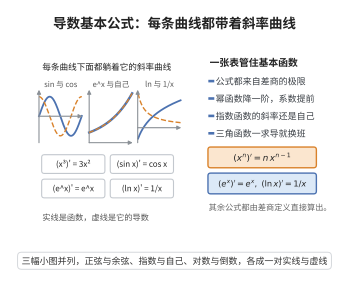

# 导数基本公式

> **一句话大白话**：把常见函数的导数一次性列成一张"乘法口诀表"，往后再求导就先查表、再套求导法则。
>
> **小例子**：$(\sin x)'=\cos x$，$(x^3)'=3x^2$，$(e^x)'=e^x$，$(\ln x)'=1/x$。

## 介绍

导数基本公式是单变量微积分的计算基础，它汇总了幂函数、指数函数、对数函数、三角函数与反三角函数等基本初等函数的导数。掌握这张表，配合乘积、商与复合函数的求导法则，就能计算一切初等函数的导数。

这些公式都直接来源于导数的定义（差商的极限），并依赖两个重要极限 $\lim_{x\to0}\frac{\sin x}{x}=1$ 与 $\lim_{x\to0}(1+x)^{1/x}=e$。历史上，牛顿与莱布尼茨正是在积累了这类具体函数的求导结果后，才建立起一般的微分法则。

导数基本公式也是积分基本表的基础：由于求导与积分互为逆运算，每一条导数公式都对应一条不定积分公式。

## 几何直观

图意在说明：基本初等函数的导数公式，等价于说某条曲线的斜率曲线恰好是另一条曲线。

## 分析

导数的定义（差商的极限）、极限的四则运算法则、重要极限 $\lim_{x\to0}\frac{\sin x}{x}=1$ 与 $\lim_{x\to0}(1+x)^{1/x}=e$、单变量链式法则

**定理内容**：下列函数在各自定义域内可导，且

$$
(C)'=0,\qquad (x^\alpha)'=\alpha x^{\alpha-1},\qquad (a^x)'=a^x\ln a,\qquad (e^x)'=e^x
$$

$$
(\log_a x)'=\frac{1}{x\ln a},\qquad (\ln x)'=\frac1x
$$

$$
(\sin x)'=\cos x,\qquad (\cos x)'=-\sin x,\qquad (\tan x)'=\frac{1}{\cos^2 x}=1+\tan^2 x
$$

$$
(\arcsin x)'=\frac{1}{\sqrt{1-x^2}},\qquad (\arctan x)'=\frac{1}{1+x^2}
$$

**数学内涵**：
- 公式 $(\ln x)'=1/x$ 与 $(e^x)'=e^x$ 说明 $e$ 是使指数函数导数等于自身的唯一底数。
- 三角函数的导数把 $\sin$ 与 $\cos$ 联系起来，两次求导回到自身的相反函数。

## 思考过程

一切公式都从差商出发。幂函数用二项式展开差商；正弦函数用和差化积把差商写成 $\cos\cdot\frac{\sin(h/2)}{h/2}$，再借重要极限取极限；指数函数把 $e^h$ 的差商化成 $(e^h-1)/h\to 1$；对数函数把差商化成 $\frac1x\cdot\frac{\ln(1+h/x)}{h/x}$，再借 $(1+t)^{1/t}\to e$ 的等价形式。至于 $\tan$、$\arcsin$、$\arctan$，或者用商的求导法则，或者用反函数的求导公式由已知函数推出，不必重新回到定义。

## 证明过程

**步骤 1：常数与幂函数。** 对常数 $C$，差商恒为 $0$，故 $(C)'=0$。对正整数 $n$，由二项式定理

$$
\frac{(x+h)^n-x^n}{h}=\frac{n x^{n-1}h+\binom n2 x^{n-2}h^2+\cdots+h^n}{h}= n x^{n-1}+O(h)\xrightarrow[h\to0]{}n x^{n-1}
$$

故 $(x^n)'=nx^{n-1}$。对一般实数 $\alpha$，写成 $x^\alpha=e^{\alpha\ln x}$，用复合函数求导法则即得 $(x^\alpha)'=e^{\alpha\ln x}\cdot\frac{\alpha}{x}=\alpha x^{\alpha-1}$。

**步骤 2：正弦与余弦。** 由和差化积，

$$
\frac{\sin(x+h)-\sin x}{h}=\frac{2\cos\!\left(x+\frac h2\right)\sin\frac h2}{h}=\cos\!\left(x+\frac h2\right)\cdot\frac{\sin(h/2)}{h/2}
$$

令 $h\to0$，由 $\lim_{t\to0}\frac{\sin t}{t}=1$ 与 $\cos$ 的连续性得 $(\sin x)'=\cos x$。同理

$$
\frac{\cos(x+h)-\cos x}{h}=-\sin\!\left(x+\frac h2\right)\cdot\frac{\sin(h/2)}{h/2}\xrightarrow[h\to0]{}-\sin x
$$

故 $(\cos x)'=-\sin x$。

**步骤 3：指数函数。** 

$$
\frac{e^{x+h}-e^x}{h}=e^x\cdot\frac{e^h-1}{h}
$$

由重要极限 $\lim_{h\to0}\frac{e^h-1}{h}=1$ 得 $(e^x)'=e^x$。于是 $(a^x)'=(e^{x\ln a})'=e^{x\ln a}\ln a=a^x\ln a$。

**步骤 4：对数函数。** 

$$
\frac{\ln(x+h)-\ln x}{h}=\frac1h\ln\!\left(1+\frac hx\right)=\frac1x\cdot\frac{\ln(1+h/x)}{h/x}
$$

令 $t=h/x\to0$，由 $\lim_{t\to0}\frac{\ln(1+t)}{t}=1$ 得 $(\ln x)'=\frac1x$。再由换底公式 $\log_a x=\frac{\ln x}{\ln a}$ 得 $(\log_a x)'=\frac{1}{x\ln a}$。

**步骤 5：正切函数。** 由商的求导法则，

$$
(\tan x)'=\left(\frac{\sin x}{\cos x}\right)'=\frac{\cos x\cdot\cos x-\sin x\cdot(-\sin x)}{\cos^2 x}=\frac{\cos^2 x+\sin^2 x}{\cos^2 x}=\frac{1}{\cos^2 x}=1+\tan^2 x
$$

**步骤 6：反三角函数。** 设 $x=\sin y$，$y\in(-\frac\pi2,\frac\pi2)$，则 $y=\arcsin x$，由反函数求导公式

$$
(\arcsin x)'=\frac{1}{(\sin y)'}=\frac{1}{\cos y}=\frac{1}{\sqrt{1-\sin^2 y}}=\frac{1}{\sqrt{1-x^2}}
$$

同理，设 $x=\tan y$，则 $(\arctan x)'=\frac{1}{1+\tan^2 y}=\frac{1}{1+x^2}$。$\square$

## 课堂问答

**老师**：这么多导数公式，是不是每条都要回到定义重算？

**学生**：不必，它们虽都源自差商极限，但可逐层推导：幂函数用二项式展开，$\sin x$ 用和差化积配 $\lim_{t\to0}\frac{\sin t}{t}=1$，指数函数用 $\lim_{h\to0}\frac{e^h-1}{h}=1$，对数函数配 $(1+t)^{1/t}\to e$。而 $\tan$、$\arcsin$、$\arctan$ 直接用商的法则或反函数求导公式推出，无需回到定义。

**老师（追问）**：$(\sin x)'=\cos x$ 的关键一步在哪？

**学生**：在和差化积：$\frac{\sin(x+h)-\sin x}{h}=\cos(x+\frac h2)\cdot\frac{\sin(h/2)}{h/2}$。当 $h\to0$ 时前一因子趋于 $\cos x$，后一因子趋于 $1$。若没有 $\lim_{t\to0}\frac{\sin t}{t}=1$ 就推不出来，也说明这里默认用了弧度制。

**老师（拓展）**：为什么 $e$ 这个底数这么特殊？

**学生**：由 $(e^x)'=e^x$ 及 $(a^x)'=a^x\ln a$，可见使指数函数导数等于自身的底数唯一，即 $\ln a=1$、$a=e$。同一事实的另一面是 $(\ln x)'=\frac1x$，这让 $e^x$ 成为微分方程 $y'=y$ 的解。

## 相关条目

- [基本积分表](./基本积分表.md)：每条导数公式反向即得一条基本不定积分公式。
- [求导法则](./求导法则.md)：乘积、商与复合函数的求导法则，与基本公式配合使用。
