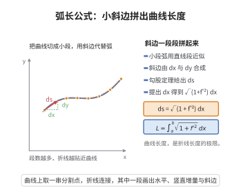

# 弧长公式

> **一句话大白话**：一条曲线有多长，就是把无数个直角三角形的小斜边拼起来求和——每小段都像爬坡，用勾股定理算出斜边再累加。
>
> **小例子**：直线 $f(x)=x$ 从 $x=0$ 到 $1$：$L=\int_0^1\sqrt{1+1^2}\,dx=\sqrt{2}$，正是两端点的距离。

## 介绍

弧长公式（Arc Length Formula）用于计算平面曲线上两点之间的弧长。该公式由微积分基本思想发展而来，其核心是将曲线分割为无穷多小段，每段用直线近似，再通过积分求和。弧长公式是微分几何中曲线长度概念的基石，在工程制图、计算机图形学和物理路径积分中有着广泛应用。

## 几何直观

图意在说明：每小段用勾股定理算斜边，提出 dx 后得到根号下 1 加导数平方，积分即弧长。

## 分析

**前置依赖**：勾股定理、积分定义

**定理内容**：设函数 $y = f(x)$ 在区间 $[a,b]$ 上具有连续导数，则曲线 $y = f(x)$ 从 $x = a$ 到 $x = b$ 的弧长为
$$L = \int_a^b \sqrt{1 + [f'(x)]^2}\,dx$$

**数学内涵**：
弧长公式将几何量（曲线长度）转化为分析量（定积分）。其核心思想是"以直代曲"：在无穷小尺度下，曲线微元 $ds$ 可视作直角三角形斜边，两直角边分别为 $dx$ 和 $dy = f'(x)dx$，由勾股定理得 $ds = \sqrt{dx^2 + dy^2} = \sqrt{1 + (f'(x))^2}\,dx$。对 $ds$ 积分即得总弧长。

**证明策略**：将曲线离散化为折线，每段用直线近似，取极限转化为定积分。

## 思考过程

将区间 $[a,b]$ 划分为 $n$ 个子区间，每个子区间上的曲线段用弦长近似。第 $i$ 段弦长为
$$\Delta s_i = \sqrt{(\Delta x_i)^2 + (\Delta y_i)^2} = \sqrt{1 + \left(\frac{\Delta y_i}{\Delta x_i}\right)^2}\,\Delta x_i$$

由微分中值定理，$\Delta y_i = f'(\xi_i)\Delta x_i$，其中 $\xi_i$ 在子区间内。于是
$$\Delta s_i = \sqrt{1 + [f'(\xi_i)]^2}\,\Delta x_i$$

当 $\max\Delta x_i \to 0$ 时，求和取极限即得积分形式。

## 证明过程

**定理**：设 $y = f(x)$ 在 $[a,b]$ 上具有连续导数，则曲线 $y = f(x)$ 从 $x = a$ 到 $x = b$ 的弧长为
$$L = \int_a^b \sqrt{1 + [f'(x)]^2}\,dx$$

**证明**：

对区间 $[a,b]$ 作分割 $P: a = x_0 < x_1 < \cdots < x_n = b$，记 $\Delta x_i = x_i - x_{i-1}$，$\Delta y_i = f(x_i) - f(x_{i-1})$。

连接相邻分点 $(x_{i-1}, f(x_{i-1}))$ 和 $(x_i, f(x_i))$，得到折线，其第 $i$ 段长度为
$$\Delta s_i = \sqrt{(\Delta x_i)^2 + (\Delta y_i)^2}$$

曲线长度的近似值为
$$L \approx \sum_{i=1}^n \sqrt{(\Delta x_i)^2 + (\Delta y_i)^2}$$

由拉格朗日中值定理，存在 $\xi_i \in (x_{i-1}, x_i)$ 使得
$$\Delta y_i = f(x_i) - f(x_{i-1}) = f'(\xi_i)\Delta x_i$$

代入得
$$\Delta s_i = \sqrt{1 + [f'(\xi_i)]^2}\,\Delta x_i$$

因此
$$L \approx \sum_{i=1}^n \sqrt{1 + [f'(\xi_i)]^2}\,\Delta x_i$$

当分割的最大步长 $\|\Delta\| \to 0$ 时，由于 $\sqrt{1 + [f'(x)]^2}$ 在 $[a,b]$ 上连续（由 $f'$ 连续保证），上述黎曼和收敛于定积分：
$$L = \lim_{\|\Delta\|\to 0} \sum_{i=1}^n \sqrt{1 + [f'(\xi_i)]^2}\,\Delta x_i = \int_a^b \sqrt{1 + [f'(x)]^2}\,dx$$

$\square$

## 课堂问答

**老师**：$y=f(x)$ 的弧长为什么是 $\int_a^b\sqrt{1+(f')^2}\,dx$？

**学生**：以直代曲：微元 $ds=\sqrt{dx^2+dy^2}=\sqrt{1+(y')^2}\,dx$，因为 $dy=f'\,dx$。严格证明把 $[a,b]$ 分割，每段弦长 $\sqrt{(\Delta x_i)^2+(\Delta y_i)^2}$，用拉格朗日中值定理 $\Delta y_i=f'(\xi_i)\Delta x_i$，得黎曼和 $\sum\sqrt{1+(f'(\xi_i))^2}\Delta x_i$，取极限成定积分。

**老师（追问）**：直线 $f(x)=x$ 从 $0$ 到 $1$，公式给出多少？

**学生**：给 $L=\int_0^1\sqrt{1+1}\,dx=\sqrt2$，正是两端点 $(0,0)$ 到 $(1,1)$ 的距离，说明公式在直线段上与初等几何一致。若曲线有竖直切线或闭合，函数表示就不够用，要改用参数方程弧长公式。

**老师（拓展）**：为什么不能用 $\sum|\Delta y_i|$ 来近似长度？

**学生**：因为长度对应的是斜边，$|\Delta y_i|$ 只是竖直分量。$ds$ 必须同时含 $dx$ 与 $dy$ 的贡献，这正是公式里出现 $\sqrt{1+(f')^2}$ 的原因。推广到空间曲线即 $\int\sqrt{(x')^2+(y')^2+(z')^2}\,dt$。
