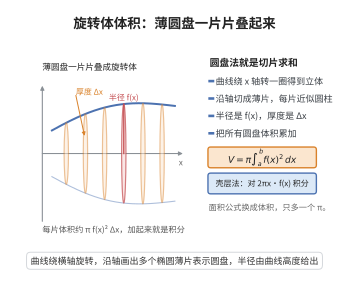

# 旋转体体积公式

> **一句话大白话**：把一条曲线绕轴转一圈就得到个“瓶瓶罐罐”，把它的体积想成无数片薄圆盘叠起来，一片片加起来就是总体积。
>
> **小例子**：$y=x^2$ 在 $[0,1]$ 绕 $x$ 轴旋转，圆盘法 $V=\pi\int_0^1 x^4\,dx=\frac{\pi}{5}$。

## 介绍

旋转体体积公式用于计算平面曲线绕坐标轴旋转所生成的立体体积。常用的方法有圆盘法（Disk Method）和壳层法（Shell Method）。这些公式由积分学基本思想发展而来，是微积分在几何中的经典应用，在工程设计和物理计算中有着广泛用途。

## 几何直观

图意在说明：把旋转体切成薄圆盘，每片体积约为 π f(x)² Δx，累加即得体积积分。

## 分析

**前置依赖**：积分定义

**定理内容**：

1. **圆盘法**：设 $y = f(x)$ 在 $[a,b]$ 上连续且 $f(x) \ge 0$，将曲线绕 $x$ 轴旋转一周所得旋转体的体积为
   $$V = \pi \int_a^b [f(x)]^2\,dx$$

2. **壳层法**：设 $y = f(x)$ 在 $[a,b]$ 上连续，将曲线绕 $y$ 轴旋转一周，所得旋转体的体积为
   $$V = 2\pi \int_a^b x|f(x)|\,dx$$
   （当 $f(x) \ge 0$ 时，绝对值可去掉）

**数学内涵**：
旋转体体积公式体现了积分学"分割-近似-求和-取极限"的核心思想。圆盘法将旋转体视为无数薄圆盘的叠加，每个圆盘的截面积为 $\pi[f(x)]^2$，厚度为 $dx$；壳层法则将旋转体视为无数薄圆柱壳的叠加，每个壳层的表面积为 $2\pi x f(x)$，厚度为 $dx$。两种方法从不同视角得出同一体积，实际应用时可根据函数形式选择较简便的方法。

**证明策略**：将旋转体分割成薄片，用圆盘或壳层近似体积单元，求和取极限转化为定积分。

## 思考过程

**圆盘法**：在 $x$ 处取厚度为 $dx$ 的薄片，该薄片是半径为 $|f(x)|$ 的圆盘，体积微元 $dV = \pi[f(x)]^2 dx$，积分即得总体积。

**壳层法**：在 $x$ 处取宽度为 $dx$ 的竖条，绕 $y$ 轴旋转形成圆柱壳，半径为 $x$，高度为 $f(x)$，壳层体积微元 $dV = 2\pi x f(x) dx$。

## 证明过程

**定理**（圆盘法）：设 $y = f(x)$ 在 $[a,b]$ 上连续且 $f(x) \ge 0$，曲线 $y = f(x)$ 绕 $x$ 轴旋转一周所得旋转体的体积为
$$V = \pi \int_a^b [f(x)]^2\,dx$$

**证明**：

对区间 $[a,b]$ 作分割 $P: a = x_0 < x_1 < \cdots < x_n = b$，记 $\Delta x_i = x_i - x_{i-1}$，在子区间 $[x_{i-1}, x_i]$ 上任取 $\xi_i$。

以 $f(\xi_i)$ 为半径、$\Delta x_i$ 为高作直圆柱，其体积为
$$\Delta V_i = \pi [f(\xi_i)]^2 \Delta x_i$$

旋转体体积的近似值为
$$V \approx \sum_{i=1}^n \pi [f(\xi_i)]^2 \Delta x_i$$

当分割的最大步长 $\|\Delta\| \to 0$ 时，由于 $\pi[f(x)]^2$ 在 $[a,b]$ 上连续，上述黎曼和收敛于定积分：
$$V = \lim_{\|\Delta\|\to 0} \sum_{i=1}^n \pi [f(\xi_i)]^2 \Delta x_i = \pi \int_a^b [f(x)]^2\,dx$$

**定理**（壳层法）：设 $y = f(x)$ 在 $[a,b]$ 上连续且 $f(x) \ge 0$，曲线 $y = f(x)$ 绕 $y$ 轴旋转一周所得旋转体的体积为
$$V = 2\pi \int_a^b x f(x)\,dx$$

**证明**：

对区间 $[a,b]$ 作分割 $P: a = x_0 < x_1 < \cdots < x_n = b$，记 $\Delta x_i = x_i - x_{i-1}$，在子区间 $[x_{i-1}, x_i]$ 上任取 $\xi_i$。

考虑以 $x_{i-1}$ 和 $x_i$ 为半径的圆柱壳，其体积为
$$\Delta V_i = \pi x_i^2 f(\xi_i) - \pi x_{i-1}^2 f(\xi_i) = \pi (x_i^2 - x_{i-1}^2) f(\xi_i)$$

由平方差公式，
$$\Delta V_i = \pi (x_i + x_{i-1})(x_i - x_{i-1}) f(\xi_i) = 2\pi \cdot \frac{x_i + x_{i-1}}{2} \cdot f(\xi_i) \Delta x_i$$

当 $\|\Delta\| \to 0$ 时，$\frac{x_i + x_{i-1}}{2} \to \xi_i$，因此
$$V = \lim_{\|\Delta\|\to 0} \sum_{i=1}^n 2\pi \xi_i f(\xi_i) \Delta x_i = 2\pi \int_a^b x f(x)\,dx$$

$\square$

## 课堂问答

**老师**：曲线绕 $x$ 轴转一圈的体积，为什么是 $\pi\int_a^b f(x)^2\,dx$？

**学生**：圆盘法：在 $x$ 处取厚度 $dx$ 的薄圆盘，半径 $|f(x)|$，体积微元 $dV=\pi f(x)^2\,dx$，积分得 $V=\pi\int_a^b f(x)^2\,dx$。例如 $y=x^2$ 在 $[0,1]$ 绕 $x$ 轴，$V=\pi\int_0^1x^4\,dx=\frac\pi5$。严格证明是对 $[a,b]$ 分割，用半径 $f(\xi_i)$、高 $\Delta x_i$ 的直圆柱求和取极限。

**老师（追问）**：那绕 $y$ 轴呢？

**学生**：用壳层法：竖条绕 $y$ 轴转成薄圆柱壳，半径 $x$、高 $f(x)$、厚 $dx$，体积微元 $dV=2\pi x f(x)\,dx$，故 $V=2\pi\int_a^b x f(x)\,dx$。也可以改用圆盘法，但要把 $y$ 当积分变量、写出反函数。

**老师（拓展）**：两种方法会不会算出不同结果？

**学生**：不会，同一旋转体体积唯一，两种方法只是切片方向不同：圆盘法垂直于旋转轴切、壳层法平行于旋转轴切。选哪种取决于被积函数是否好积——绕 $y$ 轴时若反函数难求，壳层法通常更省事。
