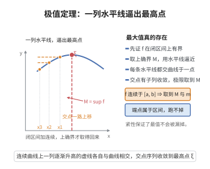

# 极值定理

> **一句话大白话**：在“连起来不断”的一段区间上，函数一定既有最高点也有最低点——只要想登顶或找谷底，结果就一定有。
>
> **小例子**：$f(x)=\sin x$ 在闭区间 $[0,\pi]$ 上连续，最大值 $1$（$x=\tfrac{\pi}{2}$）和最小值 $0$（端点）都能取到。

## 介绍

极值定理（Extreme Value Theorem）又称最值定理，是实分析中的重要定理，最早由卡尔·魏尔斯特拉斯（Karl Weierstrass）严格证明。该定理断言闭区间上的连续函数必定能取到最大值和最小值。极值定理是罗尔定理、拉格朗日中值定理等众多微分学定理的基础，也是优化理论的理论基石。

## 几何直观

图意在说明：取上确界后用一列水平线逼近，交点有收敛子列，其极限点取到最大值。

## 分析

**前置依赖**：连续函数定义、海涅-博雷尔定理、Bolzano-Weierstrass 定理、确界原理、紧集

**定理内容**：若函数 $f$ 在闭区间 $[a,b]$ 上连续，则 $f$ 在 $[a,b]$ 上既有最大值也有最小值。即存在 $x_{\max}, x_{\min}\in[a,b]$，使得对任意 $x\in[a,b]$，有
$$f(x_{\min})\le f(x)\le f(x_{\max})$$

**前置知识**：
- 海涅-博雷尔定理：$\mathbb{R}^n$ 中有界闭集是紧集（有限开覆盖性质）

**数学内涵**：
极值定理揭示了连续函数在紧集上的重要性质：紧集在连续映射下的像也是紧集。由于 $\mathbb{R}$ 中的紧集就是有界闭集，因此 $f([a,b])$ 是 $\mathbb{R}$ 中的有界闭集，必然包含最大值和最小值。

**关键条件**：
- 闭区间条件不可或缺：开区间上的连续函数可能无界（如 $f(x)=\frac{1}{x}$ 在 $(0,1)$ 上）或在端点处取不到极值。
- 连续条件不可或缺：不连续的函数可能无界或取不到极值。

## 思考过程

极值定理的证明需要两个步骤：
1. **有界性**：证明 $f$ 在 $[a,b]$ 上有界。
2. **最值可达**：证明 $f$ 能取到最大值和最小值。

**有界性**的证明：由连续函数的局部有界性，每个点 $x\in[a,b]$ 存在邻域 $U_x$ 使 $f$ 在 $U_x$ 上有界。$\{U_x\}_{x\in[a,b]}$ 构成 $[a,b]$ 的开覆盖，由海涅-博雷尔定理，存在有限子覆盖 $\{U_{x_1},\ldots,U_{x_n}\}$。$f$ 在每个 $U_{x_i}$ 上有界，故在 $[a,b]$ 上有界。

**最值可达**的证明：设 $M=\sup\{f(x)\mid x\in[a,b]\}$（由有界性，$M$ 有限）。存在序列 $\{x_n\}\subset[a,b]$ 使 $f(x_n)\to M$。由 Bolzano-Weierstrass 定理，$\{x_n\}$ 有收敛子列 $\{x_{n_k}\}$，设 $x_{n_k}\to x_0\in[a,b]$。由连续性，$f(x_0)=\lim f(x_{n_k})=M$，故最大值在 $x_0$ 取到。最小值同理。

## 证明过程

**证明**：

**第一步：证明 $f$ 在 $[a,b]$ 上有界。**

由于 $f$ 在 $[a,b]$ 上连续，对任意 $x\in[a,b]$，存在 $\delta_x>0$，使得 $f$ 在 $(x-\delta_x, x+\delta_x)\cap[a,b]$ 上有界。令 $U_x=(x-\delta_x, x+\delta_x)$，则 $\{U_x\}_{x\in[a,b]}$ 是 $[a,b]$ 的开覆盖。

由海涅-博雷尔定理，$[a,b]$ 是紧集，存在有限子覆盖 $\{U_{x_1}, U_{x_2}, \ldots, U_{x_n}\}$。在每个 $U_{x_i}$ 上，$f$ 有界，即存在 $M_i>0$ 使 $|f(x)|\le M_i$ 对 $x\in U_{x_i}\cap[a,b]$ 成立。取 $M=\max\{M_1,\ldots,M_n\}$，则对任意 $x\in[a,b]$，$|f(x)|\le M$。故 $f$ 在 $[a,b]$ 上有界。

**第二步：证明 $f$ 在 $[a,b]$ 上取到最大值。**

设 $M=\sup\{f(x)\mid x\in[a,b]\}$。由第一步，$M$ 为有限实数。由确界定义，存在点列 $\{x_n\}\subset[a,b]$，使得 $f(x_n)\to M$（$n\to\infty$）。

由于 $[a,b]$ 是有界闭集，$\{x_n\}$ 有界，由 Bolzano-Weierstrass 定理（或闭区间套定理），存在收敛子列 $\{x_{n_k}\}$，设 $x_{n_k}\to x_0\in[a,b]$。

由 $f$ 的连续性：
$$f(x_0)=\lim_{k\to\infty}f(x_{n_k})=M$$

因此 $x_0$ 是 $f$ 在 $[a,b]$ 上的最大值点，即 $f(x_0)=M$。

**第三步：证明 $f$ 在 $[a,b]$ 上取到最小值。**

令 $m=\inf\{f(x)\mid x\in[a,b]\}$。考虑函数 $-f$，$-f$ 也在 $[a,b]$ 上连续。由第二步，$-f$ 在 $[a,b]$ 上取到最大值，即存在 $x_1\in[a,b]$ 使 $(-f)(x_1)=\sup\{(-f)(x)\mid x\in[a,b]\}$。于是 $f(x_1)=\inf\{f(x)\mid x\in[a,b]\}=m$，即 $x_1$ 是 $f$ 的最小值点。

$\square$

## 课堂问答

**老师**：闭区间上的连续函数，一定取得到最大最小值吗？

**学生**：一定，这就是极值定理。证明分两步：先用海涅-博雷尔定理证有界——每点附近局部有界，这些邻域的开覆盖抽出有限子覆盖并起来即可；再取 $M=\sup f$，由确界构造序列 $f(x_n)\to M$，用 Bolzano-Weierstrass 取收敛子列 $x_{n_k}\to x_0$，由连续性得 $f(x_0)=M$，最大值可达。

**老师（追问）**：条件能削弱吗？

**学生**：不能。开区间 $(0,1)$ 上 $f(x)=1/x$ 连续但无界；而不连续函数也可能取不到极值。闭区间与连续两个条件缺一不可，本质是"紧集在连续映射下的像仍紧"。

**老师（拓展）**：为什么求最大值要借助序列和收敛子列？

**学生**：因为上确界 $M$ 未必被取到（如开区间上的情形）。取逼近序列 $f(x_n)\to M$ 之后，必须找到落在区间内的极限点，这依赖 $[a,b]$ 是紧集（有界闭），保证子列收敛到区间内部，再由连续性把极限搬到函数值上。最小值用 $-f$ 同理得到。
