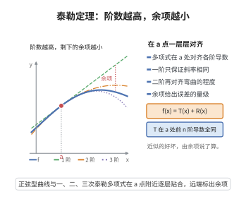

# 泰勒定理

> **一句话大白话**：把函数在某点附近的样子“复刻”成多项式，取的导数阶数越多就越像，还能顺带告诉你现在误差有多大。
>
> **小例子**：$f$ 在 $a$ 附近的二阶近似 $f(x)\approx f(a)+f'(a)(x-a)+\frac{f''(a)}{2}(x-a)^2$，是对直线的进一步“弯曲”修正。

## 介绍

泰勒定理（Taylor's Theorem）由英国数学家布鲁克·泰勒（Brook Taylor）于1715年提出，是微积分学中最重要的定理之一。该定理给出了用多项式近似表示可微函数的方法，并提供了误差估计。泰勒定理是数值分析、函数逼近、微分方程求解等领域的理论基础，在物理学、工程学中也有广泛应用。

## 几何直观

图意在说明：多项式在 a 处对齐的阶数越多，贴合的区间越长，剩下的差距由余项刻画。

## 分析

**前置依赖**：函数可导性、柯西中值定理、辅助函数构造

**定理内容**：设函数 $f$ 在区间 $[a,b]$ 上具有 $n$ 阶连续导数，在 $(a,b)$ 内存在 $n+1$ 阶导数。则对任意 $x\in[a,b]$，存在 $\xi$ 介于 $a$ 和 $x$ 之间，使得

$$f(x)=\sum_{k=0}^{n}\frac{f^{(k)}(a)}{k!}(x-a)^k+R_n(x)$$

其中 Lagrange 余项为
$$R_n(x)=\frac{f^{(n+1)}(\xi)}{(n+1)!}(x-a)^{n+1}$$

**前置知识**：
- 柯西中值定理：$[f(b)-f(a)]g'(\xi)=[g(b)-g(a)]f'(\xi)$

**数学内涵**：
泰勒定理的核心思想是用多项式逼近函数。$n$ 阶泰勒多项式 $P_n(x)=\sum_{k=0}^n\frac{f^{(k)}(a)}{k!}(x-a)^k$ 是在 $x=a$ 附近与 $f(x)$ 具有相同函数值和各阶导数值的多项式。Lagrange 余项给出了逼近误差的精确表达式。

**特殊情形**：
- $n=0$ 时，泰勒定理退化为拉格朗日中值定理：$f(x)=f(a)+f'(\xi)(x-a)$
- $n=1$ 时，$f(x)=f(a)+f'(a)(x-a)+\frac{f''(\xi)}{2}(x-a)^2$

## 思考过程

泰勒定理的证明可以采用反复应用柯西中值定理的方法。核心思路是构造辅助函数，将余项表示为某个函数在特定点处的值。

考虑函数
$$F(t)=f(x)-\sum_{k=0}^{n}\frac{f^{(k)}(t)}{k!}(x-t)^k$$
和
$$G(t)=(x-t)^{n+1}$$

则 $F(x)=0$，$F(a)=R_n(x)$（即余项），$G(x)=0$，$G(a)=(x-a)^{n+1}$。

由柯西中值定理，存在 $\xi$ 介于 $a$ 和 $x$ 之间，使得
$$\frac{F(x)-F(a)}{G(x)-G(a)}=\frac{F'(\xi)}{G'(\xi)}$$

计算可得 $\frac{F'(\xi)}{G'(\xi)}=\frac{f^{(n+1)}(\xi)}{(n+1)!}$，从而 $R_n(x)=\frac{f^{(n+1)}(\xi)}{(n+1)!}(x-a)^{n+1}$。

## 证明过程

**证明**：

设 $x$ 固定，$x\neq a$。定义辅助函数 $F$ 和 $G$ 如下（变量记为 $t$）：
$$F(t)=f(x)-\sum_{k=0}^{n}\frac{f^{(k)}(t)}{k!}(x-t)^k$$
$$G(t)=(x-t)^{n+1}$$

**验证 $F$ 和 $G$ 满足柯西中值定理的条件**：

1. $F$ 和 $G$ 在 $[a,x]$（或 $[x,a]$）上连续，在 $(a,x)$（或 $(x,a)$）内可导。
2. $G'(t)=-(n+1)(x-t)^n$，在 $(a,x)$ 内 $G'(t)\neq 0$。

**计算端点值**：
- $F(x)=f(x)-\sum_{k=0}^{n}\frac{f^{(k)}(x)}{k!}(x-x)^k=f(x)-f(x)=0$
- $G(x)=0$
- $F(a)=f(x)-\sum_{k=0}^{n}\frac{f^{(k)}(a)}{k!}(x-a)^k=R_n(x)$（余项）
- $G(a)=(x-a)^{n+1}$

**应用柯西中值定理**：

存在 $\xi$ 介于 $a$ 和 $x$ 之间，使得
$$\frac{F(x)-F(a)}{G(x)-G(a)}=\frac{F'(\xi)}{G'(\xi)}$$

即
$$\frac{0-R_n(x)}{0-(x-a)^{n+1}}=\frac{F'(\xi)}{G'(\xi)}$$
$$R_n(x)=(x-a)^{n+1}\cdot\frac{F'(\xi)}{G'(\xi)}$$

**计算 $F'(t)$**：
$$F'(t)=-\sum_{k=0}^{n}\frac{d}{dt}\left[\frac{f^{(k)}(t)}{k!}(x-t)^k\right]$$
$$=-\sum_{k=0}^{n}\left[\frac{f^{(k+1)}(t)}{k!}(x-t)^k-\frac{f^{(k)}(t)}{(k-1)!}(x-t)^{k-1}\right]$$
（注意当 $k=0$ 时第二项为零）

通过仔细计算，可以发现这是一个 telescoping 求和：
$$F'(t)=-\frac{f^{(n+1)}(t)}{n!}(x-t)^n$$

**计算 $G'(t)$**：
$$G'(t)=-(n+1)(x-t)^n$$

**因此**：
$$\frac{F'(\xi)}{G'(\xi)}=\frac{-\frac{f^{(n+1)}(\xi)}{n!}(x-\xi)^n}{-(n+1)(x-\xi)^n}=\frac{f^{(n+1)}(\xi)}{(n+1)!}$$

代入得：
$$R_n(x)=\frac{f^{(n+1)}(\xi)}{(n+1)!}(x-a)^{n+1}$$

$\square$

## 课堂问答

**老师**：泰勒定理到底在做什么？

**学生**：用多项式在 $a$ 附近复刻函数：$f(x)=\sum_{k=0}^{n}\frac{f^{(k)}(a)}{k!}(x-a)^k+R_n(x)$，多项式部分与 $f$ 在 $a$ 处有相同的函数值和直到 $n$ 阶的导数。误差由拉格朗日余项刻画：$R_n(x)=\frac{f^{(n+1)}(\xi)}{(n+1)!}(x-a)^{n+1}$，其中 $\xi$ 在 $a$ 与 $x$ 之间。

**老师（追问）**：余项是怎么证出来的？

**学生**：构造 $F(t)=f(x)-\sum_{k=0}^{n}\frac{f^{(k)}(t)}{k!}(x-t)^k$ 与 $G(t)=(x-t)^{n+1}$，于是 $F(x)=G(x)=0$、$F(a)=R_n(x)$、$G(a)=(x-a)^{n+1}$。对 $F,G$ 用柯西中值定理得 $\frac{R_n(x)}{(x-a)^{n+1}}=\frac{F'(\xi)}{G'(\xi)}$；而 $F'$ 是一个 telescoping 求和，算得 $F'(t)=-\frac{f^{(n+1)}(t)}{n!}(x-t)^n$，代入即得余项。

**老师（拓展）**：$n=0$ 和 $n=1$ 时它分别是什么？

**学生**：$n=0$ 退化为 $f(x)=f(a)+f'(\xi)(x-a)$，正是拉格朗日中值定理；$n=1$ 是一阶近似再加曲率修正 $f(a)+f'(a)(x-a)+\frac{f''(\xi)}2(x-a)^2$。取 $a=0$ 就是麦克劳林展开，是数值逼近的基础。
