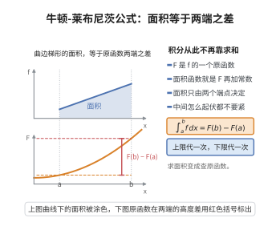

# 牛顿-莱布尼茨公式

> **一句话大白话**：算定积分根本不用一小段一小段地累加，只要找到原函数，用“上端点值减下端点值”就一步到位。
>
> **小例子**：$\int_0^1 x^2\,dx=\frac{1^3}{3}-\frac{0^3}{3}=\frac{1}{3}$，其中 $\frac{x^3}{3}$ 就是 $x^2$ 的原函数。

## 介绍

牛顿-莱布尼茨公式（Newton-Leibniz Formula），又称微积分基本定理第二部分，由艾萨克·牛顿（Isaac Newton）和戈特弗里德·威廉·莱布尼茨（Gottfried Wilhelm Leibniz）在17世纪独立发现。该公式建立了定积分与原函数之间的桥梁，将复杂的定积分计算转化为求原函数在端点处的差值，是微积分学中最核心的公式之一。

## 几何直观

图意在说明：曲边梯形的面积只由原函数在两端的取值决定，中间起伏不影响结果。

## 分析

**前置依赖**：微积分基本定理、原函数概念、可积性、中值定理

**定理内容**：若函数 $f$ 在区间 $[a,b]$ 上可积，且 $F$ 是 $f$ 在 $[a,b]$ 上的一个原函数（即 $F'(x)=f(x)$ 对任意 $x\in[a,b]$ 成立），则
$$\int_a^b f(x)\,dx = F(b)-F(a)$$

**前置知识**：
- 微积分基本定理：$F(x)=\int_a^x f(t)dt$ 是 $f$ 的原函数，且 $F'(x)=f(x)$

**数学内涵**：
牛顿-莱布尼茨公式揭示了微分与积分的内在联系——它们是互逆运算。该公式的左边是定积分（累积和），右边是原函数在端点处的差值。这一联系使得定积分计算变得简单可行，是微积分能够广泛应用于科学和工程领域的关键。

**常见记法**：
$$\int_a^b f(x)\,dx = F(x)\Big|_a^b = F(b)-F(a)$$

## 思考过程

牛顿-莱布尼茨公式的证明思路是：设 $F$ 是 $f$ 的一个原函数，而由微积分基本定理，$G(x)=\int_a^x f(t)dt$ 也是 $f$ 的一个原函数。两个原函数相差一个常数：$F(x)=G(x)+C$。

代入 $x=a$：$F(a)=G(a)+C=\int_a^a f(t)dt+C=0+C=C$，故 $C=F(a)$。

代入 $x=b$：$F(b)=G(b)+F(a)=\int_a^b f(t)dt+F(a)$。

因此 $\int_a^b f(t)dt = F(b)-F(a)$。

## 证明过程

**证明**：

设 $f$ 在 $[a,b]$ 上可积，$F$ 是 $f$ 在 $[a,b]$ 上的一个原函数，即 $F'(x)=f(x)$ 对任意 $x\in[a,b]$ 成立。

定义函数
$$G(x)=\int_a^x f(t)dt,\quad x\in[a,b]$$

由微积分基本定理，$G$ 在 $[a,b]$ 上可导，且 $G'(x)=f(x)$ 对任意 $x\in[a,b]$ 成立。因此 $G$ 也是 $f$ 的一个原函数。

由于 $F$ 和 $G$ 都是 $f$ 的原函数，它们相差一个常数，即存在常数 $C$，使得
$$F(x)=G(x)+C,\quad \forall x\in[a,b]$$

代入 $x=a$：
$$F(a)=G(a)+C=\int_a^a f(t)dt+C=0+C=C$$
因此 $C=F(a)$。

代入 $x=b$：
$$F(b)=G(b)+F(a)=\int_a^b f(t)dt+F(a)$$

整理得：
$$\int_a^b f(t)dt = F(b)-F(a)$$

$\square$

## 课堂问答

**老师**：为什么 $\int_0^1 x^2\,dx$ 不用一小段一小段加起来？

**学生**：因为牛顿-莱布尼茨公式 $\int_a^b f(x)\,dx=F(b)-F(a)$，只要找到原函数 $F$（$F'=f$）。$\frac{x^3}3$ 是 $x^2$ 的原函数，故 $\int_0^1x^2\,dx=\frac13-0=\frac13$。证明是把变限积分 $G(x)=\int_a^xf$ 与任意原函数 $F$ 比较，二者只差常数 $F=G+C$，代入 $x=a$ 得 $C=F(a)$，代入 $x=b$ 即得。

**老师（追问）**：用这条公式有什么前提？

**学生**：前提是 $f$ 在 $[a,b]$ 上可积，且 $F$ 是 $f$ 在该区间上的原函数。若 $f$ 有跳跃间断导致不可积，或区间内原函数不完整，就不能直接套用。常见误区就是对不可积函数硬套公式。

**老师（拓展）**：它和微积分基本定理是同一件事吗？

**学生**：是同一件事的两面。定理第一部分说变限积分是原函数（微分与积分互逆），第二部分就是这个公式（把定积分化为原函数的端点差）。它把"求面积"从极限过程变成了"找原函数"，是微积分得以广泛应用的关键。
