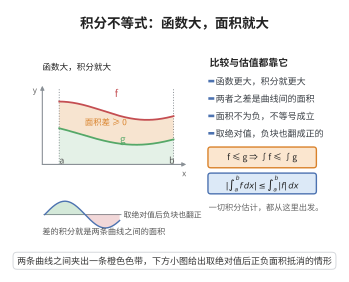

# 积分不等式

> **一句话大白话**：函数大，积分就大；加绝对值以后积分会变大——这就是定积分最基本的"比较"与"夹逼"性质。
>
> **小例子**：在 $[0,1]$ 上 $f(x)=x\le 1$，故 $0\le\int_0^1 x\,dx=\frac12\le 1$。

## 介绍

积分不等式指定积分关于被积函数的几条基本比较性质：保序性（被积函数大则积分大）、绝对值不等式（$|\int f|\le\int|f|$）与估值不等式（用上下界常数夹逼积分值）。它们直接来自定积分的定义（黎曼和的极限）与极限的保号性，是积分理论中一切估计的第一步。

这些性质在分析中无处不在：证明积分中值定理、估计误差、建立范数不等式，乃至导出 Hölder、Minkowski 等高级不等式，都要先用到"被积函数更大则积分更大"这一朴素的单调性。

从直观上看，定积分是"面积"，函数图像更高，对应面积自然更大；把函数加上绝对值，相当于把下方部分翻折到上方，面积只会增加。

## 几何直观

图意在说明：被积函数更大则积分更大，两者之差正是曲线之间那块非负的面积。

## 分析

定积分的黎曼和定义、可积性、极限的保号性（若 $A_n\le B_n$ 且两极限存在，则 $\lim A_n\le\lim B_n$）、三角不等式

**定理内容**：设 $f,g$ 在 $[a,b]$ 上黎曼可积，则：

1. （保序性）若 $f(x)\le g(x)$ 对一切 $x\in[a,b]$ 成立，则

$$
\int_a^b f(x)\,dx\le \int_a^b g(x)\,dx
$$

2. （绝对值不等式）

$$
\left|\int_a^b f(x)\,dx\right|\le \int_a^b |f(x)|\,dx
$$

3. （估值不等式）若 $m\le f(x)\le M$ 对一切 $x\in[a,b]$ 成立，则

$$
m(b-a)\le \int_a^b f(x)\,dx\le M(b-a)
$$

**数学内涵**：
- 性质 1 表明定积分是"单调"的泛函。
- 性质 2 说明积分与绝对值不可随意交换，但绝对值只会把积分放大。

## 思考过程

对同一个分割 $P=\{x_0<x_1<\cdots<x_n\}$ 与同一组介点 $\xi_i$，若 $f\le g$，则每一项 $f(\xi_i)\Delta x_i\le g(\xi_i)\Delta x_i$（因 $\Delta x_i>0$），求和得 $S(f,P)\le S(g,P)$。由于二者分别收敛到 $\int f$ 与 $\int g$，由极限的保号性得 $\int f\le\int g$。这就是性质 1。

性质 2 是把性质 1 用在 $-|f|\le f\le|f|$ 上：左半给出 $-\int|f|\le\int f$，右半给出 $\int f\le\int|f|$，合并即为 $|\int f|\le\int|f|$。性质 3 则是把性质 1 用到两个常函数上去。

## 证明过程

**步骤 1：证明保序性。** 设 $f\le g$。任取 $[a,b]$ 的分割 $P: a=x_0<x_1<\cdots<x_n=b$ 与介点 $\xi_i\in[x_i,x_{i-1}]$，令 $\Delta x_i=x_i-x_{i-1}>0$。由 $f(\xi_i)\le g(\xi_i)$ 得

$$
\sum_{i=1}^n f(\xi_i)\Delta x_i\le \sum_{i=1}^n g(\xi_i)\Delta x_i
$$

$f,g$ 可积意味着当分割的模 $\|P\|\to0$ 时，上式两端的黎曼和分别收敛到 $\int_a^b f$ 与 $\int_a^b g$。由极限的保号性，

$$
\int_a^b f(x)\,dx\le \int_a^b g(x)\,dx
$$

**步骤 2：证明绝对值不等式。** 由 $-|f(x)|\le f(x)\le |f(x)|$ 与步骤 1，分别得

$$
-\int_a^b |f(x)|\,dx\le \int_a^b f(x)\,dx\le \int_a^b |f(x)|\,dx
$$

即

$$
\left|\int_a^b f(x)\,dx\right|\le \int_a^b |f(x)|\,dx
$$

**步骤 3：证明估值不等式。** 取常函数 $g_1(x)=M$，由 $f\le M$ 与步骤 1，$\int_a^b f\le \int_a^b M\,dx=M(b-a)$。再取常函数 $g_0(x)=m$，由 $m\le f$ 与步骤 1，$m(b-a)\le\int_a^b f$。合并得

$$
m(b-a)\le \int_a^b f(x)\,dx\le M(b-a)
$$

$\square$

**推论**：取 $M=\sup_{[a,b]}f$、$m=\inf_{[a,b]}f$（当 $f$ 连续时二者有限），则估值不等式给出了积分值的夹逼范围，是积分中值定理的直接来源。

## 课堂问答

**老师**：定积分最基本的比较性质是什么？

**学生**：是保序性：$f\le g$ 在 $[a,b]$ 上成立，则 $\int_a^bf\le\int_a^bg$。因为同一分割、同一介点下每项 $f(\xi_i)\Delta x_i\le g(\xi_i)\Delta x_i$（$\Delta x_i>0$），求和后由极限保号性取极限即得。常见误区是记反方向，比如把 $\int|f|\le|\int f|$ 当成真命题。

**老师（追问）**：绝对值不等式怎么由保序性推出？

**学生**：把它用在 $-|f|\le f\le|f|$ 上：左半得 $-\int|f|\le\int f$，右半得 $\int f\le\int|f|$，合并即 $\left|\int f\right|\le\int|f|$。直观上就是把 $x$ 轴以下的部分翻折上来，面积只会不减；估值不等式 $m(b-a)\le\int f\le M(b-a)$ 则是把保序性用到常函数上。

**老师（拓展）**：积分估计能走多远？

**学生**：从这几条可以长出 $\int|fg|\le\sup|f|\cdot\int|g|$，再到 Hölder 不等式 $\left|\int fg\right|\le\left(\int|f|^p\right)^{1/p}\left(\int|g|^q\right)^{1/q}$（$\frac1p+\frac1q=1$）与 Minkowski 不等式。它们都是误差估计与函数空间（$L^p$）理论的起点。

## 相关条目

- [积分中值定理](./积分中值定理.md)：以积分不等式为前置，证明存在 $c$ 使积分等于 $f(c)(b-a)$。
- [微积分基本定理](./微积分基本定理.md)：积分估值与变限积分性质的基础。
