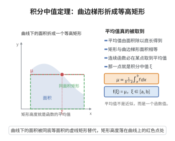

# 积分中值定理

> **一句话大白话**：曲线下那块面积，总能用一个“某点高度 × 底边长”的矩形算出来——那块起伏不定到底折合成一个“平均高度”。
>
> **小例子**：$\int_0^1 x\,dx=\frac{1}{2}$，于是 $\frac{1}{2}=f(\xi)\cdot1$，解得 $\xi=\tfrac{1}{2}$。

## 介绍

积分中值定理（Integral Mean Value Theorem）是积分学中的基本定理，揭示了连续函数在区间上的积分值与函数值之间的关系。该定理表明，连续函数在区间上的积分平均值等于区间内某点的函数值。积分中值定理是微积分基本定理的证明基础，在积分估计、不等式证明等方面有广泛应用。

## 几何直观

图意在说明：连续函数的平均值一定被某点取到，曲边梯形能折成同面积的矩形。

## 分析

**前置依赖**：定积分的定义、极值定理、介值定理、积分不等式

**定理内容**：若函数 $f$ 在闭区间 $[a,b]$ 上连续，则存在 $\xi\in[a,b]$，使得
$$\int_a^b f(x)\,dx = f(\xi)(b-a)$$

**等价形式**：
$$f(\xi)=\frac{1}{b-a}\int_a^b f(x)\,dx$$
即 $f(\xi)$ 等于 $f$ 在 $[a,b]$ 上的积分平均值。

**前置知识**：
- 介值定理：若 $f$ 在 $[a,b]$ 连续且 $f(a)<0<f(b)$，则存在 $c\in(a,b)$ 使 $f(c)=0$
- 极值定理：闭区间上的连续函数必有最大值和最小值

**数学内涵**：
积分中值定理的几何意义是：在区间 $[a,b]$ 上，曲线 $y=f(x)$ 下的面积等于以区间长度为底、以某点 $f(\xi)$ 为高的矩形面积。即使函数值变化，其积分效果等价于某个"平均高度"下的矩形面积。

## 思考过程

积分中值定理的证明思路结合了极值定理和介值定理。

由极值定理，$f$ 在 $[a,b]$ 上存在最小值 $m$ 和最大值 $M$，即对任意 $x\in[a,b]$，$m\le f(x)\le M$。

由积分不等式：
$$m(b-a)\le\int_a^b f(x)dx\le M(b-a)$$

因此
$$m\le\frac{1}{b-a}\int_a^b f(x)dx\le M$$

设 $I=\frac{1}{b-a}\int_a^b f(x)dx$，则 $I$ 介于 $m$ 和 $M$ 之间。由介值定理，存在 $\xi\in[a,b]$，使得 $f(\xi)=I$，即 $\int_a^b f(x)dx=f(\xi)(b-a)$。

## 证明过程

**证明**：

由于 $f$ 在闭区间 $[a,b]$ 上连续，由极值定理，$f$ 在 $[a,b]$ 上存在最小值 $m$ 和最大值 $M$，即
$$m\le f(x)\le M,\quad \forall x\in[a,b]$$

对不等式积分（积分保持序关系）：
$$\int_a^b m\,dx \le \int_a^b f(x)\,dx \le \int_a^b M\,dx$$
$$m(b-a) \le \int_a^b f(x)\,dx \le M(b-a)$$

除以 $b-a>0$：
$$m \le \frac{1}{b-a}\int_a^b f(x)\,dx \le M$$

记 $I=\frac{1}{b-a}\int_a^b f(x)\,dx$，则 $I\in[m,M]$。

**情况一**：若 $I=m$，则 $f$ 在 $[a,b]$ 上恒等于 $m$（否则积分值将大于 $m(b-a)$）。此时任意 $\xi\in[a,b]$ 都满足 $f(\xi)=m=I$。

**情况二**：若 $I=M$，同理 $f$ 在 $[a,b]$ 上恒等于 $M$，任意 $\xi\in[a,b]$ 都满足 $f(\xi)=M=I$。

**情况三**：若 $m<I<M$，由介值定理，存在 $\xi\in(a,b)$，使得 $f(\xi)=I$。

综上，存在 $\xi\in[a,b]$，使得
$$\int_a^b f(x)\,dx = f(\xi)(b-a)$$

$\square$

## 课堂问答

**老师**：曲线下的面积，为什么总能折成一个同底的矩形？

**学生**：因为连续函数的积分平均值必被取到：存在 $\xi\in[a,b]$ 使 $\int_a^bf(x)\,dx=f(\xi)(b-a)$。证明先用极值定理取 $m\le f\le M$，积分得 $m(b-a)\le\int_a^bf\le M(b-a)$，除以 $b-a$ 得平均值 $I\in[m,M]$，再由介值定理找到 $f(\xi)=I$。几何上就是面积等于底 $b-a$、高 $f(\xi)$ 的矩形。

**老师（追问）**：$\xi$ 一定落在开区间吗？

**学生**：不一定。若 $f$ 为常数，则 $I=m=M$，区间内任意点都行；一般情形 $m<I<M$ 时由介值定理可取 $\xi\in(a,b)$。这与拉格朗日中值定理的 $\xi$ 严格落在开区间略有不同，定理本身只保证 $\xi\in[a,b]$。

**老师（拓展）**：这条定理有什么大用？

**学生**：它能估算积分、证明不等式（把 $\int fg$ 中的 $f$ 用中值提出），更是微积分基本定理证明的跳板——用它把 $\frac1h\int_{x_0}^{x_0+h}f$ 写成 $f(\xi)$。当 $f$ 连续时，它的含义就是"积分平均值被某点取到"。
