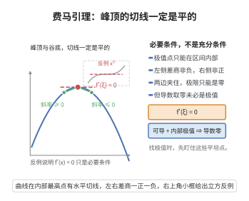

# 费马引理

> **一句话大白话**：凡是“可导函数”在最高点或最低点（山顶、谷底），切线一定是平的——导数等于 0。
>
> **小例子**：$f(x)=x^2$ 在 $x=0$ 取最小值，且 $f'(0)=2\cdot0=0$。（注意反过来不成立：$f'(0)=0$ 不代表一定是极值。）

## 介绍

费马引理（Fermat's Lemma）是微分学中的基本定理之一，由法国数学家皮埃尔·德·费马（Pierre de Fermat）在17世纪提出。该定理建立了函数取极值与导数等于零之间的联系，是中值定理理论的基础，也是优化问题的理论基础。费马引理在经济学、物理学、工程学等领域有广泛的应用，是求解最优化问题的一阶必要条件。

## 几何直观

图意在说明：可导函数在内部取得极值时，左右差商符号相反，极限只能为零。

## 分析

**前置依赖**：导数定义、左极限与右极限、局部极值概念

**定理内容**：若函数 $f$ 在点 $x_0$ 处可导，且 $f$ 在 $x_0$ 处取得局部极值（局部最大值或局部最小值），则 $f'(x_0)=0$。

**前置知识**：
- 导数定义：$f'(x_0)=\lim_{h\to 0}\frac{f(x_0+h)-f(x_0)}{h}$

**数学内涵**：
费马引理揭示了可微函数极值点的一个重要几何性质：在极值点处，函数的切线是水平的。这一结论的直观理解是，如果函数在极值点有非零导数，那么沿该点附近函数值会单调变化，这与极值点的定义矛盾。

**注意**：
- 该定理是必要条件，而非充分条件。$f'(x_0)=0$ 并不能保证 $x_0$ 是极值点（例如 $f(x)=x^3$ 在 $x=0$ 处）。
- 函数在极值点处可能不可导（例如 $f(x)=|x|$ 在 $x=0$ 处），此时费马引理不适用。

## 思考过程

费马引理的发现源于对曲线极值点的几何观察。费马在研究曲线切线与极值的关系时注意到，在曲线的最高点或最低点处，切线是水平的。这一直观观察可以通过极限语言严格化。

设 $f$ 在 $x_0$ 处取局部极大值。那么对于充分小的 $h>0$，有 $f(x_0+h)\le f(x_0)$，即 $f(x_0+h)-f(x_0)\le 0$。因此差商 $\frac{f(x_0+h)-f(x_0)}{h}\le 0$。令 $h\to 0^+$，右导数为 $f'_+(x_0)\le 0$。

类似地，对于 $h<0$ 且 $|h|$ 充分小，有 $f(x_0+h)-f(x_0)\le 0$，而 $h<0$，因此差商 $\frac{f(x_0+h)-f(x_0)}{h}\ge 0$，左导数为 $f'_-(x_0)\ge 0$。

由于 $f$ 在 $x_0$ 处可导，左右导数相等，因此 $f'(x_0)=0$。

## 证明过程

**证明**：设 $f$ 在 $x_0$ 处取局部极大值（局部极小值的情况类似可证）。

根据局部极大值的定义，存在 $\delta>0$，使得对任意 $x\in (x_0-\delta, x_0+\delta)$，有 $f(x)\le f(x_0)$。

考虑差商：

1. 当 $h>0$ 且 $h<\delta$ 时：
   $$f(x_0+h)-f(x_0)\le 0\quad\Rightarrow\quad \frac{f(x_0+h)-f(x_0)}{h}\le 0$$
   取右极限：
   $$f'_+(x_0)=\lim_{h\to 0^+}\frac{f(x_0+h)-f(x_0)}{h}\le 0$$

2. 当 $h<0$ 且 $|h|<\delta$ 时：
   $$f(x_0+h)-f(x_0)\le 0\quad\Rightarrow\quad \frac{f(x_0+h)-f(x_0)}{h}\ge 0\quad(\text{因 }h<0)$$
   取左极限：
   $$f'_-(x_0)=\lim_{h\to 0^-}\frac{f(x_0+h)-f(x_0)}{h}\ge 0$$

由于 $f$ 在 $x_0$ 处可导，故 $f'_-(x_0)=f'_+(x_0)=f'(x_0)$。因此：
$$0\le f'(x_0)\le 0$$
从而 $f'(x_0)=0$。

$\square$

## 课堂问答

**老师**：函数在极值点处导数一定为零吗？

**学生**：只要该点可导，就一定为零。证明用左右导数夹逼：设 $x_0$ 是局部极大值，$h>0$ 时 $f(x_0+h)-f(x_0)\le0$，差商 $\le0$，右导数 $\le0$；$h<0$ 时同号不等式除以负数，差商 $\ge0$，左导数 $\ge0$。可导意味着左右导数相等，只能 $f'(x_0)=0$。

**老师（追问）**：反过来成立吗？

**学生**：不成立。$f'(x_0)=0$ 只说明切线水平，并不保证是极值，例如 $f(x)=x^3$ 在 $0$ 处导数为 $0$，却单调递增、不取极值。所以费马引理只提供一阶必要条件，判断极值还需二阶导或导数是否变号。

**老师（拓展）**：不可导点怎么办？

**学生**：费马引理对不可导点失效，例如 $f(x)=|x|$ 在 $x=0$ 取极小值却不可导。所以求最值时要把三类点都列为候选：导数为 $0$ 的驻点、导数不存在的点、以及区间端点，逐一比较函数值。
