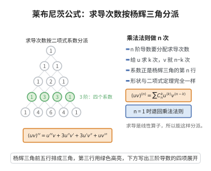

# 高阶导数公式

> **一句话大白话**：反复求导就像反复做同一件事；两个函数相乘后求 $n$ 阶导，可以把"求导次数"按二项式系数分派给两个因子，这就是乘法版的二项式定理。
>
> **小例子**：$(e^x\sin x)''=2e^x\cos x$；而 $(x^2e^x)'''=e^x(x^2+6x+6)$。

## 介绍

高阶导数公式包括两大部分：一是乘积函数的高阶导数公式，即莱布尼茨公式；二是若干初等函数（幂、指数、三角、对数）的 $n$ 阶导数具体表达式。前者把二项式定理"搬到"求导运算上，后者则是反复求导得到的一般规律。

莱布尼茨公式由戈特弗里德·莱布尼茨（Gottfried Leibniz）发现，其形式 $(uv)^{(n)}=\sum_k\binom nk u^{(k)}v^{(n-k)}$ 与二项式定理完全平行，反映的是求导算子的"导子"性质：$D(uv)=u'v+uv'$，恰如 $(a+b)$ 的一次幂展开。

这些公式在泰勒展开、微分方程、幂级数乘法等场合反复使用，是把"求导"提升为一项可系统计算的技术的关键。

## 几何直观

图意在说明：乘积的高阶导数把求导次数按二项式系数分配给两个因子，形状与二项式定理一致。

## 分析

**前置依赖**：导数的定义、乘积求导法则、数学归纳法原理、二项式定理（Pascal 恒等式）

**定理内容**：设 $u,v$ 在区间上有直到 $n$ 阶的导数，约定 $u^{(0)}=u$，则莱布尼茨公式成立：

$$
(uv)^{(n)}=\sum_{k=0}^n \binom nk u^{(k)}v^{(n-k)}
$$

此外，几个常用函数的 $n$ 阶导数为

$$
(e^{ax})^{(n)}=a^n e^{ax},\qquad (\sin x)^{(n)}=\sin\!\left(x+\frac{n\pi}{2}\right),\qquad (\cos x)^{(n)}=\cos\!\left(x+\frac{n\pi}{2}\right)
$$

$$
(\ln x)^{(n)}=\frac{(-1)^{n-1}(n-1)!}{x^n}\ (n\ge1),\qquad (x^m)^{(n)}=\frac{m!}{(m-n)!}\,x^{m-n}\ (n\le m)
$$

**数学内涵**：
- 莱布尼茨公式把 $D^n(uv)$ 展开为各阶导数的二项式型组合。
- 三角函数的 $n$ 阶导数呈现周期为 $4$ 的循环，等价于相位平移 $n\pi/2$。

## 思考过程

莱布尼茨公式的证明与二项式定理的归纳证明如出一辙：一阶时 $(uv)'=u'v+uv'$ 正是 $n=1$ 的情形；假设 $n$ 阶成立，再对两边求一次导，用乘积法则展开，得到形如 $u^{(k+1)}v^{(n-k)}+u^{(k)}v^{(n-k+1)}$ 的两组和，重新编号后同类项系数为 $\binom nk+\binom n{k-1}$，由 Pascal 恒等式即为 $\binom{n+1}{k}$，于是归纳完成。

三角函数的公式则利用"求导即把 $\sin$ 变成 $\cos$、把 $\cos$ 变成 $-\sin$"这一循环规律，把每次求导看成相位的 $\pi/2$ 平移，用归纳法验证。

## 证明过程

**步骤 1：定义与基础情形。** 定义 $f^{(0)}=f$，$f^{(n)}=(f^{(n-1)})'$。当 $n=1$ 时 $(uv)'=u'v+uv'=\binom10 u^{(1)}v^{(0)}+\binom11 u^{(0)}v^{(1)}$，公式成立。

**步骤 2：莱布尼茨公式的归纳步骤。** 假设 $n$ 阶公式成立，对其两边求导：

$$
(uv)^{(n+1)}=\sum_{k=0}^n \binom nk \left(u^{(k+1)}v^{(n-k)}+u^{(k)}v^{(n-k+1)}\right)
$$

第一项令 $j=k+1$，化为 $\sum_{j=1}^{n+1}\binom n{j-1}u^{(j)}v^{(n+1-j)}$；第二项令 $j=k$，化为 $\sum_{j=0}^{n}\binom nj u^{(j)}v^{(n+1-j)}$。合并同类项 $u^{(j)}v^{(n+1-j)}$，其系数为

$$
\binom n{j-1}+\binom nj=\binom{n+1}{j},\qquad 1\le j\le n
$$

（由 Pascal 恒等式），而 $j=0$ 与 $j=n+1$ 的系数分别为 $\binom n0=\binom{n+1}{0}=1$ 与 $\binom nn=\binom{n+1}{n+1}=1$。故

$$
(uv)^{(n+1)}=\sum_{j=0}^{n+1}\binom{n+1}{j}u^{(j)}v^{(n+1-j)}
$$

归纳完成，莱布尼茨公式对所有 $n\ge1$ 成立。

**步骤 3：指数函数。** 由 $(e^{ax})'=ae^{ax}$ 反复求导，得 $(e^{ax})^{(n)}=a^n e^{ax}$。

**步骤 4：三角函数。** 用归纳法证 $(\sin x)^{(n)}=\sin\!\left(x+\frac{n\pi}{2}\right)$。$n=0$ 时显然；若 $n$ 时成立，则

$$
(\sin x)^{(n+1)}=\left[\sin\!\left(x+\frac{n\pi}{2}\right)\right]'=\cos\!\left(x+\frac{n\pi}{2}\right)=\sin\!\left(x+\frac{(n+1)\pi}{2}\right)
$$

同理 $(\cos x)^{(n)}=\cos\!\left(x+\frac{n\pi}{2}\right)$。

**步骤 5：对数与幂函数。** 对 $n=1$，$(\ln x)'=1/x$；若 $(\ln x)^{(n)}=\frac{(-1)^{n-1}(n-1)!}{x^n}$，求导得 $\frac{(-1)^{n}n!}{x^{n+1}}$，即 $n+1$ 阶公式，故结论对一切 $n\ge1$ 成立。同理，由 $(x^m)^{(n)}=\frac{m!}{(m-n)!}x^{m-n}$ 归纳得幂函数的 $n$ 阶导数（$n\le m$；当 $n>m$ 时导数为 $0$）。$\square$

## 课堂问答

**老师**：两个函数相乘求 $n$ 阶导，有没有像二项式那样的公式？

**学生**：有，莱布尼茨公式 $(uv)^{(n)}=\sum_{k=0}^{n}\binom nk u^{(k)}v^{(n-k)}$，与二项式定理完全平行。证明对 $n$ 归纳：一阶 $(uv)'=u'v+uv'$ 正是 $n=1$；归纳步对两边再求导，合并同类项时系数 $\binom nk+\binom n{k-1}$ 恰由帕斯卡恒等式等于 $\binom{n+1}{k}$。它反映 $D$ 作为导子的代数性质。

**老师（追问）**：怎样用莱布尼茨公式快速写出 $(e^x\sin x)^{\prime\prime}$？

**学生**：逐项展开：$(e^x\sin x)^{\prime\prime}=\binom20(e^x)^{\prime\prime}\sin x+\binom21(e^x)^{\prime}(\sin x)^{\prime}+\binom22e^x(\sin x)^{\prime\prime}=e^x\sin x+2e^x\cos x-e^x\sin x=2e^x\cos x$，两端 $e^x\sin x$ 正好抵消。这正是它与二项式展开相互呼应的体现。

**老师（拓展）**：还有哪些常用 $n$ 阶导数要背？

**学生**：$(\sin x)^{(n)}=\sin\left(x+\frac{n\pi}2\right)$、$(\cos x)^{(n)}=\cos\left(x+\frac{n\pi}2\right)$（求导是相位平移 $\frac\pi2$，周期 $4$ 循环）；$(\ln x)^{(n)}=\frac{(-1)^{n-1}(n-1)!}{x^n}$；$(x^m)^{(n)}=\frac{m!}{(m-n)!}x^{m-n}$（$n\le m$，$n>m$ 时为 $0$）。它们在泰勒展开、幂级数乘法与微分方程中反复出现。

## 相关条目

- [泰勒定理](./泰勒定理.md)：泰勒展开中需要各阶导数，莱布尼茨公式常用于求高阶导。
- [常见麦克劳林展开](./常见麦克劳林展开.md)：借助高阶导数公式得到各函数的幂级数系数。
