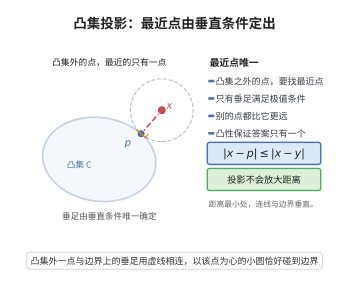

# 凸集与投影定理

> **一句话大白话**：给定一个闭凸集合和一个集合内外的点，集合里存在**唯一**一个离它最近的点（投影），而且这个点由一条"夹角不小于直角"的不等式刻画。
>
> **小例子**：把平面上的点 $\boldsymbol x$ 正投影到闭圆盘 $C$ 上，落点 $p$ 就是 $C$ 中离 $\boldsymbol x$ 最近的点；若 $\boldsymbol x$ 在圆盘外，则 $p$ 落在边界上，向量 $\boldsymbol x-p$ 与一切由 $p$ 指向圆盘内部的向量都成钝角。

## 一、定理介绍

> **前置依赖**：正交投影定理、凸集分离定理、Cauchy-Schwarz不等式、凸函数与凸集、Bolzano-Weierstrass定理

最近点投影（凸集投影）定理断言：非空闭凸集 $C$ 上存在**唯一**的最佳逼近点 $P_C(\boldsymbol x)$。它是正交投影（投影到闭子空间）的推广，不必假设 $C$ 是线性子空间——只要有闭性与凸性，最近点就存在、唯一，并可由一个变分不等式刻画。它是凸分析中次梯度与最优性条件的几何来源，也是变分不等式与投影算法的出发点。

## 几何直观

图意在说明：凸集外一点的最近点就是它在凸集上的投影，连线与边界垂直，且这样的点只有一个。

## 二、原理思路

1. **存在性**：把距离 $\mathrm{dist}(\boldsymbol x,C)$ 用一列逼近点 $\boldsymbol y_k$ 逼近，由范数的强制性该列有界，再用 Bolzano-Weierstrass 取收敛子列，闭性保证极限落在 $C$ 中。
2. **唯一性**：用平行四边形律。两个"最近点"的中点也是 $C$ 中最近点，代入平行四边形律即导出两点距离为零。
3. **变分不等式**：沿 $C$ 内任意方向作微小移动，最近性给出二次函数在 $t=0$ 处取极小，求导得"夹角非锐"不等式；反之该不等式直接给出最近性。
4. **非扩张性**：对两点各写变分不等式，相加后用 Cauchy-Schwarz 不等式。

## 三、定理的严格表述

**（凸集投影定理）** 设 $C\subseteq\mathbb R^n$ 非空、闭、凸，$\boldsymbol x\in\mathbb R^n$。则：

(1)（存在唯一）存在唯一点 $p=P_C(\boldsymbol x)\in C$ 使

$$
\|\boldsymbol x-p\|=\mathrm{dist}(\boldsymbol x,C):=\inf_{\boldsymbol y\in C}\|\boldsymbol x-\boldsymbol y\| .
$$

(2)（变分不等式刻画）$p=P_C(\boldsymbol x)$ 当且仅当 $p\in C$ 且

$$
\langle \boldsymbol x-p,\ \boldsymbol y-p\rangle\le 0\qquad\text{对一切 }\boldsymbol y\in C .
$$

(3)（非扩张性）$\|P_C(\boldsymbol x)-P_C(\boldsymbol x')\|\le\|\boldsymbol x-\boldsymbol x'\|$ 对一切 $\boldsymbol x,\boldsymbol x'\in\mathbb R^n$。

(4)（与正交投影的一致性）若 $C$ 是闭线性子空间，则 $P_C$ 就是正交投影，且 $\boldsymbol x-P_C(\boldsymbol x)\perp C$。

## 四、证明过程

**步骤 1：存在性**

记 $d=\mathrm{dist}(\boldsymbol x,C)$，取 $\boldsymbol y_k\in C$ 使 $\|\boldsymbol x-\boldsymbol y_k\|\to d$。该列有界：

$$
\|\boldsymbol y_k\|\le\|\boldsymbol x\|+\|\boldsymbol x-\boldsymbol y_k\|\le\|\boldsymbol x\|+d+1\qquad(k\ \text{充分大}).
$$

由 Bolzano-Weierstrass 定理，$(\boldsymbol y_k)$ 有收敛子列，不妨设 $\boldsymbol y_k\to p$。因 $C$ 闭，$p\in C$；由范数的连续性 $\|\boldsymbol x-p\|=\lim_k\|\boldsymbol x-\boldsymbol y_k\|=d$，故 $p$ 是最近点。$\square$

**步骤 2：唯一性**

设 $p,q\in C$ 都满足 $\|\boldsymbol x-p\|=\|\boldsymbol x-q\|=d$。由 $C$ 凸，$(p+q)/2\in C$，故 $\|\boldsymbol x-(p+q)/2\|\ge d$。对 $a=\boldsymbol x-p$、$b=\boldsymbol x-q$ 用平行四边形律 $\|a+b\|^2+\|a-b\|^2=2\|a\|^2+2\|b\|^2$。其中 $a+b=2\big(\boldsymbol x-(p+q)/2\big)$、$a-b=q-p$，代入得

$$
4\Big\|\boldsymbol x-\tfrac{p+q}{2}\Big\|^2+\|p-q\|^2=2\|\boldsymbol x-p\|^2+2\|\boldsymbol x-q\|^2=4d^2 .
$$

左端第一项 $\ge4d^2$，故 $\|p-q\|^2\le0$，即 $p=q$。$\square$

**步骤 3：变分不等式**

设 $p=P_C(\boldsymbol x)$。对任意 $\boldsymbol y\in C$ 与 $t\in[0,1]$，由凸性 $p_t:=(1-t)p+t\boldsymbol y\in C$，于是 $\|\boldsymbol x-p_t\|^2\ge\|\boldsymbol x-p\|^2$。展开

$$
\|\boldsymbol x-p_t\|^2=\|\boldsymbol x-p\|^2-2t\langle\boldsymbol x-p,\boldsymbol y-p\rangle+t^2\|\boldsymbol y-p\|^2 .
$$

移项并除以 $t>0$：$-2\langle\boldsymbol x-p,\boldsymbol y-p\rangle+t\|\boldsymbol y-p\|^2\ge0$。令 $t\to0^+$ 得 $\langle\boldsymbol x-p,\boldsymbol y-p\rangle\le0$。

反之设 $p\in C$ 满足该不等式。对任意 $\boldsymbol y\in C$，由 $\langle\boldsymbol x-p,p-\boldsymbol y\rangle=-\langle\boldsymbol x-p,\boldsymbol y-p\rangle\ge0$ 得

$$
\|\boldsymbol x-\boldsymbol y\|^2=\|\boldsymbol x-p\|^2+2\langle\boldsymbol x-p,\ p-\boldsymbol y\rangle+\|p-\boldsymbol y\|^2
\ge\|\boldsymbol x-p\|^2 .
$$

故 $p$ 是最近点。结合步骤 1、2 得 (2)。$\square$

**步骤 4：非扩张性**

记 $p=P_C(\boldsymbol x)$、$q=P_C(\boldsymbol x')$。对 $p$ 用步骤 3（取 $\boldsymbol y=q$）、对 $q$ 用步骤 3（取 $\boldsymbol y=p$）：

$$
\langle\boldsymbol x-p,\ q-p\rangle\le0,\qquad \langle\boldsymbol x'-q,\ p-q\rangle\le0 .
$$

两式相加整理得 $\langle \boldsymbol x-\boldsymbol x',\ q-p\rangle\le-\|p-q\|^2$。若 $p\ne q$，由 Cauchy-Schwarz 不等式

$$
\|p-q\|^2\le\langle\boldsymbol x-\boldsymbol x',\ p-q\rangle\le\|\boldsymbol x-\boldsymbol x'\|\cdot\|p-q\| ,
$$

约去 $\|p-q\|>0$ 得 $\|p-q\|\le\|\boldsymbol x-\boldsymbol x'\|$；若 $p=q$ 结论显然。$\square$

**步骤 5：闭子空间情形**

设 $C=M$ 为闭线性子空间。由步骤 3，$p\in M$ 为最近点当且仅当 $\langle\boldsymbol x-p,\boldsymbol y-p\rangle\le0$ 对一切 $\boldsymbol y\in M$。因 $M$ 是子空间，$\boldsymbol y$ 可换成 $2p-\boldsymbol y\in M$，两个方向的不等式迫使 $\langle\boldsymbol x-p,\boldsymbol y-p\rangle=0$ 对一切 $\boldsymbol y\in M$；再取 $\boldsymbol y=0$ 相减得 $\langle\boldsymbol x-p,\boldsymbol y\rangle=0$，即 $\boldsymbol x-p\perp M$。这正是正交投影定理的结论。$\blacksquare$

## 五、应用与意义

**在凸分析与博弈论中的作用**：变分不等式 $\langle\boldsymbol x-p,\boldsymbol y-p\rangle\le0$ 与凸函数的次梯度最优性条件同构，是凸优化一阶条件的几何来源；非扩张性保证投影梯度法、交替投影法（POCS）与近端算法的收敛性；在 Nash 均衡的证明中，用闭凸集上的投影（最近点映射）把集值对应单值化，是构造连续逼近映射的标准手段。

**理论意义**：投影定理说明"闭凸"正是"存在唯一最近点"的充要几何条件——去掉闭性或凸性结论都会失效（开单位圆盘外一点无最近点，非凸的"月牙形"可能有两个等距点）。配合凸集分离定理，它还给出"点与闭凸集可被超平面分离"的构造性证明，二者共同构成凸分析的两块基石。

## 课堂问答

**老师**：闭凸集上的最近点为什么存在且唯一？

**学生**：结论是存在性靠 Bolzano-Weierstrass，唯一性靠平行四边形律。取逼近列 $\boldsymbol y_k\in C$ 使 $\|\boldsymbol x-\boldsymbol y_k\|\to d$，该列有界故有收敛子列，闭性保证极限 $p\in C$；若 $p,q$ 都是最近点，则中点也在 $C$ 中，代入平行四边形律得
$$4\Big\|\boldsymbol x-\tfrac{p+q}{2}\Big\|^2+\|p-q\|^2=4d^2,$$
左端第一项 $\ge4d^2$，故 $\|p-q\|^2\le0$，即 $p=q$。

**老师（追问）**：变分不等式 $\langle\boldsymbol x-p,\ \boldsymbol y-p\rangle\le0$ 的几何意义是什么？

**学生**：它说向量 $\boldsymbol x-p$ 与所有由 $p$ 指向 $C$ 内部的方向都不成锐角（夹角不小于直角），这正是"$p$ 离 $\boldsymbol x$ 最近"的充要刻画。常见误区是以为投影定理要求 $C$ 是线性子空间，其实只要闭性与凸性即可，正交投影只是子空间的特例。

**老师（拓展）**：非扩张性 $\|P_C(\boldsymbol x)-P_C(\boldsymbol x')\|\le\|\boldsymbol x-\boldsymbol x'\|$ 从何而来？

**学生**：对两点各写一条变分不等式相加得 $\langle\boldsymbol x-\boldsymbol x',\ q-p\rangle\le-\|p-q\|^2$，再用 Cauchy-Schwarz 不等式约去 $\|p-q\|$ 即得。它保证投影梯度法与交替投影法的收敛性，也是把集值最优反应"单值化"的标准工具。
