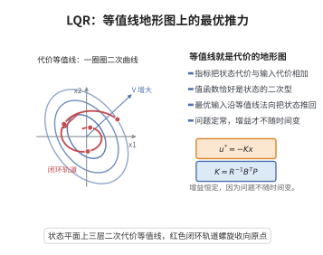

# LQR的最优反馈

> **一句话大白话**：要又快又省力地把系统拉回理想态，LQR 给出的最优控制器是写成“状态乘一个增益矩阵”的反馈，而那个增益由解一个 Riccati 方程得到。
>
> **小例子**：让自动驾驶仪把车稳在车道中心，最优转向指令就是 $\boldsymbol u=-K\boldsymbol x$，矩阵 $K$ 由 Riccati 方程一步算出，兼顾了偏离和能耗。

## 一、定理介绍

> **前置依赖**：动态规划（HJB方程）、线性时不变系统理论、Lyapunov稳定性定理、可控性与可观性、代数Riccati方程。

对线性时不变系统 $\dot{\boldsymbol x}=\boldsymbol A\boldsymbol x+\boldsymbol B\boldsymbol u$ 与二次指标 $J=\int_0^\infty(\boldsymbol x^{\top}\boldsymbol Q\boldsymbol x+\boldsymbol u^{\top}\boldsymbol R\boldsymbol u)\,dt$，LQR 定理给出最优反馈 $\boldsymbol u^*=-\boldsymbol K\boldsymbol x$，其中 $\boldsymbol K=\boldsymbol R^{-1}\boldsymbol B^{\top}\boldsymbol P$，$\boldsymbol P$ 是代数 Riccati 方程唯一正定解。

## 几何直观

图意在说明：二次代价的等值线是一圈圈椭圆，最优反馈沿法向把状态推回原点，且增益不随时间变。

## 二、原理思路

用动态规划（HJB 方程）处理无限时域调优：猜测最优值函数为二次型 $V=\boldsymbol x^{\top}\boldsymbol P\boldsymbol x$，把最优点代入 HJB 得到 Riccati 方程；再以 $V$ 作闭环 Lyapunov 函数证稳定。

## 三、定理的严格表述

设 $(\boldsymbol A,\boldsymbol B)$ 可控、$(\boldsymbol A,\boldsymbol Q^{1/2})$ 可观，$\boldsymbol Q=\boldsymbol Q^{\top}\ge0$，$\boldsymbol R=\boldsymbol R^{\top}>0$。则最优控制为
$$
\boldsymbol u^*=-\boldsymbol K\boldsymbol x,\qquad \boldsymbol K=\boldsymbol R^{-1}\boldsymbol B^{\top}\boldsymbol P,
$$
其中 $\boldsymbol P=\boldsymbol P^{\top}\ge0$ 是代数 Riccati 方程
$$
\boldsymbol A^{\top}\boldsymbol P+\boldsymbol P\boldsymbol A-\boldsymbol P\boldsymbol B\boldsymbol R^{-1}\boldsymbol B^{\top}\boldsymbol P+\boldsymbol Q=\boldsymbol 0
$$
的唯一正定解。

## 四、证明过程

1. **HJB 方程**。无限时域定常 HJB
   $$
   0=\min_{\boldsymbol u}\Big[\boldsymbol x^{\top}\boldsymbol Q\boldsymbol x+\boldsymbol u^{\top}\boldsymbol R\boldsymbol u+(\nabla V)^{\top}(\boldsymbol A\boldsymbol x+\boldsymbol B\boldsymbol u)\Big].
   $$
2. **猜二次型**。令 $V=\boldsymbol x^{\top}\boldsymbol P\boldsymbol x$，$\nabla V=2\boldsymbol P\boldsymbol x$。
3. **求最优**。对 $\boldsymbol u$ 求导设零：$2\boldsymbol R\boldsymbol u+2\boldsymbol B^{\top}\boldsymbol P\boldsymbol x=\boldsymbol 0$，故 $\boldsymbol u^*=-\boldsymbol R^{-1}\boldsymbol B^{\top}\boldsymbol P\boldsymbol x$。
4. **Riccati 方程**。回代 HJB 得 $\boldsymbol A^{\top}\boldsymbol P+\boldsymbol P\boldsymbol A-\boldsymbol P\boldsymbol B\boldsymbol R^{-1}\boldsymbol B^{\top}\boldsymbol P+\boldsymbol Q=\boldsymbol 0$。
5. **闭环稳定**。取 $V=\boldsymbol x^{\top}\boldsymbol P\boldsymbol x$ 为闭环 Lyapunov 函数，由 Riccati 方程得 $\dot V=-\boldsymbol x^{\top}(\boldsymbol Q+\boldsymbol K^{\top}\boldsymbol R\boldsymbol K)\boldsymbol x\le0$，由可控/可观条件推 $\boldsymbol P>0$ 与渐近稳定。

## 五、应用与意义

LQR 是线性最优控制的标准解法，用于航空航天、机器人运动规划与工业过程控制。其“Riccati 方程 + 状态反馈”的结构兼顾性能与稳定性，也为 H∞ 控制、MPC 等现代方法奠定基础。

## 课堂问答

**老师**：对无限时域二次指标 $J=\int_0^\infty(\boldsymbol x^{\top}\boldsymbol Q\boldsymbol x+\boldsymbol u^{\top}\boldsymbol R\boldsymbol u)\,dt$，最优控制为什么一定是状态反馈，而且带一个常数增益？

**学生**：结论是 $\boldsymbol u^*=-\boldsymbol K\boldsymbol x$，$\boldsymbol K=\boldsymbol R^{-1}\boldsymbol B^{\top}\boldsymbol P$，常数增益来自值函数的二次型结构。因为系统与指标都定常、时不变，动态规划的最优值函数只依赖当前状态，而 $\boldsymbol Q,\boldsymbol R$ 与时间无关，故令 $V=\boldsymbol x^{\top}\boldsymbol P\boldsymbol x$ 后 $\boldsymbol P$ 也不依赖时间，反馈增益自然定常。

**老师（追问）**：那你把最优控制回代 HJB，凭什么 $\boldsymbol P$ 满足的就是那个 Riccati 方程，闭环又凭什么稳定？

**学生**：把 $V=\boldsymbol x^{\top}\boldsymbol P\boldsymbol x$、$\nabla V=2\boldsymbol P\boldsymbol x$ 代入定常 HJB，对 $\boldsymbol u$ 求导得 $2\boldsymbol R\boldsymbol u+2\boldsymbol B^{\top}\boldsymbol P\boldsymbol x=\boldsymbol 0$，故 $\boldsymbol u^*=-\boldsymbol R^{-1}\boldsymbol B^{\top}\boldsymbol P\boldsymbol x$；回代即得
$$
\boldsymbol A^{\top}\boldsymbol P+\boldsymbol P\boldsymbol A-\boldsymbol P\boldsymbol B\boldsymbol R^{-1}\boldsymbol B^{\top}\boldsymbol P+\boldsymbol Q=\boldsymbol 0 .
$$
再取 $V$ 为闭环 Lyapunov 函数，得 $\dot V=-\boldsymbol x^{\top}(\boldsymbol Q+\boldsymbol K^{\top}\boldsymbol R\boldsymbol K)\boldsymbol x\le0$，故闭环稳定。常见误区是把 Riccati 方程写成 $\boldsymbol A^{\top}\boldsymbol P+\boldsymbol P\boldsymbol A+\boldsymbol Q=\boldsymbol 0$，漏掉 $-\boldsymbol P\boldsymbol B\boldsymbol R^{-1}\boldsymbol B^{\top}\boldsymbol P$ 这个负二次项。

**老师（拓展）**：如果 $\boldsymbol Q$ 只是半正定，$\dot V$ 只能半负定，稳定性论证会怎样被削弱？

**学生**：此时只能保证 Lyapunov 稳定，不能直接得渐近稳定；要靠 $(\boldsymbol A,\boldsymbol Q^{1/2})$ 可观使 $\{\dot V=0\}$ 不含非零完整轨道，再用 LaSalle 不变集原理补上。这正呼应代数Riccati方程里"可检测"的假设——可检测是可观的弱化，只在不可观子空间上额外要求自稳定。
