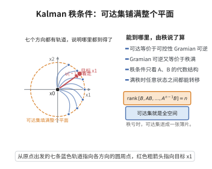

# 可控性的Kalman秩条件

> **一句话大白话**：一个系统到底能不能被控制到任意想要的状态，就看一本“能力账本”（可控性矩阵）是不是排满了行——满行就是完全可控。
>
> **小例子**：判断一辆车能否被操控到任意位置姿态，只需看可控性矩阵是否满秩；满秩意味着“力量能传导到每个自由度”。

## 一、定理介绍

> **前置依赖**：矩阵指数、Cayley-Hamilton定理、可控性Gramian与矩阵积分、线性代数（秩与核）、线性时不变系统理论。

可控性的 Kalman 秩条件给出线性时不变系统 $(\boldsymbol A,\boldsymbol B)$ 完全可控的判据：可控性矩阵
$$
\mathcal C=[\boldsymbol B,\boldsymbol A\boldsymbol B,\ldots,\boldsymbol A^{n-1}\boldsymbol B]
$$
满秩（$\mathrm{rank}\,\mathcal C=n$）。它把“可控”从动态可达性化为一个纯粹的线性代数检验。

## 几何直观

图意在说明：可控性矩阵满秩时可达集是整个状态空间，任何目标状态都能用某个输入把它送到。

## 二、原理思路

可控性等价于可控性 Gramian $\boldsymbol W_c(t)$ 的可逆性。借助 Cayley-Hamilton 定理把 $e^{\boldsymbol A\tau}$ 表为 $\boldsymbol A^0,\dots,\boldsymbol A^{n-1}$ 的组合，进而证明 Gramian 可逆 $\iff$ 可控性矩阵满秩。

## 三、定理的严格表述

设 $\dot{\boldsymbol x}=\boldsymbol A\boldsymbol x+\boldsymbol B\boldsymbol u$，$\boldsymbol A\in\mathbb{R}^{n\times n}$，$\boldsymbol B\in\mathbb{R}^{n\times m}$。系统完全可控当且仅当
$$
\mathrm{rank}\,[\boldsymbol B,\;\boldsymbol A\boldsymbol B,\;\boldsymbol A^2\boldsymbol B,\;\ldots,\;\boldsymbol A^{n-1}\boldsymbol B]=n.
$$

## 四、证明过程

1. **解与 Gramian**。状态解为 $\boldsymbol x(t)=e^{\boldsymbol At}\boldsymbol x_0+\int_0^t e^{\boldsymbol A(t-\tau)}\boldsymbol B\boldsymbol u\,d\tau$，定义 $\boldsymbol W_c(t)=\int_0^t e^{\boldsymbol A\tau}\boldsymbol B\boldsymbol B^{\top}e^{\boldsymbol A^{\top}\tau}d\tau$。
2. **等价可逆性**。系统可控 $\iff$ 对任意 $t>0$ 的 $\boldsymbol W_c(t)$ 可逆（由 $\boldsymbol u=\boldsymbol B^{\top}e^{\boldsymbol A^{\top}(t-\tau)}\boldsymbol W_c^{-1}(\cdots)$ 构造达到任意目标）。
3. **Cayley-Hamilton**。$e^{\boldsymbol A\tau}=\sum_{j=0}^{n-1}\alpha_j(\tau)\boldsymbol A^j$。
4. **奇异判据**。$\boldsymbol W_c(t)$ 奇异 $\iff$ 存在非零 $\boldsymbol v$ 使对所有 $\tau$ 有 $\boldsymbol v^{\top}e^{\boldsymbol A\tau}\boldsymbol B=\boldsymbol 0$ $\iff$ $\boldsymbol v^{\top}\boldsymbol A^j\boldsymbol B=\boldsymbol 0$（$j=0,\dots,n-1$）$\iff$ $\boldsymbol v^{\top}\mathcal C=\boldsymbol 0$。
5. **结论**。故可逆 $\iff\mathrm{rank}\,\mathcal C=n$。

## 五、应用与意义

Kalman 秩条件是线性控制设计（极点配置、LQR）的前提，广泛用于飞行器、机器人、电力系统的可控性校验。它把抽象的可达性概念落实为可计算的秩判定，是控制理论最基础、最常用的结果。

## 课堂问答

**老师**：为什么"完全可控"这个描述动态可达性的概念，会等价于一个纯线性代数的秩条件 $\mathrm{rank}\,\mathcal C=n$？

**学生**：结论：因为可达性等价于可控性 Gramian $\boldsymbol W_c(t)=\int_0^t e^{\boldsymbol A\tau}\boldsymbol B\boldsymbol B^{\top}e^{\boldsymbol A^{\top}\tau}d\tau$ 可逆，而 Gramian 的可逆性又能借 Cayley-Hamilton 归结为可控性矩阵满秩。给定目标 $\boldsymbol x_1$，取 $\boldsymbol u(\tau)=\boldsymbol B^{\top}e^{\boldsymbol A^{\top}(t-\tau)}\boldsymbol W_c^{-1}(t)\big(\boldsymbol x_1-e^{\boldsymbol At}\boldsymbol x_0\big)$ 即可实现转移。

**老师（追问）**：Cayley-Hamilton 这一步到底起了什么作用？

**学生**：它把无穷多个 $\boldsymbol A^j$ 压缩成有限组合 $e^{\boldsymbol A\tau}=\sum_{j=0}^{n-1}\alpha_j(\tau)\boldsymbol A^j$。于是 $\boldsymbol W_c(t)$ 奇异 $\iff$ 存在 $\boldsymbol v\ne\boldsymbol 0$ 使 $\boldsymbol v^{\top}e^{\boldsymbol A\tau}\boldsymbol B\equiv\boldsymbol 0$ $\iff$ $\boldsymbol v^{\top}\boldsymbol A^j\boldsymbol B=\boldsymbol 0\ (j=0,\dots,n-1)$ $\iff$ $\boldsymbol v^{\top}\mathcal C=\boldsymbol 0$，即 $\mathrm{rank}\,\mathcal C<n$ 的判据。

**老师（拓展）**：若秩不足，你能从 $\ker\mathcal C^{\top}$ 读出哪些自由度不可控吗？

**学生**：能——$\ker\mathcal C^{\top}$ 张成的方向与所有 $\boldsymbol A^j\boldsymbol B$ 正交，构成一个 $\boldsymbol A$-不变的不可控子空间，控制作用永远进不去。这引出更弱的"可稳定"概念：该子空间若自身渐近稳定，就足以让 ARE 有解，这正是代数 Riccati 方程假设 $(\boldsymbol A,\boldsymbol B)$ 可稳定而非可控的原因。
