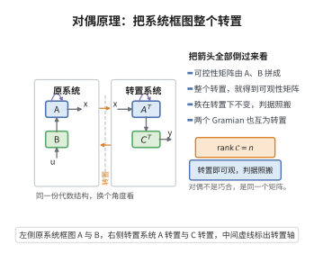

# 可观性的对偶原理

> **一句话大白话**：“看透系统内部状态”的难度，和“操控它对偶系统”的难度一模一样——可观性问题就是换了个方向的可控性问题。
>
> **小例子**：想知道卫星轨道的内情，如果可观测，就相当于它的对偶系统可控；两者互为镜像，一套判据通吃。

## 一、定理介绍

> **前置依赖**：可控性的Kalman秩条件、矩阵转置、可控性与可观性Gramian、线性系统理论、秩与线性无关。

可观性的对偶原理断言：系统 $(\boldsymbol A,\boldsymbol C)$ 可观当且仅当其转置系统 $(\boldsymbol A^{\top},\boldsymbol C^{\top})$ 可控。从而可观性秩条件
$$
\mathrm{rank}
\begin{bmatrix}
\boldsymbol C\\
\boldsymbol C\boldsymbol A\\
\vdots\\
\boldsymbol C\boldsymbol A^{n-1}
\end{bmatrix}=n,
$$
可直接由可控性 Kalman 秩条件借助转置得到。

## 几何直观

图意在说明：可控性矩阵转置后即可观性矩阵，秩不变，所以两条判据可以逐字照搬。

## 二、原理思路

通过零输入响应 $y(t)=\boldsymbol Ce^{\boldsymbol At}\boldsymbol x_0$ 定义可观性，构造可观性 Gramian $\boldsymbol W_o$。注意到 $\boldsymbol W_o$ 恰是对偶系统 $(\boldsymbol A^{\top},\boldsymbol C^{\top})$ 的可控性 Gramian，用对偶与可控性秩条件转置即得可观性秩条件。

## 三、定理的严格表述

系统 $(\boldsymbol A,\boldsymbol C)$（$\boldsymbol A\in\mathbb{R}^{n\times n}$，$\boldsymbol C\in\mathbb{R}^{p\times n}$）完全可观当且仅当可观性矩阵
$$
\mathcal O=
\begin{bmatrix}
\boldsymbol C\\
\boldsymbol C\boldsymbol A\\
\vdots\\
\boldsymbol C\boldsymbol A^{n-1}
\end{bmatrix}
$$
满秩，即 $\mathrm{rank}\,\mathcal O=n$。

## 四、证明过程

1. **可观定义**。由 $y(t)=\boldsymbol Ce^{\boldsymbol At}\boldsymbol x_0$ 唯一确定 $\boldsymbol x_0$。
2. **对偶系统**。$\dot{\boldsymbol z}=\boldsymbol A^{\top}\boldsymbol z+\boldsymbol C^{\top}\boldsymbol v$ 的可控性等价于 $\boldsymbol W_o=\int_0^t e^{\boldsymbol A^{\top}\tau}\boldsymbol C^{\top}\boldsymbol C e^{\boldsymbol A\tau}d\tau$ 可逆。
3. **Gramian 同一**。$\boldsymbol W_o$ 恰为对偶系统的可控性 Gramian，故 $(\boldsymbol A,\boldsymbol C)$ 可观 $\iff$ $(\boldsymbol A^{\top},\boldsymbol C^{\top})$ 可控。
4. **转置得秩条件**。由可控性秩条件
   $$
   \mathrm{rank}\,[\boldsymbol C^{\top},\boldsymbol A^{\top}\boldsymbol C^{\top},\ldots,(\boldsymbol A^{\top})^{n-1}\boldsymbol C^{\top}]=n,
   $$
   转置即得 $\mathrm{rank}\,\mathcal O=n$。

## 五、应用与意义

对偶原理使可观性/可控性共享同一套工具，简化了滤波器设计（Kalman 滤波需可观性）与状态估计理论。它是控制理论中“对偶”思想的典型体现，也是秩判据简约化的经典来源。

## 课堂问答

**老师**：为什么"能否由输出唯一确定初始状态"这个问题，可以原封不动地照搬可控性的判据？

**学生**：结论：因为可观性 Gramian $\boldsymbol W_o=\int_0^t e^{\boldsymbol A^{\top}\tau}\boldsymbol C^{\top}\boldsymbol C e^{\boldsymbol A\tau}d\tau$ 恰好就是转置系统 $(\boldsymbol A^{\top},\boldsymbol C^{\top})$ 的可控性 Gramian，于是 $(\boldsymbol A,\boldsymbol C)$ 可观 $\iff$ $(\boldsymbol A^{\top},\boldsymbol C^{\top})$ 可控。

**老师（追问）**：那可观性秩条件里的 $\boldsymbol C\boldsymbol A^j$ 是怎样由可控性条件转置出来的？

**学生**：把可控性秩条件写成 $\mathrm{rank}\,[\boldsymbol C^{\top},\boldsymbol A^{\top}\boldsymbol C^{\top},\dots,(\boldsymbol A^{\top})^{n-1}\boldsymbol C^{\top}]=n$，对作成的矩阵取转置，秩不变，即得
$$
\mathrm{rank}
\begin{bmatrix}
\boldsymbol C\\
\boldsymbol C\boldsymbol A\\
\vdots\\
\boldsymbol C\boldsymbol A^{n-1}
\end{bmatrix}=n .
$$
注意转置后序号的次序与 $\boldsymbol C\boldsymbol A^j$ 一致；常见误区是把序号写反成 $\boldsymbol A^j\boldsymbol C$。

**老师（拓展）**：这个对偶只是形式巧合，还是有更深的系统含义？

**学生**：是实质性的——它把状态估计与状态反馈配成对：观测器增益 $\boldsymbol L$ 的设计，正是把 $\boldsymbol A^{\top}-\boldsymbol C^{\top}\boldsymbol L^{\top}$ 的极点配置问题，与控制器设计共享同一套定理。Kalman 滤波的对偶形式把 $\boldsymbol A$ 换成 $\boldsymbol A^{\top}$、$\boldsymbol B$ 换成 $\boldsymbol C^{\top}$，与 ARE 同型，正源于此。
