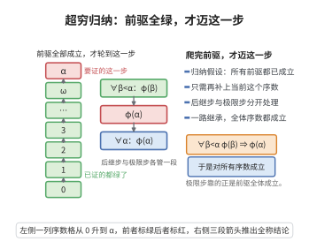

# 超穷归纳定理

> **一句话大白话**：若一个性质对每个序数都有"只要比它小的序数都满足，它就满足"，那么这个性质对所有序数都成立——把数学归纳法从自然数推广到所有（可能无穷长的）序数上。
>
> **小例子**：要证明"关于所有序数的某个性质 $P(\alpha)$"，只需证明：对任意序数 $\alpha$，只要 $P(\beta)$ 对所有 $\beta<\alpha$ 成立，就推出 $P(\alpha)$ 成立。这像搭积木——只要每一层都靠已有底层搭起来，整座塔（所有序数）都能搭成。

## 一、定理介绍

> **前置依赖**：良序原理、序数的比较定理、序数类理论、反证法、一阶逻辑的语法与语义。

超穷归纳（Transfinite Induction）是集合论、序数理论与公理集合论研究中最基础也最强大的证明工具。数学归纳法只能处理自然数，而序数可一直延伸到 $\omega,\omega+1,\dots,\omega_1,\dots$，超穷归纳定理把这个工具推广到任意序数，使得我们能够对"超穷过程"（如超穷递归定义的构造、基数算术、可构造宇宙层的归纳）建立严格证明。

## 几何直观

图意在说明：只要所有前驱都成立就能推出当前序数成立，沿良序逐级推进便覆盖全体序数。

## 二、原理思路

定理成立的根本原因在于序数在 $\in$ 关系下是**良序的**：任何由序数构成的后定义类都有最小元。因此，若存在使 $P$ 不成立的序数，则可取最小的这样的序数 $\alpha_0$，由最小性，所有 $\beta<\alpha_0$ 都满足 $P$，归纳前提便推出 $P(\alpha_0)$，导出矛盾。这正是"良序保证可归纳"的直接体现。

## 三、定理的严格表述

**定理（超穷归纳）**：设 $\varphi(x)$ 是集合论公式（可能含参数）。若对任意序数 $\alpha$，从
$$
(\forall \beta<\alpha,\ \varphi(\beta)) \implies \varphi(\alpha)
$$
可以推出 $\varphi(\alpha)$，则对所有序数 $\alpha$ 都有 $\varphi(\alpha)$ 成立。

## 四、证明过程

**证明**：

用反证法。假设存在序数 $\alpha$ 使得 $\neg\varphi(\alpha)$。考虑所有使 $\neg\varphi(\alpha)$ 成立的序数构成的类：
$$
C=\{\alpha\in\operatorname{Ord}\mid \neg\varphi(\alpha)\}.
$$
由假设 $C$ 非空。由于序数在 $\in$ 关系下是良序的，$C$ 有最小元，记作 $\alpha_0$。

由最小性，对所有 $\beta<\alpha_0$，$\varphi(\beta)$ 成立（因为 $\beta<\alpha_0$ 意味着 $\beta\notin C$）。

但归纳假设说：
$$
(\forall \beta<\alpha_0,\ \varphi(\beta)) \implies \varphi(\alpha_0),
$$
因此 $\varphi(\alpha_0)$ 成立，与 $\alpha_0\in C$ 矛盾。故 $C$ 必须为空，即对所有序数 $\alpha$ 都有 $\varphi(\alpha)$ 成立。$\square$

## 五、应用与意义

超穷归纳是序数理论、基数算术（超穷递归定义 $\aleph_\alpha$、共尾性）、超穷递归定理、可构造宇宙 $L_\alpha$ 的构建、Borel 集族的 $\omega_1$ 层构造，以及平序/良序理论中的核心工具。它和超穷递归定理配合，为处理比自然数无穷得多、甚至比实数还大的对象提供了一套完备的证明与构造框架，是公理集合论不能或缺的基础设施。

## 课堂问答

**老师**：超穷归纳跟普通数学归纳法的差别到底在哪一步？它凭什么能越过极限序数？

**学生**：结论：普通归纳只有后继步，而超穷归纳的归纳假设是"$\forall\beta<\alpha,\ \varphi(\beta)$ 蕴含 $\varphi(\alpha)$"，一次覆盖全部前趋，其中含极限序数 $\lambda$（它有无穷多个前趋）。根基在于序数在 $\in$ 下良序：任何非空序数类都有最小元。

**老师（追问）**：把良序性用到证明上，反证法具体怎么走？

**学生**：反设存在 $\alpha$ 使 $\neg\varphi(\alpha)$，令 $C=\{\alpha\in\mathrm{Ord}:\neg\varphi(\alpha)\}\ne\varnothing$，由良序取最小元 $\alpha_0$。由最小性，对所有 $\beta<\alpha_0$ 有 $\varphi(\beta)$；代入归纳前提即得 $\varphi(\alpha_0)$，与 $\alpha_0\in C$ 矛盾。常见误区是必须分后继、极限两段——两段写法只是实用形式，根本依据始终是最小反例，极限步无需单独处理，因为归纳假设已含全部前趋。

**老师（拓展）**：为什么这类归纳对真类而不是集合也成立？

**学生**：因为 $C$ 是序数的子类，而良序原理对序数子类成立（靠替换公理模式保证可定义类的秩截断是集合）。这正使超穷归纳能作用于真类，如对所有 $\alpha\in\mathrm{Ord}$ 证明累积层次 $V_\alpha$ 的性质、对阿列夫序列 $\aleph_\alpha$ 作归纳，这是它比集合上归纳更强的原因。
